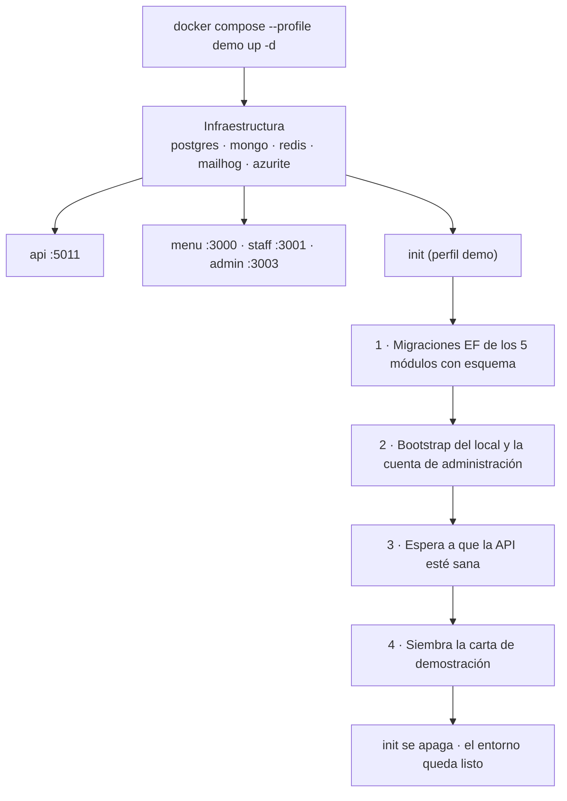
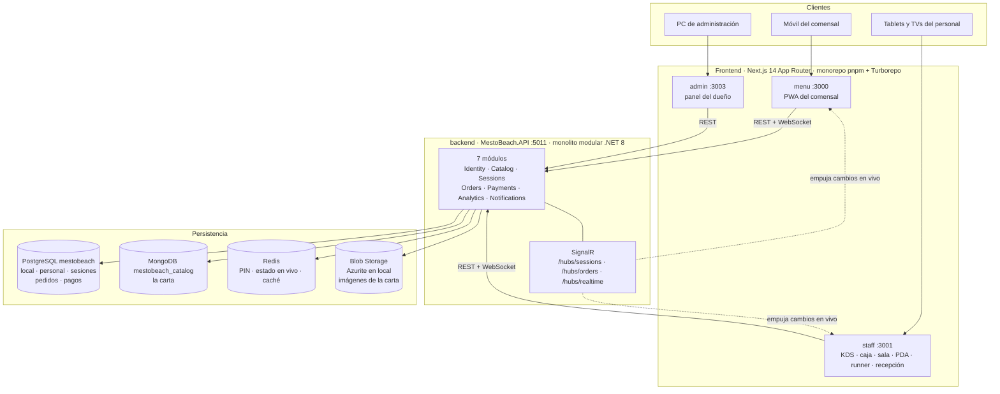
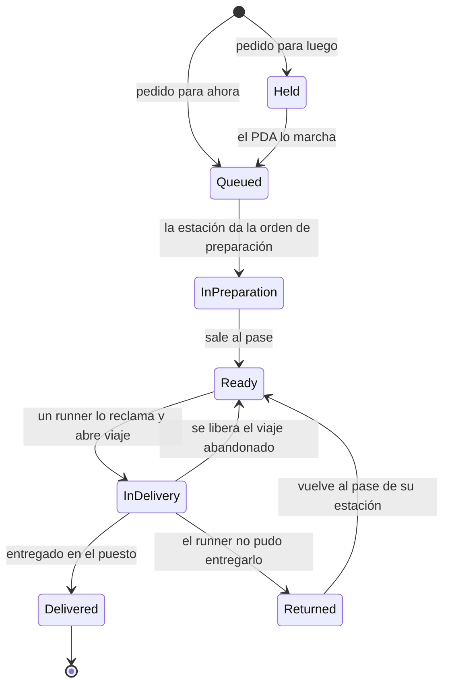

# Mesto Beach

> Sistema de pedidos y servicio hecho a medida de **Playa Demo**, un chiringuito de
> la costa. El comensal escanea el QR de su mesa o de su hamaca, pide desde el
> móvil sin instalar nada, y cada plato llega en tiempo real a la estación que le toca.

---

## Tabla de contenidos

- [Qué es Mesto Beach](#qué-es-mesto-beach)
- [Puesta en marcha](#puesta-en-marcha)
  - [Primer acceso](#primer-acceso)
  - [Los perfiles de Docker](#los-perfiles-de-docker)
  - [Arranque nativo, sin Docker](#arranque-nativo-sin-docker)
- [Arquitectura](#arquitectura)
  - [Mapa de contenedores](#mapa-de-contenedores)
  - [El ciclo de vida de un plato](#el-ciclo-de-vida-de-un-plato)
- [Las tres aplicaciones](#las-tres-aplicaciones)
- [Los siete módulos del backend](#los-siete-módulos-del-backend)
- [Persistencia y tiempo real](#persistencia-y-tiempo-real)
- [Reglas del dominio que se rompen fácil](#reglas-del-dominio-que-se-rompen-fácil)
- [Estructura del repositorio](#estructura-del-repositorio)
- [Documentación del proyecto](#documentación-del-proyecto)
- [Estado](#estado)
- [Origen: de Mesto a Mesto Beach](#origen-de-mesto-a-mesto-beach)

---

## Qué es Mesto Beach

Un chiringuito de playa en temporada alta tiene una operativa incómoda: los comensales están
repartidos entre el salón, la terraza y ochenta metros de arena con hamacas; la comida sale de
tres sitios distintos (cocina, parrilla y coctelería) a ritmos muy diferentes; y quien lleva el
plato hasta la hamaca no es quien lo cocinó.

Mesto Beach resuelve eso con cuatro ideas que atraviesan todo el sistema:

1. **El plato es la unidad de estado, no la comanda.** Un espeto y un mojito del mismo pedido
   viven vidas independientes: se preparan en estaciones distintas y se entregan por separado
   (ADR-025).

2. **El comensal decide cuándo quiere cada cosa.** Al añadir un producto elige *ahora* o
   *luego*; lo que pidió para luego queda retenido hasta que el PDA lo marcha (ADR-026).

3. **La entrega va por viajes.** El runner reclama platos del pase de forma atómica, los carga
   en su bandeja y cierra el viaje; lo que no pudo entregar vuelve al pase de su estación
   (ADR-027).

4. **El plano es a escala real.** Los sectores se calibran contra el terreno, así que la
   posición de una hamaca en la pantalla es su posición en la arena (ADR-030).

Es un sistema de **un solo local**: no hay alta de restaurantes ni panel de plataforma. El
local se siembra una vez al instalar.

---

## Puesta en marcha

Todo el sistema está containerizado. No necesitas .NET ni pnpm instalados: basta Docker.

```bash
docker compose --profile demo up -d --build
```

La primera vez tarda unos minutos (compila el backend y las tres apps). Cuando termina tienes
el entorno **funcionando y con datos**:

| Servicio | URL |
|---|---|
| Staff (KDS, caja, sala, PDA, runner, recepción) | http://localhost:3001 |
| Admin (dueño) | http://localhost:3003 |
| Menú del comensal | `http://localhost:3000/mesa?tenant=<tenantId>&table=<puesto>` |
| API + Swagger | http://localhost:5011/swagger |
| MailHog | http://localhost:8025 |

### Primer acceso

El perfil `demo` crea **una única cuenta**, con rol `Admin`:

| | |
|---|---|
| **Correo** | `admin@mestobeach.demo` |
| **Contraseña** | `MestoBeach2026!` |

Esa cuenta la siembra `scripts/bootstrap-mestobeach.sql`, y sirve **para las dos aplicaciones de
personal**: entra igual en Admin (`:3003`) y en Staff (`:3001`), porque el rol `Admin` está
admitido en ambas.

El formulario solo pide **correo y contraseña**. No te va a pedir ningún identificador de local:
como solo hay uno, el backend lo resuelve solo. Tampoco te obligará a cambiar la contraseña —
la cuenta se siembra ya activa.

> Es una credencial de **desarrollo**, escrita en claro en el repositorio. Antes de exponer esto
> a una red real, cámbiala.

#### El orden importa: el menú del comensal no funciona todavía

Si acabas de levantar el entorno y vas directo a la URL del menú, verás **«Mesa no disponible»**.
No está roto: el comensal se une a una **sesión de mesa abierta**, y recién sembrado no hay
ninguna. El recorrido corto para verlo todo funcionando es:

1. Entra en **Staff** (`http://localhost:3001`) con la cuenta de arriba. Caes en **Caja**.
2. Pulsa **Abrir turno** y luego elige un puesto en el plano — por ejemplo la hamaca `H01` — y
   **Abrir mesa**.
3. Ya con la mesa abierta, abre el menú del comensal en otra pestaña:
   `http://localhost:3000/mesa?tenant=d0ebd974-8e71-4624-81b1-60384e132a95&table=H01`
   Te pedirá solo un nombre — **Continuar como invitado** — y entrarás en la carta.
4. Pide algo y míralo aparecer en vivo en **Cocina**, dentro de la misma app de Staff.

Al terminar, en Caja puedes **Cerrar sesión** (la mesa) y **Cerrar turno**, que además imprime
el reporte de caja.

Ese `tenant` de la URL es el identificador del local, fijo porque el bootstrap lo siembra
siempre con el mismo valor. Es el mismo QR que llevaría pegado la hamaca.

#### Probarlo desde el móvil (con el QR de verdad)

Por defecto todo se anuncia como `localhost`, que **solo vale en el propio ordenador**: si
escaneas ese QR con el móvil, `localhost` es el teléfono y no encuentra nada. Para que el
sistema se anuncie con la IP del ordenador:

```bash
./scripts/set-host.sh
```

Detecta la IP de la máquina en la red local y la deja en `.env` como `MESTOBEACH_HOST` (o la
fijas tú: `./scripts/set-host.sh 192.168.1.50`; con `localhost` vuelves al modo local).
Después hay que **reconstruir**:

```bash
docker compose --profile demo up -d --build
```

> El `--build` no es opcional: las variables `NEXT_PUBLIC_*` de Next.js **se hornean en la
> imagen al construir**, no se leen al arrancar el contenedor. Cambiar la IP sin reconstruir
> no tiene ningún efecto.

Una sola variable gobierna las cinco cosas que tienen que coincidir:

| Qué | Por qué hace falta |
|---|---|
| `NEXT_PUBLIC_MENU_URL` de `staff` | Es la base del **QR fijo** de cada mesa |
| `Frontend__BaseUrl` de la API | Es la base del **QR dinámico**, que arma el backend |
| `NEXT_PUBLIC_API_URL` de las 3 apps | Si no, el navegador del móvil llamaría a *su propio* `localhost:5011` |
| `Cors__AllowedOrigins` de la API | El origen pasa a ser `http://<IP>:3000`; sin añadirlo, el backend lo rechaza |
| `BlobStorage__BaseUrl` de la API | Es la base de las **imágenes** de la carta y del branding |

El móvil tiene que estar en la **misma red Wi-Fi**. Si aun así no carga, mira el cortafuegos
del ordenador: han de estar accesibles los puertos `3000`, `3001`, `3003`, `5011` y `10000`.

> Es HTTP plano, no HTTPS. Sirve para probar en una red de confianza; no lo expongas a internet.

#### Si cambias de IP, repara las imágenes ya subidas

La URL pública de cada imagen **se guarda entera en el catálogo al subirla**, no se calcula al
leer. Así que al cambiar `MESTOBEACH_HOST` las imágenes que ya estaban subidas se quedan
apuntando a la dirección anterior. Para reescribirlas a la actual:

```bash
./scripts/fix-blob-urls.sh
```

Es idempotente: reconoce las URLs ya correctas y no las toca.

#### Dar de alta al resto del personal

Desde **Admin → Personal** invitas a cocina, camareros, runners y recepción con sus roles. El
alta genera un **enlace de activación** para que la persona ponga su contraseña.

> **Ese enlace no llega a MailHog.** El envío de correo de Identity es hoy un *stub* que solo
> escribe en el registro (`EmailNotificationService`), así que la URL de activación aparece en
> los **logs de la API**:
>
> ```bash
> docker compose logs api | grep EMAIL
> ```
>
> MailHog sigue siendo útil para el correo que sí sale por MailKit desde el módulo
> `Notifications`, pero la activación de personal no pasa por ahí.

### Los perfiles de Docker

Un *perfil* de Docker Compose es una etiqueta que marca servicios como opcionales. Los servicios
**sin** clave `profiles` arrancan siempre; los que la llevan solo arrancan si pides ese perfil
explícitamente. Mesto Beach usa exactamente un perfil, `demo`, para separar *levantar el sistema* de
*preparar los datos*.

| Comando | Qué levanta |
|---|---|
| `docker compose up -d` | Infraestructura + API + las 3 apps. **No toca los datos.** |
| `docker compose --profile demo up -d` | Lo mismo **más** el contenedor `init`, que prepara los datos. |

El servicio `init` es de un solo uso: hace su trabajo, imprime el resumen y se apaga.



**El perfil `demo` es idempotente**, y eso es lo que lo hace cómodo: puedes repetir el comando
cuantas veces quieras sin ensuciar nada.

- Las migraciones ya aplicadas se saltan solas (EF lleva su propio historial).
- El bootstrap del local usa `ON CONFLICT DO NOTHING`.
- Antes de sembrar la carta, `init` pregunta al catálogo cuántas categorías hay; si ya tiene,
  **omite el seed** en vez de duplicarla.

Lo que siembra: 5 categorías, 11 platos con precios de chiringuito, 3 estaciones KDS (Cocina,
Parrilla, Cocktails), 3 sectores (Salón, Terraza, Playa) y 15 puestos — 3 mesas de salón,
4 de terraza y 8 hamacas.

Comandos del día a día:

```bash
docker compose --profile demo logs -f init
```

```bash
docker compose stop
```

```bash
docker compose --profile demo down -v
```

El primero sigue el progreso de la inicialización; el segundo apaga los contenedores
conservando los datos; el tercero **borra los volúmenes** — base de datos, catálogo e imágenes
subidas — y deja la máquina como recién clonada.

> El `init` corre las migraciones y el seed desde dentro de la red de Compose, y monta
> `./scripts` como volumen de solo lectura. Puedes editar el seed y volver a lanzarlo sin
> reconstruir ninguna imagen.

### Arranque nativo, sin Docker

Para desarrollar con recarga en caliente conviene correr el código en la máquina y dejar en
Docker solo la infraestructura. En Windows:

```powershell
.\scripts\dev-up.ps1
```

El detalle completo — incluida la preparación manual de la base en macOS y Linux con
`scripts/seed-demo-mestobeach.sh` — está en **`docs/DESARROLLO-LOCAL.md`**.

> El backend **se cae al arrancar si Redis no responde**: los contenedores primero, siempre.

---

## Arquitectura

Monolito modular .NET 8 en el backend, monorepo Next.js 14 en el frontend, persistencia
políglota y tiempo real por SignalR. El detalle vive en `ARCHITECTURE.md`.

### Mapa de contenedores



Cada módulo del backend sigue Clean Architecture en tres proyectos — `Domain → Application →
Infrastructure` — y **gestiona sus propias migraciones EF**. `src/Shared/MestoBeach.Shared` es el
kernel compartido.

> La autenticación de SignalR viaja por *query string* (`?access_token=`) porque el navegador no
> puede poner cabeceras en el *handshake* de WebSocket. Es intencional.

### El ciclo de vida de un plato

Este es el corazón del dominio. Cada plato de una comanda recorre su propia máquina de estados,
y el estado de la comanda se **deriva** de sus platos (ADR-025, con la cola del pase en ADR-032).



Traducido a la operativa real: lo que pides *para luego* espera a que el camarero con el PDA lo
marche; lo que pides *para ahora* nace ya en la cola de su estación. La cola todavía no es el
fuego — la estación decide cuándo arranca cada plato. Cuando sale al pase queda disponible para
que **cualquier** runner lo reclame, y el reclamo es atómico: dos runners no pueden llevarse el
mismo plato.

Falta un estado en el diagrama, a propósito: **`Cancelled`**. Se alcanza desde `Held`, `Queued`,
`InPreparation`, `Ready` y `Returned`, y dibujar esas cinco flechas tapaba el recorrido real.
Fíjate en desde dónde **no** se alcanza: un plato que va en la bandeja del runner (`InDelivery`)
no se anula — primero se cierra o se libera el viaje. La tabla de transiciones que manda está en
`OrderItem.AllowedTransitions`.

---

## Las tres aplicaciones

| App | Puerto | Quién la usa | Rutas principales |
|---|---|---|---|
| `menu` | 3000 | El comensal, desde su móvil | `/mesa` (QR de la mesa), `/join` (invitación), `/session/[id]` (carta y carrito), `/session/[id]/orders` (¿cuándo sale?) |
| `staff` | 3001 | Todo el personal | `/board` (KDS), `/cashdesk` (caja), `/salon` (sala), `/pda` (comandas), `/runner` (entregas), `/host` (recepción), `/history` |
| `admin` | 3003 | El dueño | `/dashboard`, `/catalog`, `/mesas`, `/kds-stations`, `/staff`, `/payments`, `/sessions`, `/analytics`, `/menu-appearance` |

Las personas del sistema y lo que hace cada una:

- **Comensal** — escanea el QR de su mesa o hamaca, pide sin instalar nada, sigue su pedido y
  pide la cuenta. Sin cuenta: solo su nombre.
- **Cocina, parrilla y coctelería** — cada estación ve en el KDS únicamente los platos que le
  tocan, en pantalla grande y sin scroll (la densidad se ajusta sola).
- **Camarero con PDA** — toma comandas en el sector que tiene asignado y marcha los platos que
  estaban en espera. Marchar es potestad exclusiva del PDA.
- **Runner** — ve el pase, reclama platos, los carga en su bandeja y los entrega guiándose por el
  mapa del sector.
- **Recepción (host)** — ve la ocupación en vivo sobre el plano a escala y sienta a los comensales
  indicando cuántos son.
- **Cajero** — abre y cierra sesiones, cobra, divide cuentas, aplica propina e imprime el
  recibo térmico por WebUSB.
- **Dueño** — configura la carta, las mesas, las estaciones, el personal y la apariencia del
  menú; y ve la analítica.

---

## Los siete módulos del backend

| Módulo | De qué responde |
|---|---|
| **Identity** | Autenticación de personal, JWT RS256, roles y asignaciones (sector del PDA, estación del runner), Device Token del KDS |
| **Catalog** | La carta en MongoDB: categorías, platos, modificadores, estación por plato, apariencia del menú e imágenes en Blob Storage |
| **Sessions** | Mesas y hamacas, sectores con plano a escala, sesiones, PIN, participantes, QR y llamadas al camarero |
| **Orders** | Comandas, ruteo de cada plato a su estación, ciclo de vida por plato, coursing y viajes de entrega |
| **Payments** | Cobro, turnos de caja, división de cuenta y propina |
| **Analytics** | Informes y métricas, con el día de negocio cortado en `Europe/Madrid` |
| **Notifications** | Correo por MailKit (MailHog en desarrollo) |

> Se **retiraron** `Platform`, `Ledger` y `Loyalty` al separar el producto de Mesto (ADR-023):
> eran maquinaria de SaaS multi-tenant. Sus SDDs quedan archivados en `sdd/retirados/`.
> **No los reintroduzcas.**

---

## Persistencia y tiempo real

| Almacén | Contenido | Por qué |
|---|---|---|
| **PostgreSQL** `mestobeach` | Local, personal, sesiones, pedidos, pagos, viajes | Datos relacionales que exigen transacciones |
| **MongoDB** `mestobeach_catalog` | La carta | Documental: platos con variantes, modificadores y precios anidados |
| **Redis** | PIN de sesión, estado operativo en vivo, caché de la carta | Volátil y de acceso constante |
| **Blob Storage** | Imágenes de la carta y del branding | Azurite en local, Azure en producción |

El esquema conserva una columna `tenant_id` por herencia de Mesto. **Hay un solo local**,
sembrado al instalar con `scripts/bootstrap-mestobeach.sql`.

Tiempo real por **SignalR**, con tres hubs: `/hubs/sessions`, `/hubs/orders` y `/hubs/realtime`.

---

## Reglas del dominio que se rompen fácil

Estas cuatro causan casi todos los errores de quien llega nuevo al repositorio:

- **El dinero son céntimos de euro.** Todo entero `*Cents` son céntimos: `1450` = 14,50 €. Al
  mostrarlo se divide entre 100 con `formatEur`. Nunca imprimas un importe crudo (ADR-031).

- **El recibo térmico no es una pantalla.** `frontend/apps/staff/src/lib/escpos.ts` manda bytes
  por WebUSB a una impresora de un byte por carácter: nada fuera de ASCII — el `€` sale como
  basura. Ahí se imprime `14,50 EUR`.

- **El día de negocio se corta a medianoche de `Europe/Madrid`**, no en UTC. Usa
  `MestoBeach.Shared.Time.VenueTime`, o `AT TIME ZONE 'Europe/Madrid'` en SQL. España tiene horario
  de verano: restar un número fijo de horas está mal media parte del año.

- **El TPV del local factura, nosotros no** (ADR-028). No añadas emisión de facturas ni
  lógica fiscal sin un ADR nuevo: eso arrastra Verifactu y responsabilidad legal.

Y una de estilo que sí se vigila: **iconos Phosphor, nunca emojis** (`docs/marca.md`).

---

## Estructura del repositorio

```
MestoBeach/
├── docker-compose.yml          → Infraestructura + api + 3 apps + perfil demo
├── frontend/                   → Monorepo pnpm + Turborepo
│   ├── Dockerfile              → Parametrizado por APP (menu | staff | admin)
│   ├── apps/
│   │   ├── menu/      (3000)   → PWA del comensal
│   │   ├── staff/     (3001)   → KDS, caja, sala, PDA, runner, recepción
│   │   └── admin/     (3003)   → Panel del dueño
│   └── packages/
│       ├── api-client/         → Cliente HTTP y tipos, MANUAL (no generado)
│       └── tsconfig/           → Configuración TypeScript compartida
│
├── backend/                    → .NET 8, monolito modular (http://localhost:5011)
│   ├── Dockerfile              → Imagen de la API + etapa `initializer` del perfil demo
│   └── src/
│       ├── MestoBeach.API/       → Entry point: Program.cs registra Add<Modulo>Module y los hubs
│       ├── Modules/            → 7 módulos, cada uno Domain → Application → Infrastructure
│       └── Shared/             → Kernel compartido (Result, errores, VenueTime)
│
├── scripts/
│   ├── docker-init.sh          → Orquestador del perfil demo (migraciones + bootstrap + seed)
│   ├── bootstrap-mestobeach.sql  → Alta del local y la cuenta de administración (idempotente)
│   ├── seed-demo-mestobeach.sh   → Carta de demostración (macOS y Linux)
│   ├── seed-demo-mestobeach.ps1  → Lo mismo en PowerShell
│   └── dev-up.ps1              → Arranque nativo en Windows
│
├── prds/                       → Qué se construye y por qué
├── sdd/                        → Diseño por módulo (7 vivos + retirados/)
├── ARCHITECTURE.md             → Arquitectura y ADRs
├── PROCESS.md                  → PRD → Arquitectura → SDD → Código
└── AGENTS.md · CLAUDE.md       → Estado operativo real
```

---

## Documentación del proyecto

El proceso es **PRD → Arquitectura (ADRs) → SDD → Código** (ver `PROCESS.md`). La regla de oro:
no se escribe código hasta tener el SDD del módulo.

| Documento | Para qué |
|---|---|
| `README.md` | Este archivo: qué es Mesto Beach, cómo se arranca y cómo está montado |
| **`AGENTS.md`** | **Empieza aquí si te incorporas.** Estado operativo real: layout, entorno, las trampas que ya costaron horas, reglas del dominio |
| `CLAUDE.md` | Las mismas reglas, en formato de instrucciones para agentes de IA |
| `ARCHITECTURE.md` | Arquitectura técnica y **todos los ADRs**. Los de este producto son **ADR-023…041** (§14; los **036…041** son solo diseño, PRD-019), y §15 lleva el estado de implementación |
| `PROCESS.md` | El flujo de fases y sus criterios de entrada y salida |
| `docs/DESARROLLO-LOCAL.md` | Encender el entorno, paso a paso |
| `docs/marca.md` | Reglas de marca: tipografía, color, iconos |

> Si `AGENTS.md` contradice a esta guía, gana `AGENTS.md`; si contradice al código, gana el
> código.

**`PRD-018` es el documento de referencia de este producto**: mapa a escala, coursing, PDA,
runners y recepción. Los `PRD-001…017` vienen de Mesto y describen la plataforma original; varios
están marcados como retirados del alcance.

**`PRD-019` extiende PRD-018 con el modo fiesta, «Mesto Beach Night»**: un interruptor del panel
cambia todo el local de modo (carta y estaciones por modo, barra de dos estados, distribución Night,
PIN de noche, estética oscura). **El núcleo está construido**; faltan los reportes por modo y la
instalación como PWA (ADR-036…041 y `ARCHITECTURE.md` §15.5).

Los **SDD-001…007** describen los siete módulos vivos. Ojo con una trampa: **las secciones
marcadas `v2.0` son diseño, no implementación**. No asumas que ese código existe.

---

## Estado

Sistema **funcionando end-to-end**, en iteración activa sobre la operativa del chiringuito.

| Área | Estado |
|---|---|
| Backend, 7 módulos | ✅ Identity, Catalog, Sessions, Orders, Payments, Analytics, Notifications |
| Menú del comensal | ✅ Carta, carrito, modificadores, PIN, pedir la cuenta, observación de la comanda, **"Mis pedidos"** con el tiempo en cada estado |
| Ciclo de vida por plato | ✅ El plato es la unidad de estado (ADR-025), con **cola del pase** (ADR-032): marchar encola, y la orden de preparación es solo de la estación |
| KDS por estación (`/board`) | ✅ Cuatro columnas, modo foco, visibilidad cruzada entre estaciones (ADR-029) y densidad automática |
| PDA, Runner y Recepción | ✅ Toma de comandas y marchado; cola del pase, bandeja y manifiesto con reclamo atómico y devoluciones (ADR-027); ocupación en vivo y sentar con `pax` |
| Caja | ✅ Cobro, turnos, división de cuenta, propina, recibo ESC/POS por WebUSB |
| Plano a escala | ✅ Plano canónico único por sectores con hamacas (ADR-030) y editor de sala en admin; `GET /floorplan` es de lectura para todo el staff |
| Aviso "¿cuándo sale?" | ✅ Llega a **Salón** como llamado `ETA`, nunca a cocina, y no pisa un `PIN`/`WAITER` pendiente (ADR-035) |
| Admin | ✅ Carta, mesas, estaciones, personal, pagos, sesiones, analítica, apariencia |
| Diálogos propios y modo tablero | ✅ `useDialog()` en las tres apps sin `alert`/`confirm` nativos (ADR-033); pantalla completa en los 8 módulos (ADR-034) |
| Moneda y localización | ✅ Céntimos de euro y día de negocio en `Europe/Madrid` (ADR-031) |
| Containerización | ✅ Backend y las 3 apps, con perfil `demo` de datos idempotente |
| Modo beach club (PRD-018) | 🟨 Construido lo principal. Queda: coursing "ahora/luego" en el móvil del comensal, calibración e imagen de fondo del plano, hamaca de primera clase con alta en lote, edición del plano en vivo desde Recepción y carta bilingüe ES/EN (lista completa en `ARCHITECTURE.md` §15.4) |
| Mesto Beach Night (modo fiesta) | 🟨 Núcleo construido (PRD-019): modo del local con transición, carta y estaciones por modo, barra de dos estados, distribución por modo, PIN obligatorio, prioridad de reservados y tema oscuro. Faltan los reportes por modo y la PWA |
| Cobro con pasarela digital | ⬜ Pendiente — hoy efectivo, propina, split y turnos |
| Despliegue en el local | ⬜ Pendiente — híbrido local/nube y modo degradado (ADR-024) |
| Facturación electrónica | ⬜ Fuera de alcance — la emite el TPV del local (ADR-028) |
| Tests | 🟨 155 pruebas xUnit en backend (Orders, Identity y Sessions); **sin tests en frontend** |

En la práctica, verificar un cambio significa **build + `type-check` focalizado y prueba manual
o por API**.

---

## Origen: de Mesto a Mesto Beach

Mesto Beach nació como implantación de **Mesto**, una plataforma SaaS multi-tenant para restaurantes, y
se separó a este repositorio en **agosto de 2026** (ADR-023). La separación no fue cosmética:
se retiraron los tres módulos que solo tenían sentido vendiendo software a muchos restaurantes
(`Platform`, `Ledger`, `Loyalty`) y la app `platform`, y el producto pasó a diseñarse alrededor
de un único local con una operativa muy concreta.

Quedan dos huellas visibles de ese origen: la columna `tenant_id` en el esquema — con un solo
tenant sembrado al instalar — y los `PRD-001…017`, que siguen describiendo la plataforma
original y conviene leer con esa clave.

---

*Mesto Beach — sistema de pedidos y servicio de Playa Demo.*
*Versión 7.2 — noviembre de 2026 — 19 PRDs + 7 SDDs vivos; backend de 7 módulos y 3 apps, con el
modo beach club de PRD-018 y el núcleo de Night de PRD-019 construidos (ADR-023…041).*
*Idioma del producto: español de España.*
