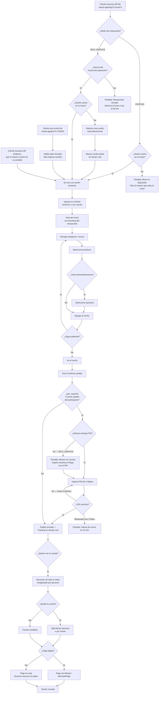

# PRD-002 — Flujo del Cliente

> **📜 Documento heredado de Mesto.** Se escribió para la plataforma SaaS multi-tenant de la que
> Mesto Beach se separó en agosto de 2026 (**ADR-023**), y su contenido sigue vigente salvo en
> tres puntos que **manda la documentación nueva**:
> - **Moneda**: los importes de este documento están en pesos colombianos. Hoy todo entero monetario
>   son **céntimos de euro** (**ADR-031**); los nombres de campo llevan el sufijo `Cents`.
> - **Facturación**: la emite el TPV del local, no nosotros (**ADR-028**). Ignora aquí cualquier
>   referencia a pasarelas o autoridades fiscales colombianas.
> - **Ejemplos**: los platos, precios y direcciones son de la época de Mesto y no reflejan la carta
>   ni el local de Playa Demo.
>
> Lo específico de este cliente está en **PRD-018** y en los **ADR-023…035**.

## Metadata

| Campo | Valor |
|---|---|
| **ID** | PRD-002 |
| **Versión** | 3.2 |
| **Estado** | Aprobado — v3.2 |
| **Fecha** | Agosto 2026 |
| **App relacionada** | `menu` (Next.js PWA) |
| **Módulos de API** | Orders, Catalog, Payments, Sessions |
| **Depende de** | PRD-001 (visión), PRD-004 (catálogo configurado), PRD-005 (pagos), PRD-011 (modos de operación) |
| **PRDs que dependen de este** | PRD-003 (KDS recibe los pedidos generados aquí), PRD-018 (el modo beach club extiende este flujo) |

---

## 1. Propósito y Objetivos

### Propósito

Definir la experiencia completa del cliente final en Mesto: desde que escanea el QR en su mesa hasta que termina de pagar. Este es el flujo más crítico del producto — es la cara visible de Mesto y el principal diferenciador frente a la competencia.

### Objetivos

| # | Objetivo | Métrica |
|---|---|---|
| OBJ-01 | El cliente debe poder hacer su primer pedido en menos de 2 minutos desde que escanea el QR | Tiempo medido en pruebas de usuario |
| OBJ-02 | La experiencia debe ser tan buena que el cliente prefiera usarla al mesero | NPS del cliente > 70 |
| OBJ-03 | El cliente siempre sabe el estado de su pedido | 100% de los pedidos emiten eventos de estado |
| OBJ-04 | El flujo de pago no debe tomar más de 60 segundos | Medido desde "pedir cuenta" hasta "pago confirmado" |

---

## 2. Contexto y Problema que Resuelve

El cliente en un restaurante hoy enfrenta:
- Esperar 5-15 minutos a que un mesero lo atienda en horas pico
- No saber si su pedido fue recibido o cuándo llegará
- Al pedir la cuenta, esperar nuevamente y hacer el cálculo manual para dividirla
- No poder personalizar fácilmente su pedido

La app `menu` de Mesto resuelve cada uno de estos puntos en un flujo continuo desde el celular del cliente, sin descargar ninguna aplicación.

---

## 3. Usuarios

**Usuario primario:** Cliente Final (Ana) — ver persona P1 en PRD-001
**Usuario secundario:** Ninguno (esta app es exclusiva del cliente)

---

## 4. Alcance

### In Scope
- Acceso via QR (URL con slug del restaurante y código de mesa)
- Verificación de sesión activa de mesa
- Ingreso de nombre del cliente (anónimo por defecto)
- Registro opcional de cuenta para historial y fidelización
- Navegación del menú por categorías
- Filtrado de menú por categoría, búsqueda por nombre
- Detalle del producto con imágenes, descripción y personalizaciones
- Carrito de compras con modificación de cantidad y eliminación
- Confirmación del pedido
- Tracking en tiempo real del estado del pedido
- Llamado al mesero desde la app
- Solicitud de cuenta (bill)
- Pago digital completo o parcial (split bill)
- Propina configurable
- Historial del pedido durante la sesión

### Out of Scope
- Pedidos para llevar / delivery
- Reservas de mesa
- Programa de puntos / fidelización (v2)
- Pago en caja desde la app (el cajero maneja esto en su propia app)
- Modo offline completo (solo el catálogo se cachea offline)

---

## 5. Flujo Principal — Diagrama

> **v3.0:** El flujo contempla tres caminos de entrada (QR fijo STAFFED, QR fijo SELF_SERVICE, QR dinámico mostrado por el mesero, y el invite link), más el paso de verificación de PIN al confirmar el primer pedido.



---

## 6. Historias de Usuario

### Épica 1: Acceso y primera vez en la app

```
US-101
Como cliente en una mesa del restaurante (modo STAFFED),
quiero escanear el QR y acceder al menú inmediatamente,
para no tener que descargar ninguna app ni registrarme.

Criterio de aceptación:
- El mesero ya creó la sesión de la mesa antes de que yo llegue al QR
- Al escanear el QR, el navegador abre la URL directamente
- No hay pantalla de "descarga nuestra app"
- En menos de 3 segundos veo el menú del restaurante
- El menú muestra el branding (logo, colores) del restaurante

US-101b [v2.0 / actualizado v3.0]
Como cliente en un restaurante en modo Self-Service,
quiero poder escanear el QR y navegar el menú sin necesitar que el mesero abra la mesa,
para tener más autonomía e independencia.

Criterio de aceptación:
- Al escanear el QR, el sistema detecta que no hay sesión activa y la crea automáticamente
- El mesero recibe una notificación y viene a la mesa con el PIN (si pin_required = true)
- Veo el menú del restaurante en menos de 3 segundos
- Si el restaurante está cerrado (fuera de horario), veo un mensaje con la próxima hora de apertura
- Si pin_required = false, puedo confirmar pedidos directo sin esperar a nadie

US-101c [v2.0]
Como segundo cliente en una mesa que ya tiene una sesión activa,
quiero unirme a la sesión de mi grupo al escanear el mismo QR,
para ver lo que ya pidieron y pedir yo también.

Criterio de aceptación:
- Al escanear el QR de una mesa con sesión activa, me uno a esa sesión
- Veo en "la cuenta" el resumen de lo que ya pidió cada persona en la mesa
- Puedo pedir de forma independiente bajo mi propio nombre
- Si el cajero cierra la sesión, mi token queda invalidado junto con los de todos

US-101d [v3.0]
Como cliente que recibió un invite link por WhatsApp,
quiero tocar el link y entrar a la sesión de mis amigos sin necesitar el PIN ni al mesero,
para unirme al grupo de forma sencilla aunque llegue después.

Criterio de aceptación:
- Al tocar el link, la app solo me pide mi nombre
- No me pide PIN en ningún momento (el token lo valida internamente)
- Quedo dentro de la misma sesión y puedo pedir directamente
- Los demás participantes ven una notificación: "Carlos se unió (por invitación)"
- Si el cajero regeneró el PIN antes de que yo llegara, el link ya no funciona y veo: "Esta invitación ya no es válida"

US-101e [v3.0]
Como cliente en un restaurante con QR dinámico,
quiero escanear el QR que el mesero me muestra en su pantalla,
para entrar a la sesión de mi mesa sin buscar ningún QR impreso.

Criterio de aceptación:
- El mesero me acerca su celular y escaneo el QR desde mi cámara
- Entro a la sesión normalmente
- Si el QR expiró (sesión ya cerrada), veo: "Este QR ya no es válido"
- **No se me pide PIN.** El QR dinámico es de un solo uso y lo muestra el mesero, así que ya autentica la mesa; el backend abre la sesión con `pin_required = false` cuando `qr_mode = DYNAMIC`. El PIN solo aplica a mesas con QR **fijo** (impreso).

US-119 [v3.1]
Como cliente en una mesa con QR fijo que exige PIN,
quiero un modal claro para ingresar el PIN y poder pedirlo al mesero,
para no quedarme bloqueado al intentar ordenar.

Criterio de aceptación:
- Al confirmar el pedido sin PIN validado, el backend responde `PIN_REQUIRED` y la app abre un **modal de PIN** (4 dígitos estilo OTP) en vez de un error
- El modal explica que el PIN es **único para toda la mesa** y que se lo debo pedir al mesero
- Botón **"Pedir el PIN al mesero"** → `POST /sessions/{id}/request-pin`; el mesero/cajero recibe `PIN_REQUESTED` al instante (PRD-008 §3.1) y ve la mesa marcada con "🔑 Pide PIN"
- Al ingresar el PIN correcto, se valida (`/pin/validate`) y **el pedido se reintenta automáticamente**
- PIN incorrecto: mensaje claro; tras 5 fallos, bloqueo temporal (reusa la lógica de intentos existente)

US-102
Como cliente,
quiero ingresar solo mi nombre para identificarme en el pedido,
para que el mesero sepa a quién llevar el pedido sin procesos complicados.

Criterio de aceptación:
- La pantalla inicial pide únicamente el nombre
- El nombre puede tener letras, tildes y espacios
- El nombre se muestra en el KDS cuando el pedido llega a la cocina
- No se requiere email ni teléfono para pedir

US-103
Como cliente frecuente,
quiero tener la opción de crear una cuenta para ver mi historial de pedidos,
para recordar qué pedí la última vez y acumular beneficios futuros.

Criterio de aceptación:
- Después de ingresar el nombre, hay un enlace opcional "Crear cuenta / Iniciar sesión"
- Si no lo hace, puede pedir normalmente como anónimo
- Si crea cuenta, su nombre se pre-llena en futuras visitas

US-120 [v1.x] — Pantalla de identificación al entrar al menú
Como cliente,
quiero una pantalla clara al entrar para decir mi nombre o usar mi cuenta Mesto,
para que el staff sepa quién pidió y para acumular puntos si tengo cuenta.

Criterio de aceptación:
- Tras unirme a la mesa, si aún no me he identificado en esta sesión (por dispositivo), aparece una pantalla con 3 vías:
  - **Invitado**: ingreso solo mi nombre (obligatorio para poder pedir).
  - **Iniciar sesión**: correo + contraseña → vincula mi cuenta Mesto al pedido.
  - **Crear cuenta Mesto**: nombre + correo + contraseña (+ teléfono opcional).
- Al identificarme, el nombre se asocia al participante (`identify`) y, si tengo cuenta, también `customer_account_id`.
- El header del menú muestra mi nombre y, si estoy logueado, mis **puntos** de lealtad.
- **Reset de contraseña e iniciar con Google** quedan para otra feature (la UI los muestra como "próximamente").
- La sesión recuerda que ya me identifiqué (no vuelve a preguntar en este dispositivo).
```

### Épica 2: Navegación del menú

```
US-104
Como cliente,
quiero ver el menú organizado por categorías con fotos de los platos,
para decidir qué pedir de forma rápida y visual.

Criterio de aceptación:
- Las categorías se muestran como pestañas o chips horizontales desplazables
- Cada producto muestra: foto, nombre, descripción corta, precio
- Los productos agotados aparecen visualmente distintos (gris, tachado) y no se pueden agregar
- Las categorías y productos que no aplican al horario actual no se muestran

US-105
Como cliente,
quiero buscar un plato específico por nombre,
para no tener que recorrer todas las categorías.

Criterio de aceptación:
- Hay un campo de búsqueda visible en la parte superior del menú
- La búsqueda filtra en tiempo real mientras escribo
- Si no hay resultados, muestra un mensaje amigable

US-106
Como cliente,
quiero ver el detalle completo de un producto antes de pedirlo,
para saber exactamente qué voy a recibir.

Criterio de aceptación:
- Al tocar un producto, se abre una vista de detalle (modal o página)
- Muestra: foto grande, nombre completo, descripción larga, precio base, opciones de personalización
- Los grupos de personalización muestran si son obligatorios u opcionales
- Al cerrar el detalle, el cliente vuelve al mismo punto del menú donde estaba
```

### Épica 3: Carrito y confirmación del pedido

```
US-107
Como cliente,
quiero agregar múltiples productos al carrito y ajustar cantidades,
para hacer mi pedido completo antes de confirmarlo.

Criterio de aceptación:
- El carrito persiste mientras navego el menú
- Puedo aumentar/disminuir cantidad de cada ítem desde el carrito
- Puedo eliminar un ítem del carrito
- El total del carrito se actualiza en tiempo real
- Un indicador flotante muestra cuántos ítems hay en el carrito

US-108
Como cliente,
quiero personalizar mi pedido con las opciones disponibles,
para recibir exactamente lo que quiero.

Criterio de aceptación:
- Si un grupo de personalización es obligatorio, no puedo confirmar sin seleccionarlo
- Si es opcional, puedo omitirlo
- Las opciones que tienen costo adicional muestran el precio (+$2.000)
- El precio total del producto se actualiza al seleccionar opciones

US-109
Como cliente,
quiero revisar mi pedido completo antes de enviarlo,
para confirmar que todo está correcto.

Criterio de aceptación:
- El carrito muestra: cada producto, sus personalizaciones, cantidad, precio unitario y subtotal
- Se muestra el total final
- Hay un botón claro de "Confirmar pedido"
- Puedo volver al menú para agregar más cosas antes de confirmar

US-109b [v3.0]
Como cliente, al tocar "Confirmar pedido" por primera vez en la sesión,
quiero saber si necesito ingresar el PIN del mesero,
para entender qué debo hacer antes de que mi pedido sea enviado.

Criterio de aceptación:
- Si pin_required = true: se muestra la pantalla de PIN con el mensaje "Ingresa el PIN que te dio el mesero"
- Si soy el primer participante en modo SELF_SERVICE y el mesero aún no llegó, veo la pantalla "Mesero en camino" (US-109c)
- Si pin_required = false: el pedido se confirma directamente
- Si me uní por invite link: el pedido se confirma directamente (sin PIN en ningún momento)
- Después de ingresar el PIN correctamente una vez, mis pedidos siguientes no lo requieren

US-109c [v3.0]
Como cliente en modo Self-Service esperando el PIN del mesero,
quiero ver una pantalla de espera que explique que el mesero está en camino,
para no pensar que algo falló.

Criterio de aceptación:
- La pantalla muestra: "El mesero está en camino con tu PIN. Ya sabe que te sentaste."
- Hay un indicador de actividad (spinner o animación suave)
- En cuanto el mesero llegue y yo ingrese el PIN, el pedido se confirma
- Puedo volver al carrito para seguir editando mientras espero

US-110
Como cliente,
quiero que mi pedido se divida automáticamente entre cocina y barra,
para no tener que pensar en eso.

Criterio de aceptación:
- Yo hago un solo pedido con todos mis productos
- El sistema envía los alimentos a la cocina y las bebidas a la barra automáticamente
- Ambas partes del pedido aparecen en mi vista de "mis pedidos"
```

### Épica 4: Tracking en tiempo real

```
US-111
Como cliente,
quiero ver el estado de cada uno de mis pedidos en tiempo real,
para saber cuándo va a llegar mi comida sin tener que preguntarle al mesero.

Criterio de aceptación:
- La pantalla "mis pedidos" muestra cada pedido con su estado actual
- Los estados posibles son: Recibido, En preparación, Listo, Entregado
- El cambio de estado se refleja en la pantalla en menos de 3 segundos
- No es necesario recargar la página para ver los cambios

US-112
Como cliente,
quiero recibir una notificación visual o sonora cuando mi pedido esté listo,
para saber que puedo esperarlo pronto sin estar mirando la pantalla todo el tiempo.

Criterio de aceptación:
- Cuando el estado cambia a "Listo", la app emite una vibración y/o sonido
- Se muestra un indicador visual prominente (badge, animación)
- Si la pantalla está apagada, aparece una notificación push (si el cliente la autorizó)
```

### Épica 5: Llamado al mesero

```
US-113
Como cliente,
quiero poder llamar al mesero desde mi celular,
para pedir ayuda sin necesidad de levantar la mano.

Criterio de aceptación:
- Hay un botón visible de "Llamar mesero" en la app
- Al tocarlo, se muestra un mensaje de confirmación antes de enviar el llamado
- El mesero recibe la alerta en su app con el número de mesa
- Puedo cancelar el llamado si el mesero no ha llegado aún

US-114
Como cliente,
quiero poder solicitar la cuenta desde la app,
para agilizar el proceso de pago sin esperar al mesero.

Criterio de aceptación:
- Hay una opción "Pedir la cuenta" en la app
- Al solicitarla, se muestra el resumen de todo lo pedido durante la sesión
- El cajero recibe la notificación de que la mesa quiere la cuenta
```

### Épica 6: Pago

```
US-115
Como cliente,
quiero pagar mi cuenta desde el celular con mi método de pago preferido,
para no tener que ir a caja ni esperar al mesero con el datáfono.

Criterio de aceptación:
- Puedo pagar con tarjeta débito/crédito o Nequi via Wompi o MercadoPago
- El proceso de pago usa el checkout del proveedor de pagos (seguro, certificado)
- Al confirmar el pago, la sesión se cierra automáticamente
- Recibo una confirmación de pago en pantalla

US-116
Como cliente en un grupo,
quiero dividir la cuenta entre varias personas,
para que cada uno pague lo suyo sin tener que hacer cálculos.

Criterio de aceptación:
- Puedo elegir "Dividir cuenta" y seleccionar en cuántas partes
- Las partes pueden ser iguales o puedo asignar montos específicos
- Cada persona puede pagar su parte individualmente desde su celular
- La sesión se cierra cuando todas las partes han sido pagadas

US-117
Como cliente,
quiero agregar propina al pagar,
para reconocer el buen servicio.

Criterio de aceptación:
- Durante el checkout se muestran opciones de propina: 5%, 10%, 15%, o monto libre
- Si no quiero dejar propina, puedo seleccionar 0%
- La propina se suma al total antes del pago
- La propina configurada por el restaurante define qué porcentajes se ofrecen
```

---

## 7. Requisitos Funcionales

### RF-201 — Verificación de sesión de mesa
- Al acceder al URL de la mesa, la API verifica si hay sesión OPEN para esa mesa
- Si no hay sesión activa (modo STAFFED), se muestra pantalla de "Mesa no disponible" con instrucción de llamar al mesero
- Si hay sesión, se genera un Session Token (JWT) y se inicia la experiencia del menú
- El PIN **no** se valida al entrar — se valida solo al confirmar el primer pedido del participante (`POST /orders`)
- Si el cliente llegó por invite link, el token embebido valida el acceso; PIN nunca requerido para ese participante

### RF-202 — Carga del menú
- El menú se filtra automáticamente por el horario actual del restaurante
- Los productos agotados se muestran pero no son seleccionables
- Las imágenes se cargan de forma lazy para performance en conexiones lentas
- El catálogo se cachea en el Service Worker por 5 minutos (reduce llamadas a la API en picos)

### RF-203 — Carrito de compras
- El carrito se mantiene en el estado local de la app (no en el servidor) hasta confirmar
- Al confirmar, se hace una sola llamada a la API con todos los ítems
- Si la sesión expira antes de confirmar, el carrito se pierde y se muestra mensaje al usuario

### RF-204 — Routing de pedidos
- El sistema usa el `stationId` de cada producto del catálogo para determinar a qué KDS enviarlo
- No se expone al cliente ningún detalle del routing (él ve un pedido unificado)

### RF-205 — Tiempo real del cliente
- La app mantiene conexión SignalR al canal `client-{sessionId}`
- Al reconectar, hace GET del estado actual de todos los pedidos de la sesión
- Los eventos de estado se mapean a mensajes amigables en español

### RF-206 — Seguridad de sesión
- El Session Token se almacena en memoria de la app (no en localStorage ni cookies)
- Si el cliente cierra el navegador y vuelve a escanear el QR, necesita volver a ingresar su nombre
- Si la sesión fue cerrada por el cajero, el cliente no puede hacer más pedidos y ve un mensaje de cierre
- El PIN se valida en `POST /orders` — el body incluye `pin?: string` solo para el primer pedido del participante
- Si `pin_required = false` el campo `pin` se ignora completamente en todos los pedidos
- 5 intentos fallidos de PIN en una misma sesión bloquean el dispositivo por 10 minutos (`429 Too Many Requests` con `Retry-After: 600`)

### RF-207 — Observación de la comanda [v3.2]
- El carrito ofrece un campo de nota libre, opcional, de hasta 500 caracteres, antes de confirmar
- Es **una sola nota por pedido**, no por producto; las personalizaciones de cada plato siguen su camino (RF-203)
- La nota viaja con el pedido y se muestra al personal: cocina, PDA, caja, salón y quien la entrega
- Un pedido sin nota se ve exactamente igual que antes en todas las pantallas

### RF-208 — Desde cuándo, nunca hasta cuándo [v3.2]
- "Mis pedidos" muestra, junto al estado de cada pedido en curso, **desde cuándo lleva en él** ("En preparación · desde hace 8 min")
- El dato sale de los sellos de transición reales del pedido; si falta un sello, se cae hacia atrás al momento de creación en vez de romperse
- **No se muestra ningún tiempo estimado de salida**: el sistema no lo calcula y prefiere callar antes que prometer (OQ-201)
- Un pedido ya listo no muestra tiempo transcurrido, sino que va de camino
- El contador avanza aunque falle la actualización de datos: no se congela con la red

### RF-209 — "¿Cuándo sale?" [v3.2]
- Junto a los pedidos en curso hay una acción para preguntar cómo va el pedido
- La pregunta deja un aviso de mesa que llega a **sala**, y desde ahí alguien se acerca a contestarla en persona
- **Nunca llega a cocina**: el pase no se interrumpe para responder preguntas
- Es el aviso **menos urgente** de los de mesa: si la mesa ya tenía pendiente un aviso de PIN o de camarero, ese motivo se conserva y no lo sustituye
- Tras preguntar, la acción descansa un tiempo antes de volver a estar disponible, para que una mesa nerviosa no genere una ráfaga de avisos
- Si la sesión ya no existe, el cliente ve un mensaje claro que le invita a escanear el QR de nuevo

---

## 8. Requisitos Técnicos

### RT-201 — Performance
- Lighthouse Score en móvil ≥ 85 (Performance)
- First Contentful Paint ≤ 1.5s en 4G
- Time to Interactive ≤ 3s en 4G
- El menú completo (con imágenes en lazy) debe ser navegable en < 2s en 4G

### RT-202 — PWA
- La app tiene `manifest.json` con nombre, ícono, colores del restaurante (dinámicos por tenant)
- Un Service Worker cachea el catálogo para acceso offline a la navegación del menú
- La app puede ser agregada a la pantalla de inicio del celular

### RT-203 — Compatibilidad
- Soporta iOS 15+ (Safari) y Android 9+ (Chrome)
- No requiere JavaScript específico de versión — Next.js maneja el transpiling
- Funciona en conexiones 3G lentas (el menú carga, quizás sin imágenes en alta res)

### RT-204 — Internacionalización
- MVP: Español únicamente
- La arquitectura usa `next-intl` desde el inicio para facilitar agregar idiomas en v2
- Los textos dinámicos del restaurante (nombre de productos, descripciones) son multi-idioma si el restaurante los configura

### RT-205 — Accesibilidad
- Contraste de colores ≥ 4.5:1 (WCAG AA)
- Botones con área mínima de 44x44px (táctil)
- Imágenes con atributo `alt` descriptivo

### RT-206 — Diálogos propios y no nativos [v3.2]
- Los avisos, confirmaciones y preguntas al comensal se muestran con la estética de la carta del local
- No se usan diálogos del navegador: rompen la ilusión de que el software es del restaurante
- Los mensajes de error nombran la causa en el idioma del comensal y ofrecen la salida (reintentar, volver a escanear el QR)

### RT-207 — El tiempo se deriva, no se guarda [v3.2]
- El "desde hace…" se calcula en el cliente a partir de los sellos de transición que ya viajan con el pedido
- El reloj de la vista late por su cuenta, independiente del sondeo de datos
- No se persiste ninguna duración ni estimación: añadir un ETA exigiría un modelo de predicción que hoy no existe

---

## 9. Diseño de Pantallas (Wireframes Conceptuales)

```
PANTALLA 1 — Landing / Ingreso de nombre
┌─────────────────────────┐
│   [Logo del restaurante]│
│                         │
│  Bienvenido a           │
│  [Nombre del restaurant]│
│                         │
│  ¿Cómo te llamamos?     │
│  ┌─────────────────┐    │
│  │  Tu nombre      │    │
│  └─────────────────┘    │
│                         │
│  [  Entrar al menú  ]   │
│                         │
│  ¿Tienes cuenta?        │
│  Iniciar sesión         │
└─────────────────────────┘

PANTALLA 2 — Menú
┌─────────────────────────┐
│ [Logo]    Hola, Ana  🛒2│
├─────────────────────────┤
│ Entradas Carnes Bebidas │← categorías (scroll horizontal)
├─────────────────────────┤
│ 🔍 Buscar en el menú   │
├─────────────────────────┤
│ ┌───────┐ Chorizo       │
│ │  📷  │ Santarrosano   │
│ │       │ $18.000       │
│ └───────┘ [+ Agregar]   │
│                         │
│ ┌───────┐ Costilla BBQ  │
│ │  📷  │ Porción 500g   │
│ │       │ $42.000       │
│ └───────┘ [+ Agregar]   │
└─────────────────────────┘

PANTALLA 3 — Mis Pedidos (Tracking)
┌─────────────────────────┐
│ ← Menú   Mis Pedidos    │
├─────────────────────────┤
│ ✅ Chorizo Santarrosano │
│    Estado: En preparación│
│    ████████░░░░░░░░      │
│                         │
│ ⏳ Limonada de Coco     │
│    Estado: Recibido     │
│    ████░░░░░░░░░░░░      │
├─────────────────────────┤
│ [ + Pedir más ]         │
│ [ Llamar mesero ]       │
│ [ Pedir la cuenta ]     │
└─────────────────────────┘

PANTALLA 4 — Cuenta
┌─────────────────────────┐
│ ← Volver   Mi Cuenta    │
├─────────────────────────┤
│ Chorizo Santarrosano    │
│ x1                $18.000│
│ Limonada de Coco        │
│ x1                $12.000│
├─────────────────────────┤
│ Subtotal          $30.000│
│ Propina (10%)      $3.000│
│ Total             $33.000│
├─────────────────────────┤
│ Propina: [5%][10%][15%][Otro]│
├─────────────────────────┤
│ [ 💳 Pagar con Wompi ]  │
│ [ Dividir la cuenta ]   │
│ [ Pagar en caja ]       │
└─────────────────────────┘

PANTALLA 5 — Confirmación de PIN [v3.0]
┌─────────────────────────┐
│ ← Volver   Tu pedido    │
├─────────────────────────┤
│                         │
│  Ingresa el PIN que     │
│  te dio el mesero       │
│                         │
│  ┌───┐ ┌───┐ ┌───┐ ┌───┐│
│  │   │ │   │ │   │ │   ││  ← 4 campos individuales
│  └───┘ └───┘ └───┘ └───┘│
│                         │
│  [  Confirmar pedido  ] │
│                         │
│  ¿No tienes el PIN?     │
│  Llama al mesero        │
└─────────────────────────┘

PANTALLA 6 — Mesero en camino [v3.0]
┌─────────────────────────┐
│ ← Volver                │
├─────────────────────────┤
│                         │
│    🧑‍💼                   │
│                         │
│  El mesero está en      │
│  camino con tu PIN      │
│                         │
│  Ya sabe que te         │
│  sentaste en esta mesa  │
│                         │
│  [  Volver al carrito ] │
│                         │
└─────────────────────────┘
```

---

## 10. Criterios de Aceptación

- [ ] El cliente accede al menú en menos de 3 segundos después de escanear el QR (fijo o dinámico)
- [ ] El cliente puede navegar el menú completo y armar el carrito sin necesitar el PIN
- [ ] Al confirmar el primer pedido, se muestra la pantalla de PIN (si pin_required = true)
- [ ] El PIN se valida correctamente; 5 intentos fallidos bloquean el dispositivo por 10 minutos
- [ ] Los pedidos siguientes del mismo participante no requieren PIN
- [ ] Al unirse por invite link, nunca se requiere el PIN
- [ ] En SELF_SERVICE con PIN, se muestra la pantalla "Mesero en camino" si el mesero aún no llegó
- [ ] El cliente puede hacer un pedido completo (incluyendo personalizaciones) en menos de 2 minutos
- [ ] El estado del pedido se actualiza en la pantalla del cliente en menos de 3 segundos
- [ ] El cliente puede dividir la cuenta y cada persona puede pagar su parte individualmente
- [ ] Si la sesión de mesa fue cerrada, el cliente no puede hacer más pedidos y ve un mensaje claro
- [ ] La app funciona correctamente en Safari iOS y Chrome Android
- [ ] [v3.2] El cliente escribe una nota en el carrito y el personal la lee tal cual en cocina, PDA, caja, salón y entrega
- [ ] [v3.2] "Mis pedidos" indica desde cuándo lleva cada pedido en su estado, y ese contador avanza aunque falle una actualización
- [ ] [v3.2] En ninguna pantalla se promete una hora de salida ni un tiempo estimado
- [ ] [v3.2] Al preguntar "¿cuándo sale?", el aviso aparece en sala y no en ninguna pantalla de cocina
- [ ] [v3.2] Si la mesa ya tenía pendiente un aviso de PIN o de camarero, preguntar "¿cuándo sale?" no lo sustituye
- [ ] [v3.2] Tras preguntar, la acción descansa antes de poder repetirse
- [ ] [v3.2] No aparece ningún diálogo nativo del navegador en la app del comensal

---

## 11. Dependencias con otros PRDs

| PRD | Dependencia |
|---|---|
| PRD-003 | Los pedidos generados aquí aparecen en el KDS del staff |
| PRD-004 | El menú que se muestra aquí es configurado por el dueño en el admin |
| PRD-005 | El pago digital de esta pantalla se procesa via el módulo de pagos |

---

## 12. Métricas de Éxito

| Métrica | Meta |
|---|---|
| Tiempo promedio de primer pedido | < 2 minutos desde QR scan |
| % de sesiones donde el cliente usa la app para pedir (vs. solo ver menú) | > 70% |
| % de clientes que completan el pago digital cuando está disponible | > 30% |
| Tasa de abandono del carrito antes de confirmar | < 20% |
| NPS de la experiencia del cliente | > 70 |

---

## 13. Open Questions

| # | Pregunta | Responsable | Estado |
|---|---|---|---|
| OQ-201 | ¿Se muestra el tiempo estimado de preparación por producto? | Product | **Resuelto**: Sin tiempo estimado en MVP; requiere datos históricos que no existen en v1. **[v3.2] Confirmado y cerrado**: en lugar del ETA, el cliente ve desde cuándo lleva su pedido en el estado en el que está (RF-208) y puede preguntar a sala (RF-209). |
| OQ-202 | ¿Puede el cliente modificar un pedido después de confirmarlo? | Product | **Resuelto**: No. El pedido es inmutable post-confirmación. Si el cliente quiere cambiar algo, debe pedirle al mesero o cajero. |
| OQ-203 | ¿Qué pasa si el cliente pierde la conexión mientras su pedido está activo? | Tech | **Resuelto**: El menú se sirve cacheado (MongoDB → Redis). Si pierde conexión al confirmar, el frontend muestra error claro "Sin conexión — tu pedido no fue enviado. Intenta de nuevo." |
| OQ-204 | ¿El cliente recibe un comprobante por email/WhatsApp al pagar? | Product | **Resuelto**: Sin comprobante digital en MVP. El pago es en caja (físico). Si el cliente quiere un recibo, el cajero puede imprimir uno en papel (impresora térmica ESC/POS). Comprobante digital automático en v2 con pagos digitales (Wompi/MercadoPago). |
| OQ-205 | ¿El menú tiene un modo "sin imágenes" para conexiones muy lentas? | Product + Tech | **Resuelto**: Sin modo sin imágenes en MVP. Las imágenes del menú son lazy-loaded; si una imagen falla al cargar, el cliente ve el nombre y descripción del producto sin imagen. No hay modo texto manual ni automático. |

---

### Épica 6: Cuenta compartida de la mesa [v2.0]

```
US-118
Como cliente en una mesa con otras personas,
quiero ver la cuenta completa de toda la mesa con el desglose de quién pidió qué,
para tener transparencia total antes de pagar.

Criterio de aceptación:
- La pantalla de cuenta muestra todos los pedidos agrupados por persona
- Veo: nombre de cada persona, sus productos, y su subtotal
- Se muestra el total acumulado de toda la mesa
- Se actualiza en tiempo real cuando alguien nuevo pide

US-119
Como cliente,
quiero que al pedir la cuenta solo pague lo que yo pedí,
para no tener que dividir manualmente con mis compañeros.

Criterio de aceptación:
- Al seleccionar "Pagar lo mío", solo se incluyen los pedidos hechos bajo mi nombre (participantId)
- Los demás participantes pueden pagar lo suyo de forma independiente
- La sesión se cierra cuando todos los participantes hayan completado su pago (o el cajero lo cierre)
```

---

### Épica 7: Cómo va mi pedido [v3.2]

```
US-121 [v3.2]
Como cliente,
quiero dejar una nota con mi pedido,
para no tener que explicarle a nadie que la niña es celíaca o que lo quiero todo junto.

Criterio de aceptación:
- En el carrito, antes de confirmar, hay un campo de nota libre y opcional
- Es una sola nota para todo el pedido; las personalizaciones de cada plato siguen siendo suyas
- La nota llega al personal y se ve destacada: cocina, comandero, caja, sala y quien me lo trae
- Si no escribo nada, no cambia nada

US-122 [v3.2]
Como cliente,
quiero saber desde cuándo está mi pedido en el estado en el que está,
para hacerme una idea sin tener que preguntar.

Criterio de aceptación:
- Cada pedido en curso muestra su estado y una coletilla del tipo "desde hace 8 min"
- Cuando ya está listo, en lugar del tiempo veo que va de camino a mi mesa
- El contador sigue avanzando aunque la app no logre actualizar los datos
- No se me promete una hora de salida en ningún momento: el sistema no la calcula (OQ-201)

US-123 [v3.2]
Como cliente,
quiero poder preguntar "¿cuándo sale?" desde la app,
para enterarme sin levantar la mano ni ir a buscar a nadie.

Criterio de aceptación:
- Hay un botón junto a mis pedidos en curso
- Al pulsarlo se me confirma que ya han preguntado por mi mesa y que alguien pasará a decírmelo
- La pregunta llega a sala, no a cocina: nadie interrumpe el pase por mí
- Si mi mesa ya había llamado al camarero o pedido el PIN, esa llamada sigue siendo la que manda
- No puedo repetir la pregunta inmediatamente; el botón descansa un rato
- Si mi sesión ya no existe, se me dice claramente que vuelva a escanear el QR
```

*PRD-002 — Flujo del Cliente*
*Versión 3.2 — Agosto 2026 — Observación de la comanda, "cómo va mi pedido" con el tiempo en el estado actual y "¿cuándo sale?" con aviso a sala sin pisar avisos más urgentes; diálogos propios sin nativos (Épica 7: US-121..US-123, RF-207..RF-209, RT-206..RT-207; refs PRD-003 v3.2, PRD-018 v1.1, ADR-033/ADR-035). OQ-201 confirmado: no hay ETA estimado*
*Versión 3.1 — Junio 2026 — OQs cerrados: 201 (sin tiempo estimado MVP), 202 (pedido inmutable post-confirmación), 203 (caché offline + error claro), 205 (sin modo sin imágenes, lazy-loading) — PIN al confirmar pedido, pantalla mesero en camino, QR dinámico, invite link*
