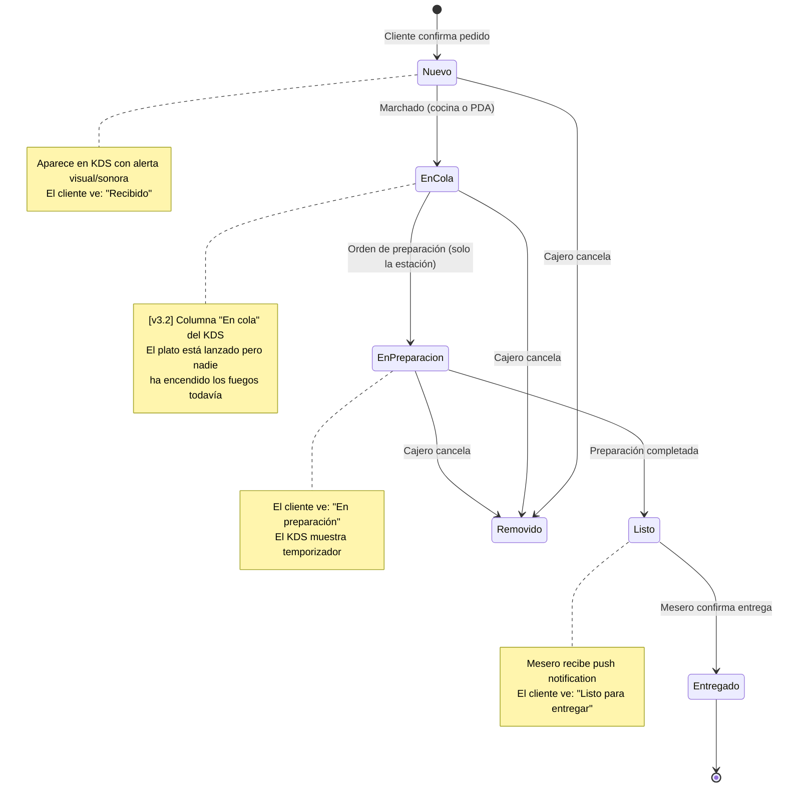

# PRD-003 — KDS y Apps de Staff

> **📜 Documento heredado de Mesto.** Se escribió para la plataforma SaaS multi-tenant de la que
> Mesto Beach se separó en agosto de 2026 (**ADR-023**), y su contenido sigue vigente salvo en
> tres puntos que **manda la documentación nueva**:
> - **Moneda**: los importes de este documento están en pesos colombianos. Hoy todo entero monetario
>   son **céntimos de euro** (**ADR-031**); los nombres de campo llevan el sufijo `Cents`.
> - **Facturación**: la emite el TPV del local, no nosotros (**ADR-028**). Ignora aquí cualquier
>   referencia a pasarelas o autoridades fiscales colombianas.
> - **Ejemplos**: los platos, precios y direcciones son de la época de Mesto y no reflejan la carta
>   ni el local de Playa Demo.
>
> Lo específico de este cliente está en **PRD-018** y en los **ADR-023…035**.

## Metadata

| Campo | Valor |
|---|---|
| **ID** | PRD-003 |
| **Versión** | 3.2 |
| **Estado** | Aprobado — v3.2 |
| **Fecha** | Agosto 2026 |
| **Apps relacionadas** | `staff` (KDS + Cajero + Mesero) |
| **Módulos de API** | Orders, Identity, Sessions |
| **Depende de** | PRD-001, PRD-002 (genera los pedidos que aquí se procesan), PRD-011 (modos de operación, roles) |
| **PRDs que dependen de este** | PRD-005 (el cajero procesa pagos desde esta app), PRD-018 (el modo beach club construye sobre este KDS) |

---

## 1. Propósito y Objetivos

### Propósito

Definir las interfaces del staff de Mesto: el Kitchen Display System (KDS) para cocina y barra, la app del mesero, y la vista del cajero. Estas apps son el sistema nervioso interno del restaurante — reciben pedidos en tiempo real, gestionan su ciclo de vida y coordinan la entrega.

### Objetivos

| # | Objetivo | Métrica |
|---|---|---|
| OBJ-01 | El staff recibe pedidos nuevos en pantalla en menos de 2 segundos | Latencia SignalR < 2s P95 |
| OBJ-02 | El KDS debe ser legible a 2 metros de distancia en una TV | Font size mínimo 20px en cards |
| OBJ-03 | Un cocinero debe poder actualizar el estado de un pedido con un solo toque | 1 tap = cambio de estado |
| OBJ-04 | El cajero puede abrir, cerrar y cobrar una mesa en menos de 3 minutos | Medido en pruebas |

---

## 2. Contexto y Problema que Resuelve

El staff de un restaurante hoy opera con:
- Comandas en papel que se mojan, se pierden o se leen mal
- Comunicación verbal de pedidos entre cocina y barra (errores, ruido)
- El cajero lleva la cuenta en su cabeza o en papel

Mesto reemplaza todo esto con pantallas digitales especializadas para cada rol del staff.

---

## 3. Usuarios

| Persona | App | Dispositivo |
|---|---|---|
| Cocinero | `staff` — Vista cocina | Tablet 10"+ o TV con browser (display fijo) |
| Bartender | `staff` — Vista barra | Tablet o TV (display fijo) |
| Cajero | `staff` — Vista cashdesk | Tablet o PC de escritorio |
| Mesero | `staff` (vista `/salon`) | Celular propio |

**Diferencias clave de rol (v3.0):**
- El **mesero** crea sesiones para sus mesas asignadas y es el responsable de llevar el PIN (o el QR dinámico) a la mesa.
- El **cajero** tiene todos los permisos del mesero más: regenerar PIN (acción exclusiva), cerrar sesiones, procesar pagos, imprimir QR dinámico, y visibilidad global de todas las mesas.

---

## 4. Alcance

### In Scope
- KDS de cocina: pedidos de alimentos en tiempo real, actualización de estado
- KDS de barra: pedidos de bebidas en tiempo real, actualización de estado
- Vista de cajero (cashdesk): mesas activas, apertura de sesión, regeneración de PIN (exclusivo cajero), resumen de cuenta, cierre de sesión, impresión de QR dinámico
- **Mapa de mesas [v1.x]:** el cajero alterna entre **mapa** (por piso, mesas coloreadas Libre/Ocupada con los muros que diseñó el admin) y lista. Toca una mesa libre para abrirla. El diseño del mapa (pisos, posiciones, muros) lo hace el dueño en **Admin → Mesas** (PRD-004 US-419/US-420). Se mantiene la creación de mesa **ad-hoc con nombre nuevo** cuando aparece una mesa fuera del plano
- **Cashdesk — flujo de cobro [v3.1]:** cuenta agrupada por participante, cobro en efectivo con cálculo de vuelto, propina sugerida con botones de %, split-bill (igualitario y por persona), impresión de recibo térmico (ESC/POS WebUSB), cierre de turno con reporte de caja, recepción en tiempo real de "pedir la cuenta", e historial de sesiones cerradas
- App de mesero: crear sesiones en mesas asignadas, mostrar PIN o QR dinámico al cliente, alertas de pedidos listos, llamados de mesa, estado de mesas asignadas
- Autenticación con JWT por rol para todas las vistas de staff
- Reconexión automática a SignalR con re-fetch de estado al reconectar

> Las especificaciones detalladas de cobro viven en **PRD-005 (Pagos)** y **PRD-016 (Admin Panel + flujo del cajero, §10)**; el cierre de turno e historial en **PRD-013 (Gestión Operativa)**. Las historias US-323..US-329 de este PRD las referencian para no duplicar.

### Out of Scope
- Gestión de inventario desde el KDS (está en PRD-006)
- Configuración del menú desde el KDS (está en PRD-004 — Admin Panel)
- Estadísticas de rendimiento del staff
- Comunicación interna entre staff (chat)

---

## 5. Flujo de Ciclo de Vida de un Pedido (Staff)



> **[v3.2] El estado es del plato, no del pedido.** Desde el ciclo de vida por ítem, este diagrama
> describe el recorrido de **cada plato**; el estado del pedido se deriva de los suyos. La columna
> **"En cola"** separa dos decisiones que antes iban juntas: *marchar* (meter el plato en la cola de
> su estación) y *dar la orden de preparación* (encenderle los fuegos). Ver PRD-018 RF-1810…RF-1812
> y RF-1820…RF-1826.

---

## 6. Historias de Usuario

### Épica 1: Kitchen Display System (Cocina y Barra)

```
US-301
Como cocinero,
quiero ver los pedidos nuevos en mi pantalla en tiempo real,
para saber qué preparar sin esperar que el mesero me traiga la comanda.

Criterio de aceptación:
- Los pedidos nuevos aparecen automáticamente sin recargar la página
- Cada card de pedido muestra: nombre del cliente, número de mesa, productos y personalizaciones
- Los pedidos se ordenan por hora de llegada (primero el más antiguo)
- Se muestra el tiempo transcurrido desde que llegó cada pedido
- Al llegar un pedido nuevo, suena una alerta sonora (configurable)

US-302
Como cocinero,
quiero marcar un pedido como "En preparación" con un toque,
para que el cliente sepa que ya estamos trabajando en su pedido.

Criterio de aceptación:
- Cada card de pedido tiene un botón grande y visible "Iniciar"
- Al tocarlo, el pedido pasa a la sección "En preparación"
- El cliente ve el cambio de estado en menos de 3 segundos
- El cambio se registra con timestamp en la base de datos

US-303
Como cocinero,
quiero marcar un pedido como "Listo" cuando termine de prepararlo,
para que el mesero sepa que puede recogerlo.

Criterio de aceptación:
- Los pedidos "En preparación" tienen un botón "Listo"
- Al marcarlo, desaparece del KDS (o va a una sección de completados recientes)
- El mesero recibe un push en su app: "Mesa X — [nombre del plato] listo"
- El cliente ve el cambio de estado

US-304
Como bartender,
quiero ver solo los pedidos de bebidas en mi pantalla,
para no mezclarme con los pedidos de comida de la cocina.

Criterio de aceptación:
- La vista de barra muestra únicamente los productos con stationId = "barra" (o el que corresponda)
- El KDS de cocina muestra solo los de cocina
- La separación es automática — no requiere acción del staff
- Si un pedido tiene alimentos Y bebidas, cada parte va al KDS correcto

US-305
Como cocinero o bartender,
quiero que el KDS siga mostrando los pedidos correctos si pierdo la conexión a internet,
para no perder información crítica durante un corte de señal.

Criterio de aceptación:
- Si SignalR se desconecta, aparece un indicador de "Sin conexión"
- Al reconectar, el KDS hace un GET de todos los pedidos activos y reconstruye el estado completo
- No se pierden pedidos por reconexión

US-331 [v3.2]
Como encargado de cocina,
quiero un tablero de cuatro columnas que se lea de izquierda a derecha,
para saber de un vistazo qué espera, qué está lanzado, qué se está cocinando y qué ya salió.

Criterio de aceptación:
- Las columnas son, en ese orden: "Esperando orden", "En cola", "En preparación" y "En el pase"
- Los botones son tres y dicen lo que hacen: "Marchar", "¡A preparar!" y "Listo"
- Un plato pedido "ahora" nace ya en la columna "En cola": nada entra en preparación por sí solo
- Solo la estación puede pulsar "¡A preparar!"; el PDA puede marchar, pero no encender los fuegos

US-332 [v3.2]
Como cocinero,
quiero ver los platos de las otras estaciones de la misma comanda con el color de su estación,
para sacar la mesa completa y a la vez.

Criterio de aceptación:
- Cada estación tiene un color estable entre pantallas y recargas
- Los platos ajenos se muestran con ese color y con su estado en vivo, no en gris
- Siguen siendo no accionables: se ven, no se tocan

US-333 [v3.2]
Como encargado de cocina,
quiero abrir una comanda al frente y ver el recorrido de cada plato con sus tiempos,
para entender por qué esa mesa va lenta sin preguntar a nadie.

Criterio de aceptación:
- Al tocar una comanda se abre en primer plano y el tablero de atrás queda difuminado
- Cada plato muestra por qué estados ha pasado y cuánto tiempo lleva en cada uno
- Se muestra tanto de mis platos como de los de otras estaciones
- Se cierra con un toque

US-334 [v3.2]
Como cocinero en hora punta,
quiero que la cola llena quepa en la pantalla,
para no tener que hacer scroll con las manos ocupadas.

Criterio de aceptación:
- La tarjeta de comanda se comprime automáticamente según cuántas haya en su columna
- Con la columna desbordada, cada comanda baja a una fila legible
- El detalle completo nunca se pierde: sigue a un toque, en el modo foco
- Cuando la columna se llena, aparece al pie el total de comandas y la espera de la más antigua

US-335 [v3.2]
Como cocinero, cajero, recepción, PDA, runner o mesero,
quiero poner mi vista a pantalla completa,
para que la pantalla colgada o el atril muestren trabajo y no cromo de navegador.

Criterio de aceptación:
- Un botón "Pantalla completa" oculta el armazón de la app y pide la pantalla completa del navegador
- Está en las siete vistas: Cocina, Caja, Recepción, PDA, Runner, Salón e Historial
- La preferencia se recuerda entre recargas para las pantallas fijas
- Si el navegador deniega la pantalla completa nativa, el modo funciona igual
- Mientras está activo, siempre hay una salida visible; nadie se queda encerrado

US-336 [v3.2]
Como cocina, caja, sala o runner,
quiero leer la observación que dejó la mesa,
para no enterarme por las malas de una alergia o de un "todo junto".

Criterio de aceptación:
- La observación es una nota libre por comanda, escrita por el comensal o por el PDA
- Se muestra destacada en la comanda del KDS, del PDA, de la caja, del salón y del runner
- Es opcional: la comanda sin observación se ve igual de limpia que antes
```

### Épica 2: Vista del Cajero

```
US-314 [v2.0]
Como cajero en un restaurante con modo Self-Service activo,
quiero recibir una alerta en tiempo real cuando un cliente crea una sesión automáticamente al escanear el QR,
para saber qué mesas están siendo ocupadas sin que yo las haya abierto.

Criterio de aceptación:
- Al auto-crearse una sesión, aparece una notificación emergente en la pantalla del cajero
- La notificación muestra: número de mesa, hora de la auto-apertura
- La notificación persiste hasta que el cajero la descarte
- El cajero puede hacer clic en la notificación para ir directo al detalle de esa mesa
- El indicador de la mesa cambia a "Ocupada" en el panel de mesas

US-315 [v2.0]
Como cajero,
quiero ver cuántas personas se han unido a la sesión de una mesa y sus nombres,
para tener contexto del grupo antes de procesar el pago.

Criterio de aceptación:
- En el detalle de una mesa ocupada, hay una sección "Participantes (N)"
- Se muestra: nombre de cada participante y hora en que se unió
- Los pedidos en el resumen de cuenta están agrupados por participante
- Si hay un solo participante, no se muestra la sección (no agrega ruido)

US-306
Como cajero,
quiero ver un panel con todas las mesas activas del restaurante,
para tener visibilidad del estado del salón en tiempo real.

Criterio de aceptación:
- La vista muestra un grid o lista de todas las mesas configuradas
- Cada mesa muestra: nombre/número, estado (libre / ocupada), cantidad de pedidos activos
- Las mesas ocupadas se distinguen visualmente de las libres
- Se actualiza en tiempo real sin recargar

US-307 [actualizado v3.0]
Como cajero,
quiero poder abrir la sesión de cualquier mesa desde mi panel (incluyendo las que no están asignadas a ningún mesero),
para cubrir casos donde el mesero no está disponible o el restaurante acaba de abrir.

Criterio de aceptación:
- Puedo abrir cualquier mesa desde el panel del cajero
- Al abrir, se genera el PIN de 4 dígitos y aparece en pantalla
- Si el modo es DYNAMIC, se genera el QR dinámico y puedo imprimirlo
- El mesero asignado a esa mesa recibe una notificación con el PIN y puede verlo en su app

US-308
Como cajero,
quiero ver el resumen de cuenta de cualquier mesa activa,
para saber cuánto está consumiendo cada mesa en cualquier momento.

Criterio de aceptación:
- Al hacer clic en una mesa ocupada, veo todos los pedidos de la sesión actual
- Se muestra: lista de productos pedidos, cantidades, subtotales y total
- Se muestra el estado de cada pedido (pendiente, en preparación, entregado)
- El resumen se actualiza en tiempo real

US-309
Como cajero,
quiero cerrar la cuenta de una mesa y procesar el pago,
para terminar la sesión de esa mesa y dejarla disponible.

Criterio de aceptación:
- Desde el resumen de cuenta, hay opciones de pago: "Cobrar en caja", "Activar pago digital"
- Si cobro en caja, registro el monto recibido y el sistema calcula el cambio
- Al confirmar el pago, la sesión se cierra y la mesa vuelve a estado "Libre"
- Los tokens de sesión del cliente se invalidan inmediatamente

US-310
Como cajero,
quiero cancelar un pedido específico de una mesa,
para cuando el cliente cambia de opinión antes de que se prepare.

Criterio de aceptación:
- Solo puedo cancelar pedidos en estado "Nuevo" (no los que ya están en preparación)
- Al cancelar, el pedido desaparece del KDS y del resumen de la mesa
- El cliente ve que ese pedido fue cancelado en su app
- El cajero puede agregar una nota de cancelación

US-316 [v3.0]
Como cajero,
quiero poder regenerar el PIN de cualquier mesa activa,
para responder si sospecho que el PIN fue comprometido o compartido indebidamente.

Criterio de aceptación:
- En el detalle de cualquier mesa activa hay un botón "Regenerar PIN" (solo visible para cajero, mesero recibe 403)
- Antes de regenerar, aparece confirmación: "¿Seguro? Los invite links existentes quedarán inválidos"
- Al confirmar, el nuevo PIN aparece en pantalla del cajero Y en la app del mesero asignado
- Todos los invite links de esa sesión quedan invalidados (retornan 410 Gone si se usan)
- La acción se registra en el log de auditoría con timestamp, sesionId y usuarioId

US-317 [v3.0]
Como cajero,
quiero ver el PIN activo de cualquier mesa desde mi panel,
para poder dárselo a un cliente si el mesero no está disponible.

Criterio de aceptación:
- En el detalle de cada mesa activa se muestra el PIN actual (oculto por defecto)
- Hay un botón "Mostrar PIN" para revelarlo
- El PIN se actualiza en tiempo real vía SignalR si el cajero lo regenera desde otra sesión

US-318 [v3.0]
Como cajero en un restaurante con QR dinámico,
quiero poder imprimir el QR dinámico de una mesa activa,
para dárselo al cliente si el mesero no puede mostrarlo en su pantalla.

Criterio de aceptación:
- En el detalle de cada mesa activa con modo DYNAMIC hay un botón "Imprimir QR"
- Se genera un PDF con el QR de la sesión actual (válido solo hasta cerrar la sesión)
- El PDF incluye el número de mesa y el nombre del restaurante

US-329 [v3.1] — Cuenta agrupada por participante
Como cajero,
quiero ver la cuenta de una mesa con los pedidos agrupados por persona,
para entender quién pidió qué antes de cobrar o dividir.
Referencia: PRD-002 US-118 (vista del cliente), PRD-016 §10.3.

Criterio de aceptación:
- En el detalle de una mesa, los pedidos se agrupan por participante con su subtotal por persona
- Como el sistema no captura el nombre del participante, se usa una etiqueta: "Anfitrión" para el host y "Invitado 2/3…" por orden de llegada (joinedAt)
- Se muestra el resumen de la cuenta: subtotal, propina, total, pagado y pendiente
- Si solo hay un participante no se muestra el agrupamiento (no agrega ruido)

US-323 [v3.1] — Split bill (igualitario y por persona)
Como cajero,
quiero dividir la cuenta en partes iguales o cobrar a cada participante lo que pidió,
para cobrar a un grupo de forma justa.
Referencia: PRD-005 US-504/US-505, PRD-016 §10.3.

Criterio de aceptación:
- Modo igualitario: divido el total entre N → cada parte usa `splitIndex/splitTotal`
- Modo por persona: el monto de cada parte = suma de los pedidos de ese participante
- El backend cierra la sesión automáticamente cuando se completan todas las partes
- El resumen muestra cuánto se ha cobrado y cuánto falta

US-324 [v3.1] — Pago en efectivo con cálculo de vuelto
Como cajero,
quiero registrar un pago en efectivo ingresando el monto recibido y ver el vuelto,
para no equivocarme dando el cambio.
Referencia: PRD-005 US-507, PRD-016 §10.4.

Criterio de aceptación:
- Ingreso "monto recibido"; el sistema calcula y muestra el vuelto al instante
- Hay atajos de billetes comunes (ej. $20k/$50k/$100k/Exacto)
- El total cobrado = subtotal + propina

US-325 [v3.1] — Propina sugerida con botones de %
Como cajero,
quiero ofrecer la propina con botones de porcentaje configurables (y "otro monto"),
para agilizar el "cobro del servicio".
Referencia: PRD-005 US-506, PRD-016 §10.7.

Criterio de aceptación:
- Los % vienen de la config del tenant (`GET /payments/config`: tipEnabled, tipOptions)
- El monto se calcula con floor sobre el subtotal (no genera puntos de lealtad)
- Puedo elegir un monto libre con "otro"
- La propina se suma al total y se registra en `tipCop`

US-326 [v3.1] — Impresión de recibo (ESC/POS)
Como cajero,
quiero imprimir el recibo en la impresora térmica al cerrar el cobro,
para entregárselo al cliente.
Referencia: PRD-016 §10.8 (ESC/POS vía WebUSB).

Criterio de aceptación:
- Tras confirmar el pago hay un botón "Imprimir recibo"
- Si no hay impresora conectada, el botón está deshabilitado con tooltip
- El recibo incluye: restaurante, mesa, cajero, ítems, subtotal, propina, total y método

US-327 [v3.1] — Cierre de turno con reporte de caja
Como cajero,
quiero cerrar mi turno y obtener el reporte de caja,
para cuadrar el efectivo y dejar registro del turno.
Referencia: PRD-016 §10.9, PRD-013 §4 (US-1301/US-1302) y §5 (estructura del reporte).

Criterio de aceptación:
- Al cerrar turno se advierte si hay sesiones activas
- El reporte agrega: total de ventas, propinas, comisión, # sesiones y desglose por método
- Puedo agregar una nota (máx. 500 caracteres)
- El turno cerrado queda consultable (historial de turnos)

US-330 [v3.1] — Abrir mesa para cliente sin celular (requiere turno)
Como cajero,
quiero abrir una mesa desde el cashdesk para un cliente que no tiene celular,
para atenderlo sin que escanee el QR.
Referencia: PRD-011 (modos de operación), PRD-016 §10.

Criterio de aceptación:
- Sólo se pueden abrir sesiones (cajero y mesero, modo STAFFED) si hay un **turno de caja abierto**; si no, el backend responde `NO_OPEN_SHIFT` y el botón está deshabilitado con el aviso "Abre el turno primero"
- El cajero puede escribir el número/nombre de la mesa; si la mesa no estaba preconfigurada, **se crea automáticamente** (walk-in) y se abre la sesión en modo STAFFED
- La sesión la opera el staff (PIN/QR opcional, no requeridos para el cliente)
- *(Pendiente — follow-up)* la captura del pedido por el staff (tomar la orden desde el cashdesk/mesero) requiere un selector de catálogo; el backend ya lo soporta (`POST /sessions/{id}/participants` + `POST /orders`)

US-328 [v3.1] — Notificación "Pedir la cuenta" del cliente
Como cajero,
quiero recibir en tiempo real cuando un cliente pide la cuenta desde su app,
para ir a cobrarle sin que tenga que llamar a nadie.
Referencia: PRD-002 US-114, PRD-008 (evento `bill.requested`).

Criterio de aceptación:
- Cuando el cliente toca "Pedir la cuenta", el cashdesk recibe una alerta en menos de 2 segundos (SignalR)
- La alerta muestra el número de mesa y permite ir directo a su detalle
- La alerta persiste hasta que el cajero la atienda (también disponible si el cajero recién abre el cashdesk)
```

### Épica 3: App del Mesero

```
US-311
Como mesero,
quiero recibir una notificación push cuando un pedido esté listo para entregar,
para ir a buscarlo a la cocina/barra sin que nadie me tenga que llamar.

Criterio de aceptación:
- Al marcar un pedido como "Listo" en el KDS, mi app vibra y suena
- La notificación muestra: número de mesa y nombre del plato
- Puedo ver todas las alertas pendientes en la sección "Alertas"
- Al entregar el pedido, lo marco como "Entregado" en mi app

US-312
Como mesero,
quiero recibir una notificación cuando un cliente llama al mesero desde la app,
para responder el llamado sin que el cliente tenga que levantarse ni gritar.

Criterio de aceptación:
- Cuando un cliente toca "Llamar mesero" en su app, recibo una alerta en la mía
- La alerta muestra el número de mesa
- Puedo marcar el llamado como "atendido" para que desaparezca
- Si hay múltiples llamados, se muestran en orden de llegada

US-313 [actualizado v3.0]
Como mesero,
quiero ver el estado general de mis mesas asignadas con toda la información relevante,
para priorizar mi atención sin preguntar en cocina.

Criterio de aceptación:
- La app muestra solo las mesas que tengo asignadas (o todas si no hay asignaciones configuradas)
- Para cada mesa veo: estado (libre/ocupada), pedidos pendientes, llamados, cuentas solicitadas
- Las mesas con PIN visible muestran el PIN activo para que pueda llevárselo al cliente
- Los indicadores usan colores y íconos claros (no solo texto)

US-320 [v3.0]
Como mesero,
quiero abrir la sesión de una de mis mesas desde mi app y ver el PIN de inmediato,
para llevárselo al cliente sin pasar por la caja.

Criterio de aceptación:
- En mi lista de mesas asignadas, toco "Abrir mesa" en cualquier mesa libre
- En menos de 2 segundos aparece el PIN de 4 dígitos en pantalla grande
- El PIN está visible de forma permanente mientras la mesa esté abierta
- Hay un botón "Mostrar / Ocultar" para privacidad al mostrárselo al cliente
- Al abrir la mesa también se muestra un botón "Compartir invitación" para generar invite links

US-321 [v3.0]
Como mesero en un restaurante con QR dinámico,
quiero ver el QR dinámico de mi mesa en pantalla para mostrárselo al cliente,
para que el cliente pueda escanear mi pantalla directamente.

Criterio de aceptación:
- Al abrir una mesa en modo DYNAMIC, el QR aparece en pantalla grande (escaneable a 30 cm)
- El QR incluye el nombre de la mesa para contexto
- Hay un botón para alternar entre "Ver QR" y "Ver PIN" si ambos están disponibles
- Al cerrar la sesión desde el cajero, el QR ya no es válido

US-322 [v3.0]
Como mesero,
quiero recibir una notificación cuando un cliente crea una sesión automáticamente
en modo SELF_SERVICE en una de mis mesas,
para ir a entregarle el PIN lo antes posible.

Criterio de aceptación:
- La notificación llega en menos de 2 segundos desde que el cliente escanea el QR
- Muestra: número de mesa y hora de creación
- Al tocarla me lleva directo al detalle de esa mesa con el PIN visible
- Si la mesa no está asignada a ningún mesero, la notificación va a todos los meseros disponibles
```

---

## 7. Requisitos Funcionales

### RF-301 — Autenticación del staff
- El staff se autentica con email + contraseña en `/login`
- El JWT contiene el tenantId y el rol del usuario; firmado RS256 (clave en Azure Key Vault)
- La sesión de staff dura 8 horas (un turno de trabajo)
- **Modelo de refresh por rol** (ver PRD-014 para flujos completos):
  - Mesero: refresh token JWT 7 días en `HttpOnly cookie` — renovación silenciosa en background
  - Cajero: sin refresh — re-login al inicio de cada turno
  - Cocina / Barra (KDS fijo): Device Token 30 días rolling (ver RF-306)

### RF-306 — Autenticación de dispositivos KDS fijos [v3.0]
- Los displays de cocina y barra operan con un Device Token de larga duración (JWT RS256, 30 días rolling)
- **Setup único**: cajero o dueño hace login normal en el dispositivo → activa "Este es un dispositivo fijo" → sistema emite Device Token almacenado en `localStorage`
- El Device Token se renueva automáticamente al cargar la app (silent refresh) — el usuario no interactúa
- El Device Token emite un JWT operacional de 8h para cada sesión del navegador
- **Revocación**: desde `Admin Panel → Configuración → Dispositivos → [revocar]`
- Al revocar, el dispositivo regresa a la pantalla de login normal en su siguiente carga
- Un restaurante puede registrar N dispositivos; cada uno tiene su propio `deviceId` único

### RF-302 — Routing de pedidos al KDS correcto
- Cada producto en el catálogo tiene un `stationId` que lo asigna a un KDS
- El KDS solo recibe pedidos de su estación via el grupo SignalR correcto
- Un restaurante puede tener múltiples estaciones (cocina principal, parrilla, barra, pastelería)

### RF-303 — Estado del KDS al conectar
- Al abrir el KDS, hace GET de todos los pedidos activos de su estación
- Nunca se fía solo de los eventos SignalR para el estado inicial

### RF-304 — Pedidos históricos recientes
- El KDS muestra los últimos 20 pedidos despachados (configurable) para referencia
- Se pueden ocultar con un gesto para mantener la pantalla limpia

### RF-305 — Alertas sonoras
- Cada evento de pedido nuevo emite un sonido
- El sonido es configurable (activar/desactivar, volumen) desde la interfaz del KDS
- El sonido debe funcionar en los browsers de tablets/TVs modernos

### RF-307 — Cobro del cashdesk [v3.1]
- El cobro en efectivo usa `POST /api/v1/payments/cash` con `{ amountCop, tipCop, splitIndex?, splitTotal? }`
- El total de la cuenta y el saldo pendiente se leen de `GET /api/v1/payments/sessions/{id}/status`
- La config de propina se lee de `GET /api/v1/payments/config` (`tipEnabled`, `tipOptions`); el % se aplica con floor sobre el subtotal
- El split (igualitario o por persona) registra un pago por parte; la sesión se cierra automáticamente al completar el total (lógica ya existente en el módulo Payments)
- El recibo se imprime en el cliente vía ESC/POS/WebUSB (no requiere backend) — ver PRD-016 §10.8

### RF-308 — Cierre de turno [v3.1]
- Endpoints: `POST /api/v1/shifts` (abrir), `POST /api/v1/shifts/{id}/close` (cerrar + nota), `GET /api/v1/shifts/{id}/report`, `GET /api/v1/shifts?open=true`
- El reporte agrega los pagos asociados al turno (por `shiftId` estampado en cada pago del turno abierto del tenant)
- Política de acceso: `StaffAdminOrCajero`

### RF-309 — "Pedir la cuenta" [v3.1]
- `POST /api/v1/sessions/{id}/request-bill` (`AllowAnonymous`, lo llama el cliente) emite el evento `BILL_REQUESTED` al grupo `waiter-{tenantId}` vía SignalR (mismo patrón que `call-waiter`)
- El cashdesk se conecta a `SessionsHub` (grupo waiter) y `OrdersHub` (grupo tenant) para recibir la alerta y refrescar la cuenta en vivo
- El estado se persiste en Redis para que el cajero lo vea aunque se conecte después

### RF-310 — Historial de sesiones cerradas [v3.1]
- `GET /api/v1/sessions/closed?from&to&tableCode&page` (`StaffAdminOrCajero`) lista sesiones con estado CLOSED del tenant
- Permite ver el detalle (pedidos, pagos, participantes) y reimprimir el recibo

### RF-311 — Cuatro columnas y tres acciones en el KDS [v3.2]
- El tablero se organiza en "Esperando orden" → "En cola" → "En preparación" → "En el pase"
- Las acciones disponibles son "Marchar", "¡A preparar!" y "Listo", una por transición
- Marchar (`en espera` → `en cola`) lo pueden la estación, el PDA y Administración
- La orden de preparación (`en cola` → `en preparación`) es **exclusiva de la estación**
- Un plato pedido "ahora" nace `en cola`; ninguna ruta lo mete en preparación automáticamente

### RF-312 — Visibilidad cruzada por color [v3.2]
- Los platos de otras estaciones de la misma comanda se muestran con el color de su estación y su estado en vivo
- Reemplaza el gris de v3.1, que los volvía invisibles justo cuando había que mirarlos (PRD-018, ADR-029)
- Siguen siendo no accionables desde una estación ajena

### RF-313 — Modo foco y recorrido del plato [v3.2]
- Al tocar una comanda se abre al frente con el tablero difuminado
- Cada plato muestra su recorrido por estados y el tiempo acumulado en cada uno, propio o ajeno
- Los tiempos salen de los sellos por transición, no de estimaciones

### RF-314 — Densidad automática de la comanda [v3.2]
- La tarjeta se comprime según cuántas comandas haya en su columna, para que la cola quepa sin scroll
- Con la columna desbordada, la comanda se reduce a una fila; el detalle sigue disponible en el modo foco
- A partir de cierto número de comandas, la columna añade al pie el total y la espera de la más antigua

### RF-315 — Modo tablero (pantalla completa) [v3.2]
- Disponible en las siete vistas de `staff`: Cocina, Caja, Recepción, PDA, Runner, Salón e Historial
- Oculta el armazón de la app y solicita la pantalla completa nativa
- La preferencia se recuerda por app entre recargas
- Hay salida visible mientras está activo, aunque el navegador haya denegado la pantalla completa

### RF-316 — Observación de la comanda [v3.2]
- Nota libre por comanda, opcional, de hasta 500 caracteres
- La escribe el comensal en el carrito (PRD-002) o el PDA al comandar
- Se muestra en KDS, PDA, caja, salón y runner

### RF-317 — Lectura del plano abierta a todo el personal [v3.2]
- El plano del local es de lectura para cualquier miembro del personal autenticado
- Antes exigía perfil de Administración o Caja, y Recepción, PDA, Runner y Cocina recibían 403
- Su edición sigue reservada a Administración

---

## 8. Requisitos Técnicos

### RT-301 — Performance del KDS
- El KDS debe funcionar sin degradación por al menos 12 horas continuas sin recargar
- Sin memory leaks en subscripciones de SignalR (cleanup en unmount)
- El rendering de cada card de pedido debe ser < 16ms (60fps)

### RT-302 — Optimización para display grande
- Tamaño de fuente mínimo 18px en cards del KDS
- Botones de acción mínimo 60x60px (área táctil)
- Contraste alto para legibilidad en cocinas con luz variable
- Modo "oscuro" disponible (cocinas suelen ser ambientes con mucho calor y poca luz)

### RT-303 — App del mesero (PWA móvil)
- Instalable como PWA en iOS y Android
- Push Notifications via Web Push API (el mesero debe autorizar los permisos)
- Diseño one-handed: todas las acciones principales alcanzables con el pulgar
- Funciona con la pantalla bloqueada si el sistema operativo lo permite

### RT-304 — Reconexión resiliente
- Configuración `withAutomaticReconnect` con backoff exponencial
- Al reconectar, siempre hace HTTP GET del estado actual antes de confiar en SignalR
- Indicador visual de estado de conexión visible en todo momento

### RT-305 — Modo tablero: el estado propio manda [v3.2]
- Son dos cosas que viajan juntas y fallan por separado: ocultar el armazón de la app siempre funciona; la pantalla completa nativa puede denegarse (navegador, permisos, iframe)
- Manda el estado propio de la aplicación; la pantalla completa nativa se intenta y, si falla, no bloquea nada
- La preferencia se guarda con clave distinta por app, para que dos módulos abiertos a la vez no se pisen
- Salir de la pantalla completa nativa (Esc o gesto del navegador) sale también del modo tablero

### RT-306 — Tiempos derivados de sellos, nunca calculados [v3.2]
- Cada transición del plato persiste su propio sello; el KDS no guarda duraciones
- El recorrido y los tiempos por estado se calculan en la vista a partir de esos sellos
- El estado nuevo se añade al final del enumerado para no desplazar valores ya persistidos

### RT-307 — Diálogos propios, sin nativos [v3.2]
- Avisos, confirmaciones y preguntas se resuelven con componentes de la propia app, con su estética
- No se usan diálogos del navegador en ninguna superficie del staff

---

## 9. Diseño de Pantallas (Wireframes Conceptuales)

```
KDS COCINA (Tablet/TV — landscape)
┌────────────────────────────────────────────────────────┐
│ 🍳 COCINA — La Parrilla     ● Conectado    14:32:05   │
├──────────────────┬─────────────────────────────────────┤
│   NUEVOS (3)     │      EN PREPARACIÓN (2)             │
├──────────────────┼─────────────────────────────────────┤
│ ┌──────────────┐ │ ┌──────────────┐ ┌──────────────┐   │
│ │ Mesa 5 · Ana │ │ │ Mesa 3 · Luis│ │ Mesa 7 · Sara│   │
│ │ hace 2 min   │ │ │ hace 8 min   │ │ hace 12 min  │   │
│ │              │ │ │              │ │              │   │
│ │ Chorizo x1   │ │ │ Costilla x2  │ │ Ensalada x1  │   │
│ │ Bien hecho   │ │ │ Sin picante  │ │              │   │
│ │              │ │ │              │ │              │   │
│ │ [▶ INICIAR ] │ │ │ [✓ LISTO   ] │ │ [✓ LISTO   ] │   │
│ └──────────────┘ │ └──────────────┘ └──────────────┘   │
│ ┌──────────────┐ │                                     │
│ │ Mesa 2 · Juan│ │                                     │
│ │ hace 3 min   │ │                                     │
│ │ Lomito x1    │ │                                     │
│ │ [▶ INICIAR ] │ │                                     │
│ └──────────────┘ │                                     │
└──────────────────┴─────────────────────────────────────┘

CAJERO (Tablet/PC) [v3.0]
┌────────────────────────────────────────────────────────┐
│ 🏠 CAJERO — La Parrilla                   14:32:05    │
│                              ┌────────────────────────┐│
│                              │ ⚡ Auto-sesión: Mesa 3  ││
│                              │ 2 clientes escanearon  ││
│                              │ hace 1 min      [Ver] ││
│                              └────────────────────────┘│
├────────────────────────────────────────────────────────┤
│  Mesa 1    Mesa 2    Mesa 3    Mesa 4    Mesa 5        │
│  🟢 Libre  🔴 Ocup.  🔴 Auto  🟢 Libre  🔴 Ocup.    │
│            PIN: ••••  PIN: ••••           PIN: ••••   │
│            [👁][🔄]  [👁][🔄]            [👁][🔄]   │← 👁 = Ver PIN, 🔄 = Regenerar PIN
│            3 pedidos 5 pedidos           2 pedidos    │
│            2 person. 2 person.           1 persona    │
│                                                        │
│  Mesa 6    Mesa 7    Mesa 8    Mesa 9    Mesa 10      │
│  🟢 Libre  🔴 Ocup.  🟢 Libre  🟢 Libre  🔴 Ocup.    │
│            PIN: ••••                     PIN: ••••    │
│            2 pedidos                     1 pedido     │
└────────────────────────────────────────────────────────┘

APP MESERO (Móvil — portrait) [v3.0]
┌─────────────────────────┐
│ 🧑‍💼 Mesero · Laura      │
├─────────────────────────┤
│ MIS MESAS               │
│                         │
│ Mesa 3  🔴 Abierta      │
│ PIN: 4821  [👁]         │
│ 2 pedidos · 2 personas  │
│ [Mostrar QR] [Invitar]  │
│                         │
│ Mesa 7  🔴 Abierta      │
│ PIN: 9374  [👁]         │
│ 1 pedido · 1 persona    │
│ [Mostrar QR] [Invitar]  │
│                         │
│ Mesa 5  🟢 Libre        │
│ [+ Abrir mesa]          │
├─────────────────────────┤
│ ALERTAS PENDIENTES (2)  │
│ 🟡 Mesa 3 · Costilla    │
│    lista · hace 2 min   │
│ 🔔 Mesa 7 · Llamado     │
│    hace 1 min    [✓]    │
└─────────────────────────┘

APP MESERO — Pantalla de PIN [v3.0]
┌─────────────────────────┐
│ ← Mis mesas  Mesa 3     │
├─────────────────────────┤
│                         │
│   PIN de la mesa        │
│                         │
│     4  8  2  1          │  ← grande, legible
│                         │
│   [  Mostrar / Ocultar ]│
│                         │
│   [  Mostrar QR     ]   │
│   [  Compartir link ]   │
│                         │
│   Mesas: Carlos, Ana    │
│   3 pedidos activos     │
└─────────────────────────┘
```

---

## 10. Criterios de Aceptación

- [ ] Un pedido nuevo aparece en el KDS en menos de 2 segundos después de ser confirmado por el cliente
- [ ] El cocinero puede cambiar el estado de un pedido con un solo toque
- [ ] Al desconectar y reconectar SignalR, el KDS muestra el estado actual correcto (no se pierden pedidos)
- [ ] El mesero puede abrir una mesa de sus asignadas y ver el PIN en menos de 3 segundos
- [ ] El mesero puede mostrar el QR dinámico en pantalla (modo DYNAMIC)
- [ ] El cajero puede ver el PIN de cualquier mesa activa con un clic
- [ ] Solo el cajero puede regenerar el PIN (el mesero recibe 403 al intentarlo)
- [ ] Al regenerar el PIN, el mesero asignado recibe el nuevo PIN en su app vía SignalR
- [ ] En modo Self-Service, el mesero recibe la alerta de auto-apertura en menos de 2 segundos
- [ ] El cajero recibe la alerta de auto-apertura en menos de 2 segundos
- [ ] El cajero puede ver los participantes de una mesa y los pedidos agrupados por persona
- [ ] El cajero puede ver el resumen de cuenta de cualquier mesa activa y cerrarla
- [ ] Al cerrar la sesión, los tokens de todos los participantes quedan invalidados
- [ ] El mesero recibe la alerta de pedido listo en menos de 3 segundos
- [ ] La app del mesero funciona como PWA instalable en iOS y Android
- [ ] [v3.1] El cashdesk muestra la cuenta agrupada por participante con subtotal por persona
- [ ] [v3.1] El cobro en efectivo calcula el vuelto correctamente a partir del monto recibido
- [ ] [v3.1] La propina se ofrece con botones de % configurables y se calcula con floor sobre el subtotal
- [ ] [v3.1] El split-bill (igualitario y por persona) cierra la sesión al completar el total
- [ ] [v3.1] Se puede imprimir el recibo por ESC/POS cuando hay impresora conectada
- [ ] [v3.1] El cajero cierra su turno y obtiene el reporte de caja con desglose por método
- [ ] [v3.1] El cliente "pide la cuenta" y el cashdesk recibe la alerta en menos de 2 segundos
- [ ] [v3.1] El cajero consulta el historial de sesiones cerradas con filtros y reimprime el recibo
- [ ] [v3.2] El tablero muestra las cuatro columnas en orden y sus tres botones: "Marchar", "¡A preparar!" y "Listo"
- [ ] [v3.2] Un plato pedido "ahora" aparece en "En cola" y no pasa a "En preparación" hasta que la estación lo lanza
- [ ] [v3.2] El PDA marcha un plato y este cae en "En cola"; el PDA no puede darle la orden de preparación
- [ ] [v3.2] Los platos de otras estaciones se ven con el color de su estación y su estado real, sin poder accionarlos
- [ ] [v3.2] Al tocar una comanda, el tablero se difumina y cada plato muestra su recorrido con el tiempo en cada estado
- [ ] [v3.2] Con doce comandas en una columna, todas caben sin scroll y el pie indica el total y la espera de la más antigua
- [ ] [v3.2] La observación de una comanda se lee igual en KDS, PDA, caja, salón y runner
- [ ] [v3.2] Las siete vistas de `staff` entran y salen del modo tablero, y la salida sigue visible aunque el navegador deniegue la pantalla completa
- [ ] [v3.2] Recepción, PDA, Runner y Cocina cargan el plano del local sin recibir un 403
- [ ] [v3.2] No aparece ningún diálogo nativo del navegador en la app de staff

---

## 11. Métricas de Éxito

| Métrica | Meta |
|---|---|
| % de pedidos con estado actualizado por el staff antes de ser entregados | > 80% |
| Tiempo promedio en KDS (recibido → listo) | Medible y comparable por restaurante |
| Satisfacción del staff con la app (encuesta interna) | > 4/5 |

---

## 12. Open Questions

| # | Pregunta | Responsable |
|---|---|---|
| OQ-301 | ¿El KDS fijo requiere login o la sesión es permanente por dispositivo? | Product + Tech |
| OQ-302 | ¿Se puede tener múltiples instancias del KDS para la misma estación (dos pantallas en cocina)? | Tech |
| OQ-303 | ¿El cajero puede reasignar un pedido de una estación a otra? | Product |

---

*PRD-003 — KDS y Apps de Staff*
*Versión 3.2 — Agosto 2026 — La cola del pase: cuatro columnas ("Esperando orden", "En cola", "En preparación", "En el pase"), marchar compartido y orden de preparación exclusiva de la estación, visibilidad cruzada por color, modo foco con recorrido y tiempos, densidad automática, modo tablero en las siete vistas, observación de la comanda y lectura del plano abierta a todo el personal (US-331..US-336, RF-311..RF-317, RT-305..RT-307; refs PRD-018, PRD-002, ADR-029/ADR-032/ADR-033/ADR-034)*
*Versión 3.1 — Junio 2026 — Cashdesk completo (Épica 2): cuenta por participante, efectivo+vuelto, propina %, split-bill, recibo ESC/POS, cierre de turno, "pedir la cuenta" en vivo, historial de sesiones (US-323..US-329; refs PRD-005/016/013/002/008). Base v3.0: mesero crea sesiones, PIN en app mesero, cajero regenera PIN, asignación de mesas*
