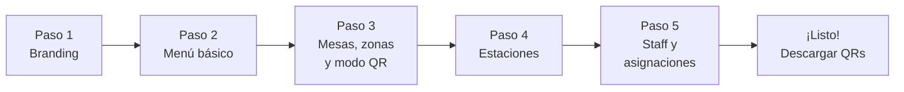

# PRD-004 — Configuración del Restaurante

> **📜 Documento heredado de Mesto.** Se escribió para la plataforma SaaS multi-tenant de la que
> Mesto Beach se separó en agosto de 2026 (**ADR-023**), y su contenido sigue vigente salvo en
> tres puntos que **manda la documentación nueva**:
> - **Moneda**: los importes de este documento están en pesos colombianos. Hoy todo entero monetario
>   son **céntimos de euro** (**ADR-031**); los nombres de campo llevan el sufijo `Cents`.
> - **Facturación**: la emite el TPV del local, no nosotros (**ADR-028**). Ignora aquí cualquier
>   referencia a pasarelas o autoridades fiscales colombianas.
> - **Ejemplos**: los platos, precios y direcciones son de la época de Mesto y no reflejan la carta
>   ni el local de Playa Demo.
>
> Lo específico de este cliente está en **PRD-018** y en los **ADR-023…035**.

## Metadata

| Campo | Valor |
|---|---|
| **ID** | PRD-004 |
| **Versión** | 3.3 |
| **Estado** | Aprobado — v3.3 |
| **Fecha** | Agosto 2026 |
| **Apps relacionadas** | `admin` (Dashboard del dueño), `platform` (Mesto Ops) |
| **Módulos de API** | Identity, Catalog, Sessions |
| **Depende de** | PRD-001, PRD-011 (modos de operación) |
| **PRDs que dependen de este** | PRD-002 (el menú configurado aquí es lo que ve el cliente), PRD-003 (las estaciones configuradas aquí determinan el routing del KDS), PRD-016 (el módulo `/mesas` del panel es el editor de plano descrito aquí), PRD-018 (el plano a escala del beach club) |

---

## 1. Propósito y Objetivos

### Propósito

Definir cómo un restaurante configura todo su setup en Mesto: desde el onboarding inicial hasta la gestión diaria del menú, mesas, estaciones, branding, horarios y staff. La premisa central es que cualquier dueño de restaurante, sin conocimiento técnico, pueda configurar y mantener su operación de forma autónoma.

### Objetivos

| # | Objetivo | Métrica |
|---|---|---|
| OBJ-01 | Un restaurante nuevo puede lanzar en producción en menos de 10 minutos | Tiempo medido desde registro hasta primer QR operativo |
| OBJ-02 | El dueño no necesita soporte técnico para ninguna tarea de configuración | 0 tickets de soporte por dificultad de configuración |
| OBJ-03 | Los cambios en el menú se reflejan para los clientes en menos de 5 minutos | TTL de caché del catálogo = 5 min |

---

## 2. Contexto y Problema que Resuelve

La razón por la que los sistemas POS enterprise fallan para restaurantes pequeños y medianos es la complejidad de configuración. Un restaurante en Colombia no tiene un equipo de IT — el dueño o su administrador deben poder hacer todo solos.

Mesto debe ser tan intuitivo que el onboarding sea una experiencia de producto en sí misma, no un proceso de soporte.

---

## 3. Usuarios

**Usuario primario:** Dueño / Administrador del restaurante (P2 en PRD-001)
**Usuario secundario:** Mesto Ops (P6) para onboarding inicial y soporte

---

## 4. Alcance

### In Scope
- Wizard de onboarding paso a paso para restaurantes nuevos
- Configuración de branding (nombre, logo, colores, descripción)
- Gestión del catálogo de menú: productos, categorías, estaciones
- Configuración de mesas y zonas del restaurante
- Gestión de horarios del menú (desayuno, almuerzo, cena)
- Gestión de staff: crear/editar/desactivar usuarios por rol
- Configuración de opciones de pago del restaurante
- Descarga de QRs por mesa (PDF o imagen)
- Configuración de alertas de stock

### Out of Scope
- Configuración de integración contable (v2)
- Templates de menú prediseñados por categoría de restaurante (v2)
- Importación masiva de menú desde Excel/CSV (v2)
- Gestión de múltiples sucursales bajo un mismo tenant (v2)

---

## 5. Wizard de Onboarding

El wizard guía al nuevo restaurante en 5 pasos. Cada paso puede guardarse como borrador y completarse después.



### Paso 1 — Branding
- Nombre del restaurante (requerido)
- Logo (imagen PNG/JPG, máx 2MB)
- Color primario (selector de color)
- Color secundario (selector de color)
- Descripción corta (opcional, aparece en la app del cliente)
- Tipo de establecimiento (Restaurante / Bar / Café / Otro)

### Paso 2 — Menú básico
- Crear al menos una categoría
- Crear al menos un producto
- (El menú se puede ampliar después desde el Admin Panel completo)

### Paso 3 — Mesas, zonas y modo de operación
- Definir el número de mesas
- Opcionalmente agrupar en zonas (Salón principal, Terraza, VIP, Barra)
- Cada mesa recibe un nombre o número
- **[v2.0] Seleccionar el modo de operación** del restaurante:
  - `Staffed` — el mesero (o cajero) abre la sesión antes de que el cliente pueda pedir (recomendado para restaurantes de servicio completo)
  - `Self-Service` — el cliente crea la sesión automáticamente al escanear el QR (recomendado para bares, cafeterías, zonas de comida rápida)
- **[v3.2] Seleccionar el tipo de QR/acceso — por cada mesa** (ya no es global del tenant; se elige en `admin → Mesas`, ver Épica 3). Tres opciones que combinan `qrMode` + `requiresPin`:
  - `QR Fijo (con PIN)` — el QR está impreso permanentemente en la mesa; la seguridad se basa en el PIN. Permite imprimir los QRs una sola vez. (Recomendado)
  - `QR Dinámico` — se genera un QR nuevo por sesión, impreso/mostrado por el staff; no se reutiliza nada. Implica siempre modo Staffed; nunca pide PIN.
  - `Sin seguridad` — QR fijo **abierto**: el cliente escanea y pide directamente, sin PIN ni verificación. Para barras/bares de alta rotación.
- **[v2.0] Configurar el horario de operación** (solo aplica en modo Self-Service): franjas de días y horas en que el QR está activo

### Paso 4 — Estaciones de preparación
- Definir las estaciones (por defecto: Cocina, Barra)
- Asignar un color a cada estación (para identificación visual en el KDS)
- Cada producto del menú se asignará a una estación

### Paso 5 — Staff y asignaciones de mesa
- Crear usuarios para el staff (email + **uno o varios roles**: el dueño puede asignar, p. ej., Cajero + Mesero a la misma persona)
- Los usuarios creados reciben un email de invitación con link de acceso
  - **[v1.4 Identidad unificada]** Si el correo **ya tiene cuenta** (trabaja en otro restaurante o ya fue invitado), se le concede acceso **inmediato** con su contraseña actual — no se reenvía activación. Cada persona usa **una sola cuenta y contraseña** en todos los restaurantes donde es miembro (ver PRD-014 §v1.4 y SDD-001 v1.3).
- Gestión posterior: **editar los roles** de un miembro en este restaurante y **quitarlo** (lo desvincula solo de este restaurante; conserva su cuenta y el acceso a otros)
- Mínimo requerido: 0 (el dueño puede operar solo en el MVP)
- **[v3.0] Asignación de mesas a meseros**: para cada mesero, seleccionar las mesas de las que es responsable. Si no se configura ninguna asignación, las alertas van a todos los meseros.

---

## 6. Historias de Usuario

### Épica 1: Onboarding

```
US-401
Como nuevo dueño de restaurante,
quiero completar el wizard de onboarding y tener mi restaurante listo para operar,
para lanzar en menos de 10 minutos sin ayuda técnica.

Criterio de aceptación:
- El wizard guía paso a paso sin ambigüedades
- Cada paso tiene instrucciones claras y ejemplos visuales
- Puedo guardar mi progreso y continuar después
- Al finalizar el paso 5, puedo descargar los QRs de mis mesas

US-402
Como Mesto Ops,
quiero poder crear un nuevo restaurante desde el Platform Admin,
para hacer el onboarding asistido cuando el cliente lo necesite.

Criterio de aceptación:
- Puedo crear un tenant con nombre, slug, email del dueño y plan
- El sistema envía email automático al dueño con el link de acceso
- Puedo ver el progreso del onboarding del restaurante (qué pasos completó)
```

### Épica 2: Gestión del Menú

```
US-403
Como dueño,
quiero crear y editar productos en mi menú con toda la información necesaria,
para que mis clientes tengan una experiencia completa al ver el menú.

Criterio de aceptación:
- Puedo ingresar: nombre, descripción, precio, categoría, estación, imágenes
- Puedo subir hasta 5 imágenes por producto
- Puedo activar/desactivar un producto sin eliminarlo
- Puedo marcar un producto como "agotado" — aparece en el menú del cliente pero no es seleccionable
- Los cambios se reflejan en la app del cliente en menos de 5 minutos

US-404 [implementado v1.x]
Como dueño,
quiero agregar grupos de personalización (adiciones) a mis productos,
para que el cliente pueda elegir el punto de cocción, tamaño, extras, quitar ingredientes o dejar un comentario.

Criterio de aceptación:
- Tengo una **biblioteca de adiciones reutilizable** (sección "Adiciones" en el catálogo) con buscador; un grupo se adjunta a varios productos por referencia (editarlo actualiza todos los que lo usan)
- Puedo crear tres tipos de grupo:
  - **Única (radio)**: el cliente elige exactamente una; puede ser obligatoria. Ej: término de la carne 1/2, 3/4 — con opción predeterminada
  - **Múltiple (checkbox con costo)**: varias opciones con min/máx. Ej: + Michelada, + Queso (+$2.000)
  - **Quitar (sin X)**: quitar ingredientes sin costo. Ej: sin cebolla
- Cada opción puede marcarse como disponible/agotada
- Puedo habilitar por producto un **comentario libre** del cliente
- Puedo adjuntar adiciones a un producto buscándolas (chips), duplicar grupos y ver en cuántos productos se usa cada uno
- El **backend recalcula el precio** (base + adiciones) y valida las selecciones; nunca confía en el cliente
- Las adiciones y el comentario elegidos por el cliente se muestran en el KDS, el cobro (cashdesk) y "Mi cuenta"

US-405
Como dueño,
quiero organizar mis productos en categorías y poder reordenarlas,
para que el menú tenga la estructura que yo quiero.

Criterio de aceptación:
- Puedo crear, editar y eliminar categorías
- Puedo reordenar categorías con drag-and-drop
- Puedo reordenar productos dentro de una categoría con drag-and-drop
- Una categoría eliminada mueve sus productos a "Sin categoría" (no los elimina)

US-406
Como dueño,
quiero configurar menús por horario,
para que el desayuno, almuerzo y cena muestren productos diferentes.

Criterio de aceptación:
- Puedo crear franjas horarias (ej: Desayuno 6am-11am, Almuerzo 11am-3pm, Cena 6pm-11pm)
- Cada producto puede asignarse a una o más franjas horarias
- Las categorías también pueden asignarse a franjas
- En la app del cliente, solo aparecen los productos/categorías del horario actual
- Puedo tener un menú "todo el día" para productos siempre disponibles
```

### Épica 3: Mesas y Zonas

```
US-407
Como dueño,
quiero configurar la distribución de mesas de mi restaurante,
para que el sistema refleje la realidad de mi salón.

Criterio de aceptación:
- Puedo crear mesas con nombre o número (Mesa 1, Mesa Terraza 2, VIP-3, etc.)
- Puedo agrupar mesas en zonas (Salón, Terraza, Barra, VIP)
- Puedo activar o desactivar mesas (ej: mesas que no están en uso esta temporada)
- El número de mesas no tiene un límite fijo (configurable según el plan)

US-407b [v3.2] — Tipo de QR/acceso por mesa
Como dueño,
quiero elegir el tipo de QR de cada mesa al crearla o editarla,
para mezclar mesas con QR fijo, dinámico o sin seguridad en un mismo local.

Criterio de aceptación:
- En la sección Mesas, cada mesa tiene un selector con tres opciones: **QR Fijo (con PIN)**, **QR Dinámico** y **Sin seguridad** (acceso abierto sin PIN).
- La elección se guarda por mesa (no es una config global del restaurante).
- Al abrir una sesión, el staff (cajero/mesero) **no vuelve a elegir** el tipo: se toma de la mesa. Fijo/Sin seguridad abren la sesión de inmediato; Dinámico ofrece imprimir/mostrar el QR de la mesa.
- "Sin seguridad" permite que el cliente escanee y pida sin PIN ni verificación.

US-408
Como dueño,
quiero descargar los QRs de todas mis mesas listos para imprimir,
para ponerlos en las mesas físicamente.

Criterio de aceptación:
- Puedo descargar el QR de cada mesa individualmente (PNG)
- Puedo descargar todos los QRs en un ZIP
- Puedo descargar una hoja A4 con múltiples QRs etiquetados (PDF)
- Los QRs incluyen el nombre/número de la mesa y el logo del restaurante
- El QR apunta a la URL permanente de esa mesa: mesta.app/[slug]/[tableCode]

US-419 [v1.x] — Mapa de mesas por pisos
Como dueño,
quiero diseñar el mapa físico de mi local con varios pisos y ubicar las mesas,
para que mi equipo (en especial el cajero) vea la distribución real al operar.

Criterio de aceptación:
- Puedo crear varios **pisos con nombre** (Planta baja, Terraza, Piso 2…), renombrarlos, reordenarlos y eliminarlos. Al eliminar un piso, sus mesas no se borran: quedan "sin ubicar".
- En cada piso tengo un **lienzo (rectángulo)** con grilla donde **arrastro** las mesas para colocarlas (drag-and-drop, con snap a la grilla).
- Puedo **dibujar muros** (líneas) dentro del rectángulo para representar paredes/divisiones, y borrarlos.
- Por mesa configuro: código, **número de sillas**, **forma** (cuadrada/redonda), activa/inactiva; puedo crear y eliminar mesas, y quitarlas del mapa sin borrarlas.
- Las mesas creadas en caja (ad-hoc, sin lugar) aparecen en una bandeja **"Sin ubicar"** que puedo colocar en el mapa.
- Pantalla: app **Admin → Mesas** (`/mesas`). Backend: entidad `Floor` + posición/forma/sillas en `tables` (ver SDD-003).

US-420 [v1.x] — El cajero ve y opera sobre el mapa
Como cajero,
quiero ver el mapa del local por piso con el estado de cada mesa,
para saber dónde está cada mesa y abrirla con un toque.

Criterio de aceptación:
- En el cashdesk hay una vista de **mapa** (alternable con la lista) que muestra las mesas por piso, **coloreadas por estado** (Libre = verde, Ocupada = azul), con los muros del diseño del admin.
- Al tocar una mesa **libre** se abre el flujo de "Abrir mesa" (exige turno abierto); una **ocupada** se selecciona y muestra su panel.
- Se mantiene la creación de mesas **ad-hoc con nombre nuevo** cuando aparece una mesa que no estaba en el plano (PRD-003).

US-421 [v3.3] — Editar la sala sobre el plano que ve el equipo
Como dueño,
quiero organizar la sala sobre el mismo plano a escala que usa mi personal,
para que lo que yo dibujo y lo que ellos ven sean la misma cosa y no dos dibujos parecidos.

Criterio de aceptación:
- El editor trabaja sobre el **plano canónico** del local, el mismo que consumen recepción, comandero, runner y caja — no sobre un lienzo aparte.
- **Arrastro** las mesas a su sitio; las posiciones se guardan **en lote** cuando termino, no una por una.
- Añado puestos a partir de los **tipos y dimensiones reales del local** (Redonda 2/4/6, Cuadrada 4/6/8, Hamaca de playa), sin tener que inventar medidas ni códigos: el código se propone solo.
- Sobre un puesto seleccionado cambio **forma** y **plazas**, o lo elimino.
- El plano es de **lectura para todo el personal** autenticado; **editarlo** sigue siendo solo mío (ver PRD-003 RF-317).
- Los sectores se presentan siempre en el mismo orden explícito, no en el que salgan de la base de datos.

US-422 [v3.3] — Modo tablero en el panel de administración
Como dueño,
quiero poder poner el panel a pantalla completa,
para revisar el servicio en una pantalla grande sin el cromo del navegador delante.

Criterio de aceptación:
- Hay un botón de pantalla completa en el panel; oculta el armazón de la app y pide la pantalla completa del navegador.
- La preferencia se recuerda entre recargas, con clave propia del panel (no interfiere con la del staff).
- Mientras está activo hay siempre una salida visible, aunque el navegador haya denegado la pantalla completa.
- Los avisos y confirmaciones del panel usan diálogos propios, con la estética del panel; ninguno es nativo del navegador.
```

### Épica 4: Branding / Apariencia del menú [v3.1]

Implementada como página **Apariencia** (`/menu-appearance`) en `admin`, con **vista previa en vivo** del menú mientras se edita.

```
US-409
Como dueño,
quiero personalizar la apariencia de la app que ve mi cliente,
para que refleje la identidad visual de mi restaurante.

Criterio de aceptación:
- Puedo definir el nombre visible y un slogan del restaurante
- Puedo elegir un color de acento (se aplica a botones, chips y acentos)
- Puedo elegir un preset de fondo: claro, crema u oscuro
- Puedo elegir la tipografía de una lista curada de fuentes
- Puedo subir mi logo (header del menú) y una imagen de portada (hero)
- Veo una vista previa en vivo antes de guardar
- Los cambios se reflejan en la app del cliente en menos de 5 minutos (TTL del catálogo)
- La app de un restaurante A nunca muestra el branding de restaurante B
- El branding solo aplica a la sesión del menú del cliente; el login del menú conserva la identidad Mesto
```

> Nota de alcance v3.1: se reemplazó la idea original de "color secundario" por un **preset de fondo (tema) + fuente curada**, que da un resultado más consistente y a prueba de combinaciones ilegibles. Las imágenes (logo/portada) se guardan en Blob Storage (Azurite en dev).

### Épica 6: Modo de Operación y Horarios del QR [v2.0]

```
US-412
Como dueño de restaurante,
quiero elegir entre el modo Staffed y Self-Service para mi restaurante,
para adaptar el sistema al modelo operativo de mi negocio.

Criterio de aceptación:
- En la configuración general hay una sección "Modo de operación"
- Las opciones disponibles son: Staffed y Self-Service, con descripción de cada una
- Al cambiar el modo, el cambio aplica inmediatamente a todas las mesas activas
- El modo activo es visible en el panel del cajero (indicador en el header)
- El cambio de modo queda registrado en el log de auditoría con fecha, hora y usuario

US-413
Como dueño de restaurante en modo Self-Service,
quiero configurar el horario de operación de mi restaurante,
para que los QRs se desactiven automáticamente fuera del horario y se eviten pedidos fuera de turno.

Criterio de aceptación:
- Puedo configurar uno o más rangos de días/horas (ej: Lunes a Viernes 11am-10pm, Sábado 11am-11pm)
- Fuera del horario configurado, el QR muestra un mensaje de "Restaurante cerrado" con el próximo horario
- El cajero puede hacer override manual del horario (abrir o cerrar el QR temporalmente)
- Si no se configura horario, el QR está activo 24/7 (comportamiento por defecto)

US-414
Como dueño de restaurante,
quiero configurar el modo de operación de forma diferente por zona,
para tener self-service en la terraza y staffed en el salón principal.

Criterio de aceptación:
- En la configuración de cada zona, puedo sobrescribir el modo del restaurante
- Si una zona no tiene modo configurado, hereda el modo del restaurante
- La vista del cajero distingue visualmente las mesas por modo (color o ícono)
```

### Épica 7: Configuración de QR Mode, PIN y Asignación de Meseros [v3.0]

```
US-415
Como dueño de restaurante,
quiero elegir entre QR fijo y QR dinámico,
para adaptar el nivel de seguridad de acceso a la realidad de mi operación.

Criterio de aceptación:
- En la configuración general hay una sección "Modo de QR"
- Las opciones son: "QR Fijo (impreso en mesa)" y "QR Dinámico (mesero lo muestra en pantalla)"
- Si selecciono QR Dinámico, el modo de operación se fuerza automáticamente a Staffed y se muestra una nota explicativa
- Al cambiar el modo, el cambio aplica a nuevas sesiones; las sesiones activas no se ven afectadas
- El cambio queda registrado en el log de auditoría

US-416
Como dueño de restaurante,
quiero configurar si el PIN de sesión es requerido o no,
para decidir el nivel de control de acceso que quiero para mi restaurante.

Criterio de aceptación:
- En la configuración general hay una sección "PIN de sesión"
- Toggle: "Requerir PIN para confirmar el primer pedido" (activado por defecto)
- Si está desactivado y el modo es Self-Service, aparece una nota: "Acceso completamente libre — cualquiera que escanee el QR puede pedir"
- El cambio aplica a nuevas sesiones; las sesiones activas no se ven afectadas
- El dueño puede activar/desactivar el PIN en cualquier momento

US-417
Como dueño de restaurante,
quiero asignar mis meseros a mesas específicas,
para que cada mesero reciba solo las alertas de sus mesas.

Criterio de aceptación:
- En la página de cada mesero (dentro de gestión de staff) hay una sección "Mesas asignadas"
- Puedo seleccionar de forma múltiple las mesas que le corresponden a ese mesero
- Una mesa puede tener 0, 1 o más meseros asignados
- Si una mesa no tiene meseros asignados, las alertas van a todos los meseros del restaurante
- Los cambios de asignación aplican inmediatamente (la próxima sesión de esa mesa ya usa la asignación nueva)
- Puedo ver una vista de resumen: "qué mesero cubre qué mesas"

US-418
Como dueño de restaurante,
quiero ver una vista resumen del modo de seguridad activo,
para tener visibilidad clara de cómo está configurado el acceso a mis mesas.

Criterio de aceptación:
- En el dashboard del Admin Panel hay un panel "Configuración de seguridad"
- Muestra: modo QR (FIXED/DYNAMIC), modo de operación (STAFFED/SELF_SERVICE), PIN requerido (sí/no)
- Hay un botón "Editar" para ir directamente a la configuración correspondiente
- Si la combinación de configuración representa un riesgo alto (ej: SELF_SERVICE + sin PIN), se muestra una advertencia informativa
```

```
US-410
Como dueño,
quiero crear usuarios para mi equipo de trabajo con su rol específico,
para controlar quién tiene acceso a qué parte del sistema.

Criterio de aceptación:
- Puedo crear usuarios con: nombre, email y rol (Cajero, Cocina, Barra, Mesero)
- El usuario creado recibe un email con su contraseña temporal y link de acceso
- Puedo cambiar el rol de un usuario en cualquier momento
- Puedo desactivar un usuario sin eliminarlo (puede reactivarse)
- Un usuario desactivado no puede hacer login

US-411
Como dueño,
quiero poder cambiar mi propio email y contraseña,
para mantener mi cuenta segura.

Criterio de aceptación:
- Desde la configuración de mi perfil puedo cambiar email (requiere verificación) y contraseña
- El cambio de contraseña requiere ingresar la contraseña actual
```

---

## 7. Requisitos Funcionales

### RF-401 — Catálogo multi-nivel
- El catálogo soporta: categorías → productos → grupos de detalles → opciones
- Cada nivel tiene sus propios atributos configurables
- La estructura es completamente flexible — no hay límite de categorías, productos u opciones

### RF-402 — Slugs únicos
- El slug del restaurante (URL identifier) es único en toda la plataforma
- Se verifica disponibilidad en tiempo real al escribirlo
- El slug puede contener letras minúsculas, números y guiones medios
- Una vez elegido, solo puede ser cambiado por Mesto Ops

### RF-403 — Propagación de cambios
- Los cambios en el catálogo se propagan a la app del cliente vía invalidación del caché en Redis
- El TTL del caché es de 5 minutos por defecto
- El dueño puede forzar una actualización inmediata desde el Admin Panel

### RF-404 — Validaciones del menú
- Un producto debe tener al menos: nombre, precio y categoría
- El precio debe ser un número positivo mayor a cero
- Un grupo de detalles obligatorio debe tener al menos 2 opciones
- No se puede eliminar una categoría que tiene productos activos (debe moverlos primero)

### RF-405 — QR generation
- Los QRs se generan con el logo del restaurante en el centro (cuando está configurado)
- El código QR es de tipo URL y usa corrección de errores nivel M (resiste hasta 15% de daño)

### RF-406 — Modo de operación [v2.0]
- El modo de operación se almacena a nivel tenant (`operationMode: STAFFED | SELF_SERVICE`)
- Las zonas pueden tener un `modeOverride` opcional que sobrescribe el del tenant
- Al cambiar el modo, el sistema notifica via SignalR a todos los clientes de staff conectados
- El cambio es eventual-consistente: nuevas sesiones usan el nuevo modo; sesiones existentes no se ven afectadas

### RF-407 — Horario de operación [v2.0]
- El horario se almacena como un arreglo de slots `{ dayOfWeek: 0-6, openTime: "HH:mm", closeTime: "HH:mm" }`
- El servidor evalúa el horario en la zona horaria configurada del restaurante (`tenantTimezone`)
- Si no hay horario configurado, el resultado es siempre "abierto"
- El override manual del cajero tiene una duración máxima de 24 horas antes de expirar automáticamente

### RF-408 — QR Mode y PIN [v3.0]
- Los campos `qrMode: FIXED | DYNAMIC` y `pinRequired: bool` se almacenan en la tabla `tenants`
- Si `qrMode = DYNAMIC`, el sistema rechaza cualquier intento de configurar `operationMode = SELF_SERVICE` con error 400
- Si `pinRequired = false`, el campo `pin` en `POST /orders` se ignora para todos los participantes
- El cambio de `pinRequired` aplica solo a nuevas sesiones y a participantes que aún no validaron su PIN
- El PIN se genera con `SecureRandom` de 4 dígitos al crear la sesión, almacenado en Redis: `session:{tid}:{sid}:pin`

### RF-409 — Asignación de meseros a mesas [v3.0]
- La asignación se almacena en la tabla PostgreSQL `waiter_assignments { id, tenant_id, waiter_id, table_code, created_at }`
- Una mesa puede tener múltiples meseros asignados (relación N:N)
- Si una mesa no tiene asignaciones, el sistema usa un grupo SignalR de broadcast a todos los meseros del tenant
- Al asignar o desasignar una mesa, el cambio aplica inmediatamente a las próximas notificaciones (no afecta sesiones activas)
- Se puede vaciar todas las asignaciones de un mesero desde su perfil (ej: al desactivar al usuario)

### RF-410 — Apariencia del menú [v3.1]
- El branding por tenant se compone de: nombre visible, slogan, color de acento (`#RRGGBB`), preset de fondo (`light`/`cream`/`dark`), fuente (lista curada), logo y portada (hero)
- Se administra en la página **Apariencia** del admin con vista previa en vivo
- El branding viaja embebido en el catálogo público y se aplica como tema en la app del cliente; se invalida con el caché del catálogo (≤ 5 min)
- El login del menú no se tematiza: conserva la identidad Mesto

### RF-411 — Editor de sala sobre el plano canónico [v3.3]
- El módulo **Mesas** del admin es el editor del plano a escala del local, el mismo que consumen todas las vistas operativas
- Permite mover puestos (guardado en lote), crear puestos a partir de los tipos y dimensiones del local, cambiar forma y plazas, y eliminar
- Los tipos ofrecidos son los reales del local: Redonda 2/4/6, Cuadrada 4/6/8 y Hamaca de playa; el código del puesto se propone automáticamente sin colisionar
- **Leer** el plano es potestad de cualquier miembro del personal autenticado; **editarlo** sigue reservado a Administración
- Los sectores se listan en un orden explícito y estable en todas las apps, no en el orden de inserción

### RF-412 — Modo tablero y diálogos propios en el admin [v3.3]
- El panel de administración ofrece modo tablero (pantalla completa), recordado entre recargas con clave propia
- Mientras está activo hay una salida visible aunque el navegador haya denegado la pantalla completa nativa
- Los avisos, confirmaciones y preguntas del panel se resuelven con diálogos propios; no se usan los del navegador

---

### RT-401 — Subida de imágenes
- Las imágenes de productos se comprimen automáticamente al subir (max 800px wide, WebP)
- Se genera un thumbnail (200px) para listings y un hero (800px) para detalle
- Las imágenes se almacenan en Azure Blob Storage con CDN
- Se soportan formatos: JPG, PNG, WebP
- Tamaño máximo de upload: 5MB por imagen

### RT-402 — Performance del Admin Panel
- El listado de productos debe cargar en menos de 2 segundos aunque el menú tenga 500 productos
- Las operaciones de CRUD son optimistas (UI se actualiza antes de confirmar con el servidor)

### RT-403 — Persistencia del wizard
- El progreso del wizard se guarda automáticamente en el servidor al completar cada paso
- Si el dueño cierra el browser y vuelve, el wizard retoma desde donde lo dejó

### RT-404 — Un solo plano, muchas superficies [v3.3]
- El editor del admin y las vistas operativas comparten el mismo componente de mapa a escala; el editor solo añade el gesto de arrastre
- Evita la deriva entre "el plano del admin" y "el plano del equipo": es el mismo dato y el mismo dibujo
- El movimiento de puestos se acumula y se envía en lote, no una petición por arrastre

---

## 9. Criterios de Aceptación

- [ ] Un restaurante nuevo puede completar el onboarding completo en menos de 10 minutos
- [ ] Los cambios en el menú se reflejan en la app del cliente en menos de 5 minutos
- [ ] Los QRs descargados funcionan correctamente y llevan a la URL correcta de la mesa
- [ ] Un usuario con rol "Cocina" no puede acceder al Admin Panel ni a la configuración del menú
- [ ] El dueño puede reordenar categorías con drag-and-drop y el orden se persiste correctamente
- [ ] El dueño puede cambiar el modo entre Staffed y Self-Service y el cambio aplica de inmediato
- [ ] El dueño puede cambiar el modo de QR entre FIXED y DYNAMIC; al elegir DYNAMIC el modo de operación se fuerza a STAFFED
- [ ] El dueño puede activar o desactivar el PIN de sesión
- [ ] El dueño puede asignar meseros a mesas específicas; las alertas llegan al mesero correcto
- [ ] El horario de operación desactiva el QR fuera de las franjas configuradas
- [ ] [v3.3] El dueño mueve una mesa en el editor, guarda, y el equipo la ve en su nueva posición sobre el mismo plano
- [ ] [v3.3] El dueño añade una mesa de un tipo del local y esta aparece con la forma, plazas y código correctos, sin colisionar con otro
- [ ] [v3.3] Un miembro del personal sin perfil de administración puede **ver** el plano, pero no editarlo
- [ ] [v3.3] Los sectores aparecen en el mismo orden en el admin y en todas las vistas del equipo
- [ ] [v3.3] El panel entra y sale del modo tablero, y la salida sigue visible aunque el navegador deniegue la pantalla completa
- [ ] [v3.3] No aparece ningún diálogo nativo del navegador en el panel

---

## 10. Métricas de Éxito

| Métrica | Meta |
|---|---|
| Tiempo promedio de onboarding completo | < 10 minutos |
| % de restaurantes que completan el wizard sin contactar soporte | > 90% |
| Tickets de soporte relacionados con configuración | < 1 por restaurante en el primer mes |

---

## 11. Open Questions

| # | Pregunta | Responsable | Estado |
|---|---|---|---|
| OQ-401 | ¿Se ofrecen templates de menú prediseñados (ej: "Template bar", "Template restaurante de carnes")? | Product | **Resuelto**: No en MVP. El menú se crea desde cero en el wizard. Templates prediseñados en v2. |
| OQ-402 | ¿Puede el dueño importar su menú desde un Excel o CSV? | Product | **Resuelto**: Fuera del MVP; en v2. |
| OQ-403 | ¿Los QRs deben tener diseño personalizable (forma, colores) o son estándar? | Design | **Resuelto**: QR con logo centrado del restaurante. El dueño sube el logo en el wizard de branding; el QR generado lo incluye centrado. Descargable como PNG desde el Admin Panel y desde acciones rápidas del back-office de Ops. |
| OQ-404 | ¿Cuántas imágenes máximo por producto? ¿Hay galería o solo una foto principal? | Design | **Resuelto**: Hasta 3 imágenes por producto. La primera es la imagen principal (visible en el listado del menú). Las siguientes se muestran en un carrusel al abrir el detalle del producto. Todas las imágenes son lazy-loaded. |

---

*PRD-004 — Configuración del Restaurante*
*Versión 3.3 — Agosto 2026 — Editor de sala sobre el plano canónico: arrastre con guardado en lote, alta por tipos y dimensiones del local, cambio de forma/plazas y borrado; lectura del plano abierta a todo el personal y edición reservada a Administración; orden explícito de sectores; modo tablero y diálogos propios en el panel (US-421..US-422, RF-411..RF-412, RT-404; refs PRD-003 v3.2 RF-317, PRD-018 v1.1, ADR-030/ADR-033/ADR-034)*
*Versión 3.1 — Junio 2026 — OQs cerrados: 403 (QR con logo centrado, PNG), 404 (hasta 3 imágenes + galería carrusel)*
