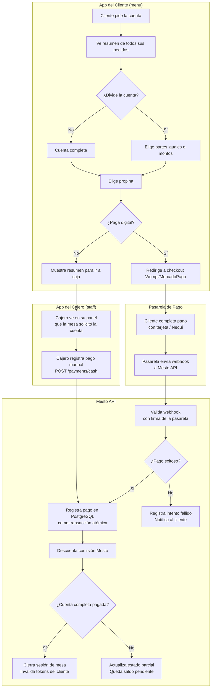

# PRD-005 — Pagos y Facturación

> **📜 Documento heredado de Mesto.** Se escribió para la plataforma SaaS multi-tenant de la que
> Mesto Beach se separó en agosto de 2026 (**ADR-023**), y su contenido sigue vigente salvo en
> tres puntos que **manda la documentación nueva**:
> - **Moneda**: los importes de este documento están en pesos colombianos. Hoy todo entero monetario
>   son **céntimos de euro** (**ADR-031**); los nombres de campo llevan el sufijo `Cents`.
> - **Facturación**: la emite el TPV del local, no nosotros (**ADR-028**). Ignora aquí cualquier
>   referencia a pasarelas o autoridades fiscales colombianas.
> - **Ejemplos**: los platos, precios y direcciones son de la época de Mesto y no reflejan la carta
>   ni el local de Playa Demo.
>
> Lo específico de este cliente está en **PRD-018** y en los **ADR-023…035**.

## Metadata

| Campo | Valor |
|---|---|
| **ID** | PRD-005 |
| **Versión** | 2.0 |
| **Estado** | Aprobado — v2.0 |
| **Fecha** | Junio 2026 |
| **Apps relacionadas** | `menu` (cliente paga), `staff` (cajero registra), `admin` (dueño configura) |
| **Módulos de API** | Payments, Orders, Identity |
| **Depende de** | PRD-001 (modelo de negocio), PRD-002 (flujo del cliente), PRD-003 (cajero) |
| **PRDs que dependen de este** | PRD-001 (los ingresos de Mesto vienen de aquí) |

---

## 1. Propósito y Objetivos

### Propósito

Definir cómo se manejan los pagos en Mesto: desde el pago digital por el cliente hasta el registro de pago en caja por el cajero. Este módulo es crítico para el modelo de negocio de Mesto (comisión por transacción) y para la operación financiera del restaurante.

### Objetivos

| # | Objetivo | Métrica |
|---|---|---|
| OBJ-01 | El pago digital debe ser tan simple que el cliente lo complete sin ayuda | < 60s desde "pedir cuenta" hasta "pago confirmado" |
| OBJ-02 | El sistema de pagos es 100% confiable (nunca se pierde un pago) | 0 pagos perdidos o duplicados |
| OBJ-03 | El restaurante puede elegir si quiere o no pagos digitales | Configuración en 1 clic desde Admin Panel |
| OBJ-04 | La división de cuenta es fluida para grupos | < 2 minutos para dividir y que cada persona pague |

---

## 2. Contexto y Problema que Resuelve

El pago al final de una comida es uno de los momentos de mayor fricción en un restaurante:
- Esperar que el mesero traiga la cuenta (5-10 min)
- Esperar que vuelva con el datáfono
- Dividir la cuenta manualmente entre varias personas
- No tener claridad sobre qué pidió cada quien

Mesto resuelve esto con pagos directamente desde el celular del cliente o con un resumen digital instantáneo para el cajero.

---

## 3. Usuarios

| Persona | Rol en el pago |
|---|---|
| Cliente Final | Paga su cuenta o parte de ella desde la app |
| Cajero | Registra pagos en efectivo, activa/desactiva pago digital por mesa |
| Dueño | Configura pasarela de pago, ve reportes de pagos |
| Mesto Ops | Configura el modelo de comisión por tenant |

---

## 4. Alcance

### In Scope — MVP
- Pago digital completo desde la app del cliente (Wompi y/o MercadoPago)
- Registro de pago en caja (efectivo, datáfono externo)
- Split bill: división igual entre N personas
- Split bill: pago parcial por monto específico
- Propina configurable (porcentajes o monto libre)
- Resumen de cuenta por sesión (todos los pedidos)
- Historial de pagos por sesión
- Webhook de confirmación de pasarela de pago
- Cobro de comisión de Mesto sobre transacciones digitales

### Out of Scope — MVP
- Facturación electrónica DIAN (v2)
- Reembolsos desde la plataforma (el restaurante maneja esto externamente)
- Pagos parciales con múltiples métodos en una sola cuenta (mitad digital, mitad efectivo)
- Integración con datáfonos físicos (Verifone, Ingenico)
- Cryptocurrency payments
- Suscripciones o planes de consumo prepagado

---

## 5. Flujo de Pagos — Diagrama



---

## 6. Historias de Usuario

### Épica 1: Pago digital desde la mesa

```
US-501
Como cliente,
quiero pagar mi cuenta completa desde mi celular con tarjeta o Nequi,
para no tener que ir a caja ni esperar al mesero con el datáfono.

Criterio de aceptación:
- En la vista "Mi cuenta" hay un botón claro "Pagar con tarjeta / Nequi"
- Me redirige al checkout de Wompi o MercadoPago (el configurado por el restaurante)
- Al completar el pago exitosamente, veo una pantalla de confirmación con el resumen
- La sesión de mesa se cierra automáticamente
- Recibo un comprobante visual del pago (número de transacción, monto, fecha)

US-502
Como cliente,
quiero que el proceso de pago sea seguro y que yo nunca ingrese mis datos de tarjeta en la app de Mesto,
para sentirme tranquilo con mis datos financieros.

Criterio de aceptación:
- Los datos de tarjeta se ingresan SOLO en el checkout de la pasarela certificada (Wompi/MercadoPago)
- Mesto nunca toca ni almacena números de tarjeta
- El checkout de la pasarela tiene el certificado SSL visible (candado en el navegador)
- La integración usa los SDKs oficiales de las pasarelas

US-503
Como cliente que pagó pero el pago falló en la pasarela,
quiero recibir un mensaje claro sobre qué pasó,
para saber si necesito intentarlo de nuevo o ir a caja.

Criterio de aceptación:
- Si el pago falla, veo un mensaje claro: "El pago no pudo procesarse"
- Se indica si puedo reintentar o si debo ir a caja
- El sistema no cobra ni registra un pago fallido
- La sesión de mesa permanece abierta para que pueda reintentar o pagar en caja
```

### Épica 2: Split Bill

```
US-504
Como cliente en un grupo,
quiero dividir la cuenta en partes iguales entre N personas,
para que sea justo y rápido sin hacer cálculos.

Criterio de aceptación:
- En la vista de cuenta hay una opción "Dividir la cuenta"
- Puedo seleccionar el número de personas (2-20)
- El sistema calcula automáticamente el monto por persona (incluyendo propina)
- Se genera un link o QR que cada persona puede usar para pagar su parte desde su celular
- La sesión se cierra cuando todas las partes hayan sido pagadas

US-505
Como cliente en un grupo,
quiero pagar solo lo que yo pedí, no dividir la cuenta equitativamente,
para ser justo con lo que consumió cada quien.

Criterio de aceptación:
- Hay una opción "Cada quien paga lo suyo"
- Cada persona puede ver y pagar solo los pedidos que hizo bajo su nombre
- Si alguien no paga su parte, el cajero puede cerrar la sesión manualmente y registrar el pago pendiente

US-506
Como cliente,
quiero agregar propina al momento de pagar,
para reconocer el buen servicio.

Criterio de aceptación:
- Antes del checkout se muestran las opciones de propina configuradas por el restaurante
- Las opciones típicas son: 5%, 10%, 15%, o "Otro monto"
- Si selecciono "Otro monto", puedo ingresar el valor exacto
- Puedo seleccionar 0% si no quiero dejar propina
- La propina se suma al total antes de procesar el pago
```

### Épica 3: Pago en caja

```
US-507
Como cajero,
quiero registrar un pago en efectivo cuando el cliente paga en caja,
para cerrar la cuenta de la mesa correctamente en el sistema.

Criterio de aceptación:
- Desde la vista de la sesión de mesa puedo seleccionar "Registrar pago en caja"
- Ingreso el monto recibido y el sistema calcula el cambio a devolver
- Al confirmar, la sesión se cierra y los tokens del cliente se invalidan
- Se registra el pago con método "Efectivo" en el historial de la sesión

US-508
Como cajero,
quiero ver el resumen completo de todos los pedidos de una mesa antes de cerrar la cuenta,
para asegurarme de que el total es correcto.

Criterio de aceptación:
- El resumen muestra todos los pedidos de la sesión activa: producto, cantidad, precio, estado
- Se muestra el total con y sin propina
- Si hay pedidos en estado "En preparación", el sistema muestra una advertencia antes de cerrar
- Puedo igualmente forzar el cierre si es necesario

US-509
Como cajero,
quiero poder manejar el caso donde una parte del grupo paga digital y otra en caja,
para no tener problemas cuando el grupo mezcla métodos de pago.

Criterio de aceptación:
- La vista del cajero muestra qué partes del split bill ya fueron pagadas (digital) y cuáles no
- Puedo registrar el pago en caja para las partes no pagadas digitalmente
- Al registrar todas las partes, la sesión se cierra automáticamente
```

### Épica 4: Configuración de pagos (Admin)

```
US-510
Como dueño,
quiero activar o desactivar los pagos digitales para mi restaurante,
para decidir si quiero ofrecer esa opción o no.

Criterio de aceptación:
- En Configuración del restaurante hay un toggle "Pagos digitales"
- Al activarlo, debo configurar mis credenciales de Wompi o MercadoPago
- Al desactivarlo, los clientes no ven la opción de pago digital — solo "Pagar en caja"
- El cambio aplica inmediatamente para todos los clientes conectados

US-511
Como dueño,
quiero configurar las opciones de propina que se le muestran a mis clientes,
para definir si quiero propina y en qué porcentajes.

Criterio de aceptación:
- Puedo definir los porcentajes de propina a mostrar (ej: 5%, 10%, 15%)
- Puedo activar o desactivar completamente la opción de propina
- Si la desactivo, la propina no aparece en el checkout del cliente

US-512
Como dueño,
quiero ver el historial de todos los pagos recibidos,
para llevar control de mis ingresos.

Criterio de aceptación:
- En el Admin Panel hay una sección de "Pagos"
- Veo cada pago: fecha, mesa, monto, método (digital/efectivo), estado
- Puedo filtrar por rango de fechas
- Puedo exportar el listado a CSV
```

---

## 7. Requisitos Funcionales

### RF-501 — Abstracción de pasarelas
- La lógica de pago en el backend es independiente de la pasarela
- Se puede agregar una nueva pasarela implementando una interfaz sin modificar la lógica de negocio
- MVP soporta: Wompi y MercadoPago
- El restaurante configura su propia cuenta de pasarela (no la cuenta de Mesto)

### RF-502 — Webhooks de pago
- Los webhooks de las pasarelas deben validarse con la firma provista por la pasarela
- Un webhook procesado exitosamente no debe volver a procesarse (idempotencia via `gateway_reference`)
- Los webhooks fallidos se reintentan automáticamente (máximo 3 reintentos)

### RF-503 — Transacciones atómicas
- El registro de un pago y el cierre de sesión deben ocurrir en la misma transacción de PostgreSQL
- Si el cierre de sesión falla, el pago se revierte
- Los pagos parciales (split bill) solo cierran la sesión cuando el total sea cubierto

### RF-504 — Comisión de Mesto
- La comisión de Mesto se calcula sobre el monto del pago (excluyendo propina)
- El porcentaje de comisión se configura por tenant desde Platform Admin
- El cálculo de comisión se registra en cada transacción para auditoría

### RF-505 — Estados de pago
- Los estados posibles de un pago son: `Pending`, `Completed`, `Failed`, `Refunded`
- Solo los pagos en estado `Completed` activan el cierre de sesión
- Los pagos en `Failed` no modifican ningún estado del pedido o sesión

---

## 8. Requisitos Técnicos

### RT-501 — Seguridad de pagos
- Mestó nunca almacena datos de tarjeta (PCI compliance - SAQ A)
- Todas las transacciones usan HTTPS
- Los webhooks se validan con firma HMAC provista por la pasarela
- Los montos se calculan siempre en el servidor — nunca se confía en montos enviados por el cliente

### RT-502 — Idempotencia
- El endpoint de registro de pago es idempotente via `gateway_reference`
- Múltiples webhooks del mismo pago no generan pagos duplicados

### RT-503 — Auditoría
- Cada pago registra: monto, método, gateway_reference, timestamp, userId que lo procesó
- Los pagos nunca se eliminan — solo se cambia su estado
- Cualquier cambio de estado queda en un log de auditoría inmutable

### RT-504 — Moneda
- MVP: COP (Peso Colombiano) únicamente
- Los montos se almacenan como enteros en centavos (o en pesos enteros sin decimales, que es la norma colombiana)
- v2: soporte multi-moneda

---

## 9. Criterios de Aceptación

- [ ] Un cliente puede pagar su cuenta completa en menos de 60 segundos
- [ ] Un pago fallido no cierra la sesión de mesa ni modifica el estado de los pedidos
- [ ] El mismo webhook de pago procesado dos veces no genera un pago duplicado
- [ ] El cajero puede registrar un pago en efectivo y la sesión se cierra correctamente
- [ ] El split bill divide correctamente el total incluyendo la propina configurada
- [ ] Las credenciales de la pasarela del restaurante se almacenan cifradas (Azure Key Vault)

---

## 10. Métricas de Éxito

| Métrica | Meta |
|---|---|
| Tasa de éxito de pagos digitales | > 95% |
| Tiempo promedio de checkout (digital) | < 60 segundos |
| % de sesiones con pago digital vs. caja | Meta: 40% digital para restaurantes que lo activan |
| Incidentes de doble cobro | 0 |

---

## 11. Open Questions

| # | Pregunta | Responsable |
|---|---|---|
| OQ-501 | ¿Wompi o MercadoPago primero? ¿Cuál tiene mejor penetración en Colombia? | Founders |
| OQ-502 | ¿Mesto cobra la comisión en el momento de la transacción o al mes? | Founders / Legal |
| OQ-503 | ¿Se emite algún comprobante al cliente? ¿Por email? ¿Por WhatsApp? | Product |
| OQ-504 | ¿Qué pasa si el restaurante quiere hacer un reembolso? ¿Mesto lo gestiona o es manual? | Product |
| OQ-505 | ¿El restaurante puede agregar cargos adicionales (servicio, descorche)? | Product |

---

*PRD-005 — Pagos y Facturación*
*Versión 2.0 — Junio 2026*
