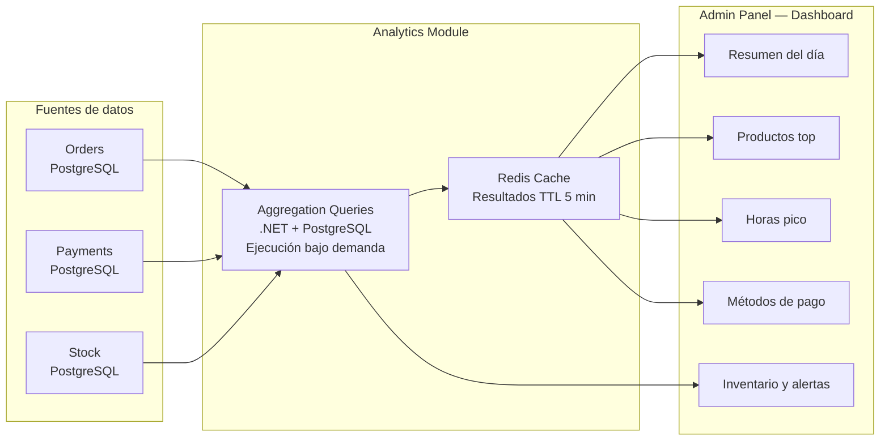

# PRD-006 — Analytics e Inventario

> **📜 Documento heredado de Mesto.** Se escribió para la plataforma SaaS multi-tenant de la que
> Mesto Beach se separó en agosto de 2026 (**ADR-023**), y su contenido sigue vigente salvo en
> tres puntos que **manda la documentación nueva**:
> - **Moneda**: los importes de este documento están en pesos colombianos. Hoy todo entero monetario
>   son **céntimos de euro** (**ADR-031**); los nombres de campo llevan el sufijo `Cents`.
> - **Facturación**: la emite el TPV del local, no nosotros (**ADR-028**). Ignora aquí cualquier
>   referencia a pasarelas o autoridades fiscales colombianas.
> - **Ejemplos**: los platos, precios y direcciones son de la época de Mesto y no reflejan la carta
>   ni el local de Playa Demo.
>
> Lo específico de este cliente está en **PRD-018** y en los **ADR-023…035**.

## Metadata

| Campo | Valor |
|---|---|
| **ID** | PRD-006 |
| **Versión** | 2.0 |
| **Estado** | Aprobado — v2.0 |
| **Fecha** | Junio 2026 |
| **Apps relacionadas** | `admin` (Dashboard del dueño) |
| **Módulos de API** | Analytics, Inventory |
| **Depende de** | PRD-001, PRD-002 (genera los datos), PRD-005 (pagos son la fuente de verdad de ingresos) |
| **PRDs que dependen de este** | Ninguno — este es un módulo de lectura/consulta |

---

## 1. Propósito y Objetivos

### Propósito

Definir las capacidades de analytics e inventario de Mesto para el dueño del restaurante. El objetivo es transformar los datos operacionales (pedidos, pagos, stock) en información accionable que el dueño pueda usar para tomar mejores decisiones de negocio.

### Objetivos

| # | Objetivo | Métrica |
|---|---|---|
| OBJ-01 | El dueño puede ver el resumen del día en menos de 10 segundos al abrir el Admin Panel | Dashboard carga en < 2s |
| OBJ-02 | El dueño identifica sus productos más y menos rentables sin conocimiento técnico | % de dueños que ajustan el menú tras ver analytics en el primer mes |
| OBJ-03 | El stock nunca llega a cero sin que el dueño lo sepa | Alertas de stock enviadas con al menos 10% de stock restante |

---

## 2. Contexto y Problema que Resuelve

El 80% de los dueños de restaurantes en Colombia no tienen datos de su operación. Sus decisiones sobre menú, precios y personal se basan en intuición. Saber que el "Chorizo del día" se vende el doble que la "Ensalada César" puede significar la diferencia entre un menú rentable y uno no.

El módulo de analytics de Mesto convierte los pedidos del día a día en un panel de control real para el negocio.

---

## 3. Usuarios

**Usuario primario:** Dueño / Administrador del restaurante (P2 en PRD-001)
**Usuario secundario:** Mesto Ops (para monitoreo de la plataforma)

---

## 4. Alcance

### In Scope — MVP
- Dashboard de resumen del día (ventas, pedidos, ticket promedio)
- Comparativa con período anterior (ayer, semana pasada, mes pasado)
- Ranking de productos más pedidos y menos pedidos
- Distribución de ventas por categoría
- Mapa de calor de pedidos por hora del día (horas pico)
- Tiempo promedio de preparación por estación (cocina vs barra)
- Resumen de métodos de pago (digital vs efectivo)
- Control de stock por producto (unidades disponibles)
- Alertas de stock bajo (configurable por producto)
- Ajuste manual de stock desde el Admin Panel
- Costo de producción por producto (ingresado manualmente por el dueño)
- Margen bruto por producto (precio - costo)

### Out of Scope — MVP
- Proyecciones y forecasting
- Comparativas entre sucursales (v2 — multi-sucursal)
- Integración con software contable (Siigo, Alegra) (v2)
- Exportación a herramientas de BI externas (Power BI, Tableau)
- Analytics de comportamiento del cliente en la app del menú (heatmaps, sesiones)
- Alertas automáticas vía WhatsApp o email (v2)
- Gestión de proveedores y órdenes de compra

---

## 5. Flujo de Datos — Analytics



---

## 6. Historias de Usuario

### Épica 1: Dashboard de ventas

```
US-601
Como dueño,
quiero ver un resumen de ventas del día al abrir el Admin Panel,
para saber cómo va el negocio sin tener que buscar la información.

Criterio de aceptación:
- El dashboard es la pantalla de inicio al hacer login
- Muestra de forma destacada: total vendido hoy, número de pedidos, ticket promedio
- Cada métrica tiene una flecha comparativa con el mismo día de la semana pasada
  (↑ verde si mejoró, ↓ rojo si bajó, → gris si igual)
- Los datos se actualizan cada 5 minutos automáticamente
- Puedo cambiar el período: Hoy / Esta semana / Este mes

US-602
Como dueño,
quiero ver cuánto vendí por categoría del menú,
para saber si las bebidas venden más que la comida o si debo reforzar alguna sección.

Criterio de aceptación:
- Gráfico de torta o barras mostrando % de ventas por categoría
- Puedo filtrar por período: hoy, esta semana, este mes
- Al hacer clic en una categoría, veo el detalle de productos de esa categoría

US-603
Como dueño,
quiero ver un resumen de los métodos de pago usados,
para saber cuánto recibí en efectivo y cuánto en digital.

Criterio de aceptación:
- Muestra: % de pagos en efectivo, % digital, montos totales de cada uno
- Útil para cuadrar la caja al final del día
```

### Épica 2: Análisis de productos

```
US-604
Como dueño,
quiero ver el ranking de mis productos más pedidos,
para saber qué es lo que más gusta y qué debo tener siempre disponible.

Criterio de aceptación:
- Lista ordenada de productos por cantidad de pedidos (descendente)
- Muestra: nombre, categoría, unidades vendidas, ingresos totales generados
- Puedo filtrar por período: hoy, esta semana, este mes
- Los primeros 3 productos tienen un badge visual destacado

US-605
Como dueño,
quiero ver mis productos menos pedidos,
para evaluar si debo quitarlos del menú o cambiar su precio.

Criterio de aceptación:
- Lista de los 10 productos con menos pedidos en el período
- Muestra la última vez que fue pedido
- Botón directo para ir a editar o desactivar ese producto

US-606
Como dueño,
quiero ver el margen de cada producto,
para saber cuáles son realmente rentables y cuáles no.

Criterio de aceptación:
- En la vista de analytics de productos puedo ver: precio de venta, costo de producción, margen bruto (% y monto)
- Los costos los ingreso yo manualmente (no se calculan automáticamente)
- Puedo ordenar por mayor margen o menor margen
- Los productos sin costo registrado muestran "Costo no configurado"
```

### Épica 3: Análisis temporal

```
US-607
Como dueño,
quiero ver en qué horas del día tengo más pedidos,
para decidir cuándo necesito más staff y cuándo puedo reducirlo.

Criterio de aceptación:
- Mapa de calor o gráfico de barras por hora del día (0h-23h)
- Puedo seleccionar el día de la semana para ver patrones (lunes vs sábado)
- Se destacan las 3 horas pico con un color diferente

US-608
Como dueño,
quiero ver el tiempo promedio que tarda cada estación en preparar los pedidos,
para identificar cuellos de botella en mi operación.

Criterio de aceptación:
- Muestra el tiempo promedio (en minutos) de la cocina y de la barra
- El tiempo se calcula desde que el pedido llega al KDS hasta que el staff lo marca como "Listo"
- Puedo comparar el tiempo promedio de esta semana vs la semana pasada
- Si el tiempo es alto, hay una sugerencia visual (ej: "La cocina tarda en promedio 22 min — ¿necesitas más personal?")
```

### Épica 4: Control de inventario

```
US-609
Como dueño,
quiero ver el stock actual de todos mis productos en un solo lugar,
para saber qué me queda y qué debo reabastecer.

Criterio de aceptación:
- Lista de todos los productos con su stock actual (unidades disponibles)
- Los productos con stock bajo se destacan con color amarillo o rojo
- Puedo ajustar el stock manualmente (ej: llegó nueva mercancía)
- Los cambios de stock se registran con timestamp para tener trazabilidad

US-610
Como dueño,
quiero configurar alertas de stock bajo por producto,
para que el sistema me avise antes de quedarme sin ingredientes.

Criterio de aceptación:
- Para cada producto puedo definir un umbral de "stock bajo" (ej: alerta cuando queden menos de 5 unidades)
- Cuando el stock baja del umbral, aparece una alerta en el dashboard del Admin Panel
- v2: También envía una notificación por email o push al dueño

US-611
Como dueño,
quiero que el stock se descuente automáticamente al recibir un pedido,
para no tener que hacerlo manualmente.

Criterio de aceptación:
- El descuento automático de stock es opcional y configurable por producto
- Si está activado, al confirmar un pedido se descuenta la unidad del stock
- Si el stock llega a 0 y el descuento automático está activo, el producto se marca automáticamente como "Agotado" en el menú del cliente
- El dueño puede desactivar el descuento automático para productos donde el control manual tiene más sentido

US-612
Como dueño,
quiero ingresar el costo de producción de cada plato,
para calcular el margen real de mi negocio.

Criterio de aceptación:
- Desde la vista de inventario puedo editar el costo de producción de cada producto
- El costo es un valor en COP que ingreso manualmente
- Al ingresar el costo, el sistema calcula automáticamente el margen: (precio_venta - costo) / precio_venta * 100
- El margen se muestra en la vista de analytics de productos (US-606)
```

---

## 7. Requisitos Funcionales

### RF-601 — Aggregations bajo demanda
- Los reportes se calculan en el momento de la request (no hay pre-cálculo batch)
- Los resultados se cachean en Redis por 5 minutos para no sobrecargar PostgreSQL
- El dueño puede forzar una actualización inmediata ("Actualizar ahora")

### RF-602 — Aislamiento por tenant
- Todos los queries de analytics aplican el filtro de `tenant_id` — un restaurante nunca ve datos de otro
- Los índices de PostgreSQL incluyen `tenant_id` como primer campo en todos los índices compuestos

### RF-603 — Períodos de análisis
- Los períodos soportados son: Hoy, Ayer, Esta semana, Semana pasada, Este mes, Mes pasado, Rango personalizado
- Las fechas se calculan en la zona horaria del restaurante (configurada en el tenant)

### RF-604 — Exportación de datos
- El dueño puede exportar cualquier reporte a CSV
- El CSV incluye todos los campos visibles en la tabla, más campos adicionales para análisis externo

### RF-605 — Historial de ajustes de stock
- Cada ajuste manual de stock registra: producto, cantidad anterior, cantidad nueva, fecha, usuario que lo hizo
- El historial de ajustes es visible para el dueño (últimos 30 días)

---

## 8. Requisitos Técnicos

### RT-601 — Performance de queries
- Los queries de analytics deben responder en menos de 3 segundos para 12 meses de historial
- Se usan índices en PostgreSQL: `(tenant_id, created_at)` en la tabla `orders`, `(tenant_id, paid_at)` en `payments`
- Para períodos largos (> 3 meses), se pagina la respuesta o se usa agregación incremental

### RT-602 — Caché de analytics
- Los resultados del dashboard principal se cachean en Redis con TTL de 5 minutos por tenant
- Al cerrar una sesión con pago, se invalida el caché del tenant correspondiente para que el dashboard refleje la venta inmediatamente

### RT-603 — Separación del módulo de Analytics
- El módulo de Analytics **no debe** afectar la performance del módulo de Orders
- Las queries de analytics usan una conexión de solo lectura a PostgreSQL (read replica si el negocio lo justifica en el futuro)
- Si una query de analytics tarda más de 5 segundos, se cancela y se muestra un error amigable

---

## 9. Diseño de Pantallas (Wireframes Conceptuales)

```
DASHBOARD PRINCIPAL (Admin Panel)
┌────────────────────────────────────────────────────────────┐
│ 🏠 La Parrilla  •  Panel de Control          [Hoy ▼]      │
├──────────────┬──────────────┬──────────────┬───────────────┤
│ Total Ventas │   Pedidos    │    Ticket    │  Mesas        │
│  $842.000    │     43       │  promedio    │  atendidas    │
│  ↑ 12% vs.  │  ↑ 8% vs.   │  $19.581     │    11         │
│  ayer        │  ayer        │  ↑ 4%        │              │
├──────────────┴──────────────┴──────────────┴───────────────┤
│                                                            │
│  Ventas por hora                        Ventas por categoría│
│  ████░░░████████████░░░░░░░░░░░         Carnes    42%  ████│
│  08 09 10 11 12 13 14 15 16 17 18       Bebidas   28%  ███ │
│                                         Entradas  18%  ██  │
│                                         Postres   12%  █   │
├────────────────────────────────────────────────────────────┤
│  Top 5 Productos Hoy                                       │
│  1. Chorizo Santarrosano  x18  $324.000  ████████████      │
│  2. Limonada de coco      x15  $180.000  ██████████        │
│  3. Costilla BBQ 500g     x11  $462.000  ███████           │
│  4. Ensalada de la casa   x8   $96.000   █████             │
│  5. Jugo natural          x7   $63.000   ████              │
└────────────────────────────────────────────────────────────┘

INVENTARIO
┌────────────────────────────────────────────────────────────┐
│ 📦 Inventario                              [+ Ajustar]     │
├───────────────────┬────────┬────────┬────────┬────────────┤
│ Producto          │ Stock  │ Alerta │ Costo  │ Margen     │
├───────────────────┼────────┼────────┼────────┼────────────┤
│ Chorizo Santarros │  24    │ < 5    │$8.000  │ 56%        │
│ Costilla BBQ 500g │  🔴 3  │ < 5    │$18.000 │ 57%        │
│ Limonada de Coco  │  15    │ < 8    │$3.000  │ 75%        │
│ Ensalada de Casa  │  ⚠️ 6  │ < 10   │$4.500  │ 63%        │
└───────────────────┴────────┴────────┴────────┴────────────┘
```

---

## 10. Criterios de Aceptación

- [ ] El dashboard carga en menos de 2 segundos con datos de los últimos 30 días
- [ ] Las ventas del día se reflejan en el dashboard en menos de 5 minutos
- [ ] El ranking de productos muestra correctamente los más vendidos del período seleccionado
- [ ] Al llegar al umbral de stock bajo, aparece una alerta visible en el dashboard
- [ ] El descuento automático de stock descuenta exactamente la cantidad pedida al confirmar el pedido
- [ ] Los datos de un restaurante A nunca aparecen en el dashboard del restaurante B

---

## 11. Métricas de Éxito

| Métrica | Meta |
|---|---|
| % de dueños que abren el dashboard al menos 3 veces por semana | > 60% |
| % de restaurantes con costos de producción configurados | > 40% al mes 3 |
| Tiempo de respuesta P95 del dashboard | < 3 segundos |

---

## 12. Open Questions

| # | Pregunta | Responsable | Estado |
|---|---|---|---|
| OQ-601 | ¿Se envían alertas de stock por email o push en el MVP, o solo en el dashboard? | Product | **Resuelto**: Solo en el dashboard del Admin Panel (sección Alertas). Sin email ni push por alertas de stock en MVP. |
| OQ-602 | ¿El historial de analytics se guarda indefinidamente o tiene un límite (ej: 12 meses)? | Tech | **Resuelto**: Indefinido en MVP. El dueño puede ver todo su historial desde que creó su cuenta, sin fecha de expiración en la UI. |
| OQ-603 | ¿Se incluye un reporte de "sesiones que escanearon pero no pidieron"? (análisis de conversión) | Product | **Resuelto**: No en MVP. El analytics solo incluye sesiones con al menos un pedido. Métrica de conversión QR→pedido en v2. |
| OQ-604 | ¿El dueño puede ver el tiempo de preparación por cocinero individual? (performance del staff) | Product | **Resuelto**: No en MVP. El KDS no asigna cocineros a ítems; no hay reporte de preparación por persona. Sin asignación individual en v1. |

---

*PRD-006 — Analytics e Inventario*
*Versión 2.1 — Junio 2026 — OQs cerrados: 601 (alertas stock solo en dashboard MVP), 602 (historial indefinido MVP), 603 (sin reporte sesiones sin pedido MVP), 604 (sin asignación por cocinero MVP)*
