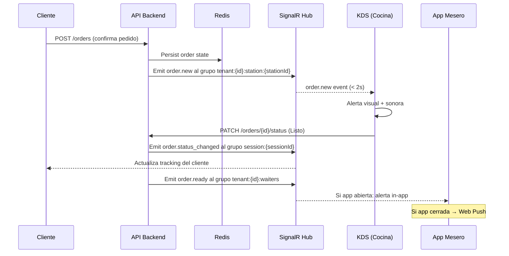

# PRD-008 — Notificaciones y Comunicación

> **📜 Documento heredado de Mesto.** Se escribió para la plataforma SaaS multi-tenant de la que
> Mesto Beach se separó en agosto de 2026 (**ADR-023**), y su contenido sigue vigente salvo en
> tres puntos que **manda la documentación nueva**:
> - **Moneda**: los importes de este documento están en pesos colombianos. Hoy todo entero monetario
>   son **céntimos de euro** (**ADR-031**); los nombres de campo llevan el sufijo `Cents`.
> - **Facturación**: la emite el TPV del local, no nosotros (**ADR-028**). Ignora aquí cualquier
>   referencia a pasarelas o autoridades fiscales colombianas.
> - **Ejemplos**: los platos, precios y direcciones son de la época de Mesto y no reflejan la carta
>   ni el local de Playa Demo.
>
> Lo específico de este cliente está en **PRD-018** y en los **ADR-023…035**.

## Metadata

| Campo | Valor |
|---|---|
| **ID** | PRD-008 |
| **Versión** | 1.0 |
| **Estado** | Aprobado |
| **Fecha** | Junio 2026 |
| **Apps relacionadas** | `staff` (incl. `/salon`), `customer` |
| **Módulos de API** | Notifications, Orders, Sessions |
| **Depende de** | PRD-002 (eventos del cliente), PRD-003 (eventos del staff) |
| **PRDs que dependen de este** | PRD-011 (alerta de auto-sesión), PRD-003 (push al mesero) |

---

## 1. Propósito y Objetivos

### Propósito

Definir el sistema de notificaciones de Mesto: cómo el sistema comunica eventos relevantes a los distintos actores (clientes, staff, dueños) en tiempo real y de forma asíncrona. Las notificaciones son el tejido conectivo que mantiene a todos sincronizados sin necesidad de polling o recarga manual.

### Objetivos

| # | Objetivo | Métrica |
|---|---|---|
| OBJ-01 | El staff recibe notificaciones críticas en menos de 2 segundos | Latencia P95 < 2s |
| OBJ-02 | El mesero puede recibir push aunque la app esté en segundo plano | Web Push funcional en iOS 16.4+ y Android |
| OBJ-03 | Las notificaciones son configurables por rol — no hay spam | Staff puede silenciar tipos de alerta no críticos |
| OBJ-04 | Cero notificaciones perdidas por reconexión de SignalR | Re-fetch de missed events al reconectar |

---

## 2. Canales de Notificación

Mesto utiliza dos canales complementarios:

| Canal | Tecnología | Cuándo se usa |
|---|---|---|
| **In-app (tiempo real)** | SignalR | Staff con la app abierta: KDS, cajero, dashboard |
| **Web Push** | Web Push API (VAPID) | Mesero con app en background o pantalla bloqueada |

> **Fuera de scope:** SMS, email transaccional (solo email de sistema: registro, invitación), notificaciones push nativas de apps móviles, email marketing.

---

## 3. Taxonomía de Eventos

### 3.1 Eventos del cliente → staff

| Evento | Canal | Destinatario | Prioridad |
|---|---|---|---|
| `order.new` | SignalR + Sonido KDS | KDS de la estación correspondiente | Crítica |
| `session.auto_created` | SignalR | Cajero | Alta |
| `session.participant_joined` | SignalR | Cajero | Media |
| `waiter.called` | SignalR + Web Push | Mesero asignado / todos los meseros | Alta |
| `pin.requested` | SignalR + Sonido | Mesero / cajero (grupo `waiter-{tenantId}`) | Alta |
| `bill.requested` | SignalR | Cajero / mesero asignado (grupo `waiter-{tenantId}`) | Alta |
| `payment.digital_initiated` | SignalR | Cajero | Media |

> `bill.requested` lo dispara el cliente con "Pedir la cuenta" (PRD-002 US-114). Mismo patrón que `waiter.called`: `POST /sessions/{id}/request-bill` emite `BILL_REQUESTED` al grupo `waiter-{tenantId}`; el cashdesk lo recibe en tiempo real. Ver PRD-003 RF-309 / US-328.

> `pin.requested` lo dispara el cliente desde el modal de PIN del menú cuando su mesa (QR **fijo**) exige PIN para ordenar y no lo conoce (PRD-002 US-119). `POST /sessions/{id}/request-pin` emite `PIN_REQUESTED` al grupo `waiter-{tenantId}` con `reason: "PIN"`; se persiste en Redis (TTL 4 h, mismo store que `waiter.called`) para que un mesero que se reconecta siga viéndolo. El mesero lee el PIN de la mesa en su pantalla y lo dicta; el cliente lo ingresa y el pedido se reintenta. **El PIN es único por mesa, no por persona.** Las sesiones con QR **dinámico** no exigen PIN (ver PRD-002 §QR/PIN), por lo que este evento solo ocurre en mesas de QR fijo.

### 3.2 Eventos del staff → cliente

| Evento | Canal | Destinatario | Prioridad |
|---|---|---|---|
| `order.status_changed` | SignalR | Cliente de esa sesión | Alta |
| `session.closed` | SignalR | Todos los participantes de la sesión | Crítica |
| `order.cancelled` | SignalR | Cliente de ese pedido | Alta |

### 3.3 Eventos del sistema → dueño/admin

| Evento | Canal | Destinatario | Prioridad |
|---|---|---|---|
| `stock.low_alert` | In-app (dashboard) | Dueño / Admin | Media |
| `payment.failed` | In-app (dashboard) | Dueño / Admin | Alta |

---

## 4. Flujo de Notificación



---

## 5. Historias de Usuario

### Épica 1: Notificaciones del KDS

```
US-801
Como cocinero,
quiero recibir una alerta sonora y visual cada vez que llega un pedido nuevo,
para nunca perder un pedido aunque no esté mirando la pantalla.

Criterio de aceptación:
- Al llegar un pedido nuevo, la pantalla parpadea brevemente y suena un tono
- Si hay múltiples pedidos nuevos en segundos, se emite un sonido por cada uno
- El sonido puede desactivarse desde la interfaz (para ambientes con mucho ruido)
- El sonido funciona en browsers de tablets Android y iPads

US-802
Como cocinero,
quiero que los pedidos lleguen ordenados por hora en el KDS,
para preparar primero el que lleva más tiempo esperando.

Criterio de aceptación:
- Los pedidos se muestran con un timer desde que llegaron
- Los pedidos más antiguos aparecen primero (arriba a la izquierda)
- El timer se actualiza en tiempo real
- Los pedidos con más de 15 minutos de espera se destacan visualmente en rojo
```

### Épica 2: Web Push para el Mesero

```
US-803
Como mesero,
quiero recibir una notificación push en mi celular cuando un pedido esté listo,
para saber que debo ir a buscarlo aunque tenga el celular guardado.

Criterio de aceptación:
- La primera vez que abro la app, se solicita permiso de notificaciones
- Las notificaciones llegan aunque la app esté en background
- La notificación muestra: "Mesa X — [nombre del plato] listo"
- Al tocar la notificación, la app se abre en la pantalla de alertas
- Funciona en iOS 16.4+ y Android

US-804
Como mesero,
quiero recibir una notificación cuando un cliente me llama desde la app,
para responder sin que el cliente tenga que levantarse.

Criterio de aceptación:
- La notificación push llega con: "Mesa X te llama"
- Puedo marcar el llamado como atendido desde la notificación (si el sistema lo soporta)
- Si no tengo push activado, la alerta aparece en la sección de alertas de la app al abrirla
```

### Épica 3: Notificaciones del Cajero

```
US-805
Como cajero,
quiero ver una alerta cuando se auto-crea una sesión en modo self-service,
para saber qué mesas están siendo ocupadas sin que yo las haya abierto.

Criterio de aceptación:
- La alerta aparece como un toast/banner en la esquina superior derecha
- Contiene: número de mesa y hora de creación
- Persiste en pantalla por 30 segundos o hasta que la descarte
- También aparece en un historial de alertas recientes
- Si hay más de una alerta simultánea, se apilan

US-806
Como cajero,
quiero ver en tiempo real cuántos participantes se unen a cada mesa activa,
para saber la ocupación del salón sin preguntar.

Criterio de aceptación:
- El contador de participantes en cada mesa del panel se actualiza en tiempo real
- Al unirse un nuevo participante, el número cambia sin recargar la página
- No hay alerta disruptiva por cada nuevo participante (solo el contador actualiza)
```

### Épica 4: Configuración de Notificaciones

```
US-807
Como cajero o cocinero,
quiero poder configurar qué tipos de alertas quiero recibir y cómo,
para no ser interrumpido por notificaciones que no me son relevantes.

Criterio de aceptación:
- En la configuración de la app hay una sección "Mis notificaciones"
- Puedo activar o desactivar por tipo: pedido nuevo, llamado mesero, etc.
- No puedo desactivar las notificaciones marcadas como "críticas" (session.closed, order.cancelled)
- La configuración se guarda por usuario y persiste entre sesiones
```

---

## 6. Requisitos Técnicos

### RT-801 — Grupos SignalR
- Cada tenant tiene grupos nombrados: `tenant:{tenantId}:station:{stationId}`, `tenant:{tenantId}:cashdesk`, `tenant:{tenantId}:waiters`, `session:{sessionId}`
- Al conectar, el cliente/staff se suscribe al grupo correspondiente según su rol y JWT
- Al desconectar, SignalR limpia la suscripción automáticamente

### RT-802 — Web Push (VAPID)
- El backend genera las VAPID keys una vez y las persiste en Key Vault
- Al registrarse para push, el frontend envía el `PushSubscription` al backend que lo almacena por usuario
- El backend usa la librería `WebPush` para enviar notificaciones
- Si el push falla (suscripción expirada), se elimina del backend y se registra un warning en logs

### RT-803 — Mensajes perdidos al reconectar
- Al reconectar SignalR, el cliente envía `lastEventTimestamp` al hub
- El hub hace un replay de los eventos posteriores a ese timestamp desde Redis Stream (TTL: 5 minutos)
- Si han pasado más de 5 minutos, se hace un GET completo del estado en lugar de replay

### RT-804 — Rate limiting de notificaciones
- Máximo 10 notificaciones por segundo por tenant en el hub (throttling a nivel de grupo)
- En picos (ej: 50 pedidos a la vez al abrir el restaurante), se encolan y emiten en batches

---

## 7. Criterios de Aceptación

- [ ] Un pedido nuevo aparece en el KDS con alerta visual+sonora en menos de 2 segundos
- [ ] El mesero recibe Web Push con app cerrada en iOS 16.4+ y Android
- [ ] El cajero recibe el toast de auto-sesión en menos de 2 segundos
- [ ] Al reconectar SignalR, no se pierden pedidos que llegaron durante la desconexión
- [ ] El staff puede configurar sus preferencias de alerta por tipo

---

## 8. Métricas de Éxito

| Métrica | Meta |
|---|---|
| Latencia P95 de notificaciones in-app | < 2s |
| % de meseros con Web Push activo | > 70% |
| Notificaciones perdidas por reconexión | 0 |

---

## 9. Open Questions

| # | Pregunta | Responsable | Estado |
|---|---|---|---|
| OQ-801 | ¿El dueño recibe notificaciones de ciertos eventos fuera del horario (ej: pago fallido a las 2am)? | Product | **Resuelto**: Solo alertas críticas fuera de horario (stock bajo, error de sistema) vía push/email. Las notificaciones operativas del día (pedidos, sesiones activas) solo se ven en el dashboard al ingresar al Admin Panel. |
| OQ-802 | ¿Los clientes deben recibir Web Push cuando su pedido está listo? | Product | **Resuelto**: Sin Web Push para el cliente en MVP. El estado del pedido se actualiza en tiempo real vía SignalR en la pantalla del cliente. |

---

*PRD-008 — Notificaciones y Comunicación*
*Versión 1.1 — Junio 2026 — OQs cerrados: 801 (solo alertas críticas fuera de horario), 802 (sin Web Push cliente MVP)*
