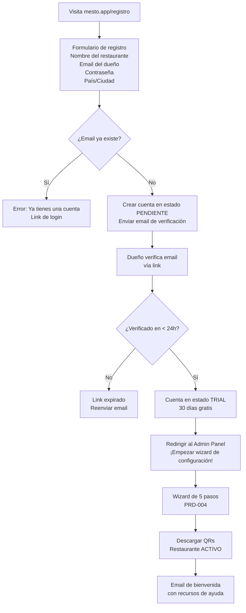

# PRD-009 — Onboarding Self-Service del Restaurante

> **📜 Documento heredado de Mesto.** Se escribió para la plataforma SaaS multi-tenant de la que
> Mesto Beach se separó en agosto de 2026 (**ADR-023**), y su contenido sigue vigente salvo en
> tres puntos que **manda la documentación nueva**:
> - **Moneda**: los importes de este documento están en pesos colombianos. Hoy todo entero monetario
>   son **céntimos de euro** (**ADR-031**); los nombres de campo llevan el sufijo `Cents`.
> - **Facturación**: la emite el TPV del local, no nosotros (**ADR-028**). Ignora aquí cualquier
>   referencia a pasarelas o autoridades fiscales colombianas.
> - **Ejemplos**: los platos, precios y direcciones son de la época de Mesto y no reflejan la carta
>   ni el local de Playa Demo.
>
> Lo específico de este cliente está en **PRD-018** y en los **ADR-023…035**.

## Metadata

| Campo | Valor |
|---|---|
| **ID** | PRD-009 |
| **Versión** | 1.1 |
| **Estado** | Aprobado |
| **Fecha** | Junio 2026 |
| **Apps relacionadas** | `platform` (página pública de registro), `admin` (wizard post-registro) |
| **Módulos de API** | Identity, Billing |
| **Depende de** | PRD-001 (modelo de negocio), PRD-004 (wizard de configuración), PRD-014 (flujos de login post-registro) |
| **PRDs que dependen de este** | Todos los demás (el restaurante debe existir para usar el sistema) |

---

## 1. Propósito y Objetivos

### Propósito

Definir el proceso completo por el que un restaurante nuevo se registra en Mesto, activa su cuenta y llega a su primer QR operativo, sin intervención del equipo de Mesto. El onboarding self-service es la principal palanca de crecimiento escalable de la plataforma.

### Objetivos

| # | Objetivo | Métrica |
|---|---|---|
| OBJ-01 | Un restaurante puede registrarse y tener su primer QR activo sin hablar con nadie | Time-to-first-QR < 15 minutos |
| OBJ-02 | La tasa de conversión de visita de registro → QR activo sea mayor al 60% | Medido en funnel analytics |
| OBJ-03 | El 90% de los restaurantes registrados no requiere soporte durante las primeras 72 horas | Tickets de soporte en primeras 72h < 10% |

---

## 2. Alcance

### In Scope
- Página pública de registro (mesto.app/registro)
- Verificación de email del dueño
- Selección de plan (comisión por transacción vs. suscripción)
- Wizard de configuración inicial guiado (PRD-004)
- Email de bienvenida con links y recursos de ayuda
- Estado del restaurante: `TRIAL → ACTIVE → SUSPENDED`
- Panel de Mesto Ops para ver y gestionar restaurantes registrados

### Out of Scope
- Integración de pago para suscripción mensual (en MVP la comisión es el modelo por defecto; suscripción se activa manualmente por Mesto Ops)
- KYC/verificación de identidad del negocio (v2)
- Programa de referidos (v2)

---

## 3. Flujo de Registro



---

## 4. Estados del Restaurante (Tenant)

| Estado | Descripción | Restricciones |
|---|---|---|
| `PENDING` | Registro iniciado, email no verificado | No puede operar, no puede acceder al admin |
| `TRIAL` | Email verificado, período de prueba de 30 días | Operación completa; comisión diferida hasta activar plan |
| `ACTIVE` | Plan seleccionado y activo | Sin restricciones |
| `SUSPENDED` | Pago pendiente o violación de términos | Clientes ven "Restaurante no disponible"; staff no puede operar |
| `CANCELLED` | Cuenta cancelada voluntariamente | Datos retenidos 90 días, luego eliminados |

---

## 5. Historias de Usuario

### Épica 1: Registro Inicial

```
US-901
Como dueño de restaurante interesado en Mesto,
quiero poder registrarme en menos de 2 minutos sin necesidad de hablar con nadie,
para evaluar el sistema sin compromiso.

Criterio de aceptación:
- El formulario de registro tiene solo 4 campos: nombre del restaurante, email, contraseña, ciudad
- El campo "nombre del restaurante" sugiere automáticamente el slug disponible
- Puedo ver si el slug está disponible en tiempo real mientras lo escribo
- Al enviar, recibo el email de verificación en menos de 1 minuto
- No se pide tarjeta de crédito en el registro

US-902
Como dueño,
quiero recibir un email de verificación inmediatamente después de registrarme,
para confirmar mi cuenta y empezar a configurar el restaurante.

Criterio de aceptación:
- El email llega en menos de 2 minutos
- El link de verificación es válido por 24 horas
- Si el link expira, puedo solicitar uno nuevo desde la pantalla de login
- El email tiene el nombre del restaurante registrado para que reconozca la cuenta

US-903
Como dueño recién verificado,
quiero que el sistema me lleve directamente al wizard de configuración,
para no tener que buscar por dónde empezar.

Criterio de aceptación:
- Al verificar el email, soy redirigido automáticamente al Admin Panel ya autenticado
- Una pantalla de bienvenida explica los pasos siguientes y el período de trial de 30 días
- El wizard de configuración (PRD-004) inicia automáticamente
- Puedo saltarme el wizard y explorarlo por mi cuenta
- Mi sesión dura 8 horas con refresh automático (ver PRD-014 §Flujo 1 para detalles de tokens)
- Si en el futuro olvido mi contraseña, el flujo de reset está en PRD-014 §Flujo 3
```

### Épica 2: Plan y Facturación

```
US-904
Como dueño en período de trial,
quiero entender claramente cuándo y cómo se activa el cobro,
para tomar la decisión de continuar con información completa.

Criterio de aceptación:
- En el dashboard hay un banner visible con los días de trial restantes
- Al llegar a 7 días antes del fin del trial, recibo un email con las opciones de plan
- Las opciones de plan son claramente comparables: comisión X% vs. suscripción $Y/mes
- Al seleccionar plan, Mesto Ops recibe una notificación para hacer el seguimiento

US-905
Como Mesto Ops,
quiero ver todos los restaurantes registrados y su estado de trial/plan,
para hacer seguimiento proactivo y convertirlos a clientes activos.

Criterio de aceptación:
- En el Platform Admin hay una lista de todos los tenants con: nombre, fecha de registro, estado, días de trial
- Puedo filtrar por estado (TRIAL, ACTIVE, SUSPENDED, PENDING)
- Puedo extender el período de trial de un restaurante
- Puedo cambiar el estado de un restaurante manualmente
- Puedo ver el progreso del wizard de configuración (qué pasos completó)
```

### Épica 3: Suspensión y Cancelación

```
US-906
Como dueño cuya cuenta fue suspendida,
quiero entender claramente por qué y cómo reactivarla,
para resolver el problema lo antes posible.

Criterio de aceptación:
- Al entrar al Admin Panel en estado SUSPENDED, veo una pantalla clara con el motivo
- Si es por pago pendiente, veo las instrucciones de pago
- Si es por violación de términos, veo el motivo específico y el canal de contacto
- Hay un email automático enviado al momento de la suspensión

US-907
Como dueño,
quiero poder cancelar mi cuenta en cualquier momento,
para no sentirme atrapado en el servicio.

Criterio de aceptación:
- Desde la configuración de la cuenta hay una opción "Cancelar cuenta"
- Se muestra un resumen de lo que se perderá (datos, QRs, historial)
- Se ofrece la opción de exportar todos los datos antes de cancelar
- La cancelación requiere escribir "CONFIRMAR" para evitar cancelaciones accidentales
- Los datos se retienen por 90 días antes de eliminarse definitivamente
```

---

## 6. Emails del Sistema

| Trigger | Asunto | Contenido |
|---|---|---|
| Registro | "Verifica tu email — Mesto" | Link de verificación + instrucciones |
| Verificación exitosa | "¡Bienvenido a Mesto, [nombre]!" | Link al Admin + recursos de inicio |
| 7 días antes de fin del trial | "Tu trial de Mesto termina en 7 días" | Opciones de plan + CTA |
| Suspensión | "Tu cuenta de Mesto ha sido suspendida" | Motivo + pasos para reactivar |
| Cancelación | "Tu cuenta ha sido cancelada" | Confirmación + info sobre retención de datos |

---

## 7. Requisitos Técnicos

### RT-901 — Aislamiento de datos desde el primer día
- El `tenantId` se genera al crear la cuenta (UUID v4)
- Todos los recursos creados durante el wizard se asocian al `tenantId` desde el primer momento
- No hay datos "compartidos" entre tenants — ni siquiera en período de trial

### RT-902 — Email transaccional
- Proveedor: SendGrid (o equivalente configurable en Key Vault)
- Los templates de email se gestionan en el proveedor, no hardcodeados en el backend
- Todos los emails incluyen un link de cancelación de marketing al pie

### RT-903 — Idempotencia del registro
- Si el mismo email intenta registrarse dos veces, no se crea un duplicado
- Si el registro falla a mitad (ej: error de red), el proceso puede retomarse con el mismo email

---

## 8. Criterios de Aceptación

- [ ] Un restaurante puede completar el registro y verificación de email en menos de 5 minutos
- [ ] Al verificar el email, el dueño llega directamente al wizard de configuración
- [ ] Un restaurante en estado SUSPENDED no puede que sus clientes hagan pedidos
- [ ] Mesto Ops puede ver todos los tenants y cambiar su estado desde el Platform Admin
- [ ] El proceso de cancelación incluye la opción de exportar datos

---

## 9. Métricas de Éxito

| Métrica | Meta |
|---|---|
| Tasa de conversión registro → QR activo | > 60% |
| Time-to-first-QR (desde registro hasta primer QR descargado) | < 15 minutos |
| Restaurantes que requieren soporte en primeras 72h | < 10% |

---

## 10. Open Questions

| # | Pregunta | Responsable |
|---|---|---|
| OQ-901 | ¿El período de trial es de 30 días o diferente según el plan? | Product + Biz |
| OQ-902 | ¿Se requiere verificación del negocio (RUT, NIT) antes de activar el plan de comisión? | Legal + Biz |
| OQ-903 | ¿El dueño puede tener múltiples restaurantes bajo el mismo email? | Product |

---

*PRD-009 — Onboarding Self-Service del Restaurante*
*Versión 1.0 — Junio 2026*
