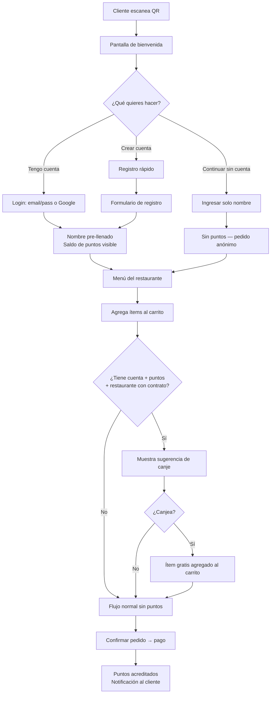

# PRD-012 — Fidelización y Cuentas de Cliente

> **📜 Documento heredado de Mesto.** Se escribió para la plataforma SaaS multi-tenant de la que
> Mesto Beach se separó en agosto de 2026 (**ADR-023**), y su contenido sigue vigente salvo en
> tres puntos que **manda la documentación nueva**:
> - **Moneda**: los importes de este documento están en pesos colombianos. Hoy todo entero monetario
>   son **céntimos de euro** (**ADR-031**); los nombres de campo llevan el sufijo `Cents`.
> - **Facturación**: la emite el TPV del local, no nosotros (**ADR-028**). Ignora aquí cualquier
>   referencia a pasarelas o autoridades fiscales colombianas.
> - **Ejemplos**: los platos, precios y direcciones son de la época de Mesto y no reflejan la carta
>   ni el local de Playa Demo.
>
> Lo específico de este cliente está en **PRD-018** y en los **ADR-023…035**.

## Metadata

| Campo | Valor |
|---|---|
| **ID** | PRD-012 |
| **Versión** | 2.0 |
| **Estado** | Aprobado |
| **Fecha** | Junio 2026 |
| **Apps relacionadas** | `customer` (menú web), `admin` (panel restaurante), `platform` (back-office Mesto) |
| **Módulos de API** | Identity, Orders, Loyalty |
| **Depende de** | PRD-002 (flujo cliente), PRD-009 (onboarding), PRD-010 (seguridad y datos personales), PRD-015 (back-office — contratos de fidelización) |
| **PRDs que dependen de este** | PRD-006 (analytics — historial de clientes), PRD-005 (pagos — canje mixto) |

---

## Changelog

| Versión | Fecha | Cambios |
|---|---|---|
| 1.0 | Jun 2026 | Versión inicial — cuentas de cliente, historial, favoritos. Puntos marcados como v2 |
| 2.0 | Jun 2026 | Reescritura completa: Red de Lealtad Mesto (cross-tenant), programa de puntos canjeables, contratos Mesto-restaurante, settlement en billing, registro self-service con Google |

---

## 1. Propósito y Objetivos

### Propósito

Definir el sistema de cuentas de cliente y el **Programa de Lealtad Mesto** — una red de fidelización cross-tenant donde el cliente acumula puntos en cualquier restaurante de la plataforma y los canjea por ítems gratis.

A diferencia de los programas de fidelización por restaurante, el **Programa Mesto** es:
- **Gestionado por Mesto**, no por cada restaurante individualmente
- **Negociado en contrato**: la tasa de acumulación, los ítems elegibles y el precio en puntos se definen entre Mesto y el restaurante
- **Financiado por Mesto**: cuando un cliente canjea puntos, Mesto cubre el costo del ítem y lo deduce del billing mensual del restaurante

### Objetivos

| # | Objetivo | Métrica |
|---|---|---|
| OBJ-01 | Los pedidos anónimos siguen funcionando sin cuenta | 100% de flujos de pedido sin fricción de registro |
| OBJ-02 | Los clientes frecuentes crean cuenta Mesto para acumular puntos | > 30% de pedidos en restaurantes con programa activo vinculados a cuenta |
| OBJ-03 | Los restaurantes participantes aumentan la frecuencia de visita de sus clientes Mesto | > 20% más visitas en clientes con cuenta vs. anónimos (6 meses) |
| OBJ-04 | El canje de puntos no genera fricción en el flujo de pedido | ≥ 85% de clientes que ven la sugerencia de canje la completan |

---

## 2. Alcance

### In Scope
- Registro de cuenta de cliente: email + contraseña o Google OAuth
- Historial de pedidos propios (todos los restaurantes Mesto)
- Pre-llenado de nombre al escanear un QR
- Lista de restaurantes favoritos
- Gestión de cuenta: nombre, cambio de contraseña, eliminación
- **Programa de Lealtad Mesto**: acumulación de puntos cross-tenant
- **Canje**: ítems gratuitos del menú (lista negociada por contrato)
- **Perfil de puntos**: saldo, historial de movimientos
- **Notificaciones de puntos**: al ganar, al canjear, alerta de "puntos suficientes"
- **Contrato de fidelización**: entidad gestionada desde el back-office de Mesto (PRD-015)

### Out of Scope
- Niveles/Tiers de membresía (bronce/plata/oro) — v2
- Wallet de Mesto (crédito prepagado) — v2
- Transferencia de puntos entre clientes — no aplica
- Puntos con vencimiento — no aplica (los puntos no vencen)
- Zonas o límites de puntos por restaurante — no aplica (cross-tenant)

---

## 3. Modelo de Datos

### 3.1 Cuenta de Cliente

La cuenta de cliente es **cross-tenant**: una sola cuenta por email que funciona en todos los restaurantes de la red Mesto.

```sql
customer_accounts {
    id:             UUID (PK)
    email:          VARCHAR UNIQUE NOT NULL
    name:           VARCHAR NOT NULL
    phone:          VARCHAR (nullable)
    birth_date:     DATE (nullable)
    password_hash:  VARCHAR (nullable — null si usa solo OAuth)
    google_id:      VARCHAR (nullable — null si usa solo email/password)
    loyalty_points: INTEGER DEFAULT 0 NOT NULL
    created_at:     TIMESTAMP
    last_login:     TIMESTAMP
}

customer_favorites {
    customer_id: UUID (FK → customer_accounts)
    tenant_id:   UUID (FK → tenants)
    added_at:    TIMESTAMP
    PRIMARY KEY (customer_id, tenant_id)
}
```

Los pedidos en `orders` se vinculan a la cuenta vía `session_participants.customer_account_id` (nullable — null para pedidos anónimos).

### 3.2 Programa de Lealtad — Tablas

```sql
-- Contrato de fidelización entre Mesto y un restaurante
loyalty_contracts {
    id:                 UUID (PK)
    tenant_id:          UUID (FK → tenants) UNIQUE
    points_rate:        DECIMAL NOT NULL  -- puntos por $1.000 COP gastados (ej: 1.0)
    status:             ENUM('active', 'paused', 'terminated') DEFAULT 'active'
    activated_at:       TIMESTAMP
    activated_by:       UUID (FK → platform_users)  -- solo Admin Mesto
    notes:              TEXT  -- términos del contrato, condiciones especiales
    updated_at:         TIMESTAMP
}

-- Ítems del menú elegibles para canje, con su precio en puntos
loyalty_redeemable_items {
    id:                 UUID (PK)
    contract_id:        UUID (FK → loyalty_contracts)
    catalog_item_id:    VARCHAR  -- ID del ítem en MongoDB (catálogo)
    item_name_snapshot: VARCHAR  -- nombre en el momento de definir el contrato
    points_cost:        INTEGER NOT NULL  -- puntos necesarios para canjear este ítem
    is_active:          BOOLEAN DEFAULT true
    added_at:           TIMESTAMP
    added_by:           UUID (FK → platform_users)
}

-- Movimientos del saldo de puntos del cliente
loyalty_transactions {
    id:                 UUID (PK)
    customer_id:        UUID (FK → customer_accounts)
    tenant_id:          UUID (FK → tenants)
    order_id:           UUID (FK → orders, nullable — null si es ajuste manual)
    type:               ENUM('earn', 'redeem', 'adjustment')
    points:             INTEGER NOT NULL  -- positivo=ganados, negativo=canjeados/ajustados
    balance_after:      INTEGER NOT NULL  -- saldo después del movimiento
    description:        VARCHAR  -- ej: "Pedido #4421 en La Parrilla" / "Canje: Café Americano"
    created_at:         TIMESTAMP
}

-- Ítems canjeados en un pedido (para settlement con el restaurante)
loyalty_redemptions {
    id:                 UUID (PK)
    transaction_id:     UUID (FK → loyalty_transactions)
    order_id:           UUID (FK → orders)
    tenant_id:          UUID (FK → tenants)
    catalog_item_id:    VARCHAR
    item_name_snapshot: VARCHAR
    points_used:        INTEGER
    item_value_cop:     INTEGER  -- valor real del ítem en pesos (para el settlement)
    billing_period:     VARCHAR  -- ej: "2026-06" — período al que se imputa
    settled:            BOOLEAN DEFAULT false
    settled_at:         TIMESTAMP (nullable)
    settled_billing_id: UUID (FK → billing_records, nullable)
}
```

---

## 4. Programa de Lealtad Mesto — Reglas de Negocio

### 4.1 Quién puede participar

- Solo clientes con **cuenta Mesto registrada** acumulan puntos
- Los pedidos anónimos no generan puntos (incluso si el restaurante tiene contrato activo)
- El restaurante debe tener un `loyalty_contract` activo con Mesto

> **Punto de entrada de la cuenta [v1.x]:** la creación/inicio de sesión de la cuenta Mesto ocurre en la **pantalla de identificación del menú** al entrar a la mesa (PRD-002 US-120): invitado (solo nombre, sin puntos) vs. cuenta Mesto (nombre/login → acumula puntos). Al identificarse con cuenta, el participante queda vinculado (`session_participants.customer_account_id`) y los pedidos se atribuyen a la cuenta (`orders.customer_account_id`), alimentando el CRM de clientes (SDD-009) y la lealtad. (Reset de contraseña y Google: otra feature.)

### 4.2 Cómo se ganan los puntos

```
Puntos ganados = floor( total_pedido_cop / 1000 × points_rate )
```

Donde `points_rate` es el valor definido en el `loyalty_contract` del restaurante (ej: `1.0` = 1 punto por cada $1.000 COP).

- Los puntos se acreditan al **confirmar el pago** del pedido
- El total considerado es el monto pagado después de cualquier descuento del restaurante
- Los ítems canjeados con puntos **no generan puntos adicionales** (para evitar loops)
- Los puntos se acreditan en el perfil global del cliente (`customer_accounts.loyalty_points`)

### 4.3 Los puntos no vencen

Los puntos de la cuenta Mesto no tienen fecha de vencimiento. Se mantienen mientras la cuenta esté activa.

### 4.4 Cómo se canjean los puntos

**Momento del canje**: solo durante una **sesión activa** en un restaurante con contrato de fidelización activo.

**Flujo**:
1. El cliente agrega un ítem al carrito
2. El sistema evalúa: ¿el cliente tiene cuenta? ¿el restaurante tiene contrato activo? ¿el cliente tiene puntos suficientes para algún ítem elegible?
3. Si aplica, el sistema muestra una sugerencia no bloqueante:
   ```
   ┌──────────────────────────────────────────────────────────────┐
   │  🏆  Tienes 350 puntos Mesto                                 │
   │                                                              │
   │  Puedes canjear:                                             │
   │  • Café Americano       (250 pts)  [Agregar gratis →]        │
   │  • Agua Cristal 500ml   (100 pts)  [Agregar gratis →]        │
   │                                                              │
   │  [Mejor en otra visita]                                      │
   └──────────────────────────────────────────────────────────────┘
   ```
4. El cliente elige un ítem elegible; se agrega al carrito con precio `$0`
5. Al confirmar el pedido, los puntos se descuentan del saldo

**Reglas de canje**:
- Un cliente puede canjear **un solo ítem por pedido** (v1)
- El canje es **opcional** — el cliente puede ignorar la sugerencia
- El ítem canjeado se paga **mixto**: el ítem es gratis (puntos), el resto del pedido se paga normalmente
- Si el cliente cancela el pedido después del canje, los puntos se restituyen

### 4.5 Settlement con el restaurante

Cuando un cliente canjea un ítem:
1. Se crea un registro en `loyalty_redemptions` con el valor real del ítem en COP
2. Al cierre del período de billing (mensual), el módulo de billing calcula el total de canjes del restaurante
3. Este valor se **deduce del monto que Mesto le cobra/transfiere al restaurante** en el billing mensual
4. El restaurante ve en su dashboard: "Canjes del mes: 23 ítems — impacto en billing: -$138.000"

---

## 5. Registro de Cuenta de Cliente

### 5.1 Flujo de registro — desde el menú

El registro es **self-service**: el cliente puede crear su cuenta desde la pantalla de bienvenida al escanear el QR, o desde su perfil después de pedir.



### 5.2 Datos requeridos en el registro

| Campo | Tipo | Requerido |
|---|---|---|
| Email | VARCHAR | Sí |
| Contraseña | VARCHAR (min 8 chars) | Sí (si no usa Google) |
| Nombre | VARCHAR | Sí |
| Teléfono | VARCHAR | No — opcional |
| Fecha de nacimiento | DATE | No — opcional |
| Login con Google | OAuth | Alternativa al email/pass |

### 5.3 Registro post-pedido (alternativo)

El cliente también puede crear cuenta después de pedir:

```
Al solicitar la cuenta o al confirmar el pago →
  "¿Quieres guardar tu historial? Crea tu cuenta Mesto" →
  Formulario de registro →
  Pedido actual vinculado a la nueva cuenta
```

---

## 6. Perfil del Cliente — Saldo y Historial de Puntos

### 6.1 Saldo visible

El saldo de puntos es visible en el perfil del cliente, accesible desde cualquier restaurante Mesto mientras el cliente esté logueado.

```
Mi perfil Mesto
──────────────────────────────────
  [Foto/Avatar]  Juan García
  juan@email.com

  🏆  Mis puntos Mesto
  ┌────────────────────────────────┐
  │   350 puntos disponibles       │
  └────────────────────────────────┘

  [Ver historial de puntos]
  [Mis pedidos]
  [Restaurantes favoritos]
  [Configuración de cuenta]
```

### 6.2 Historial de movimientos

El historial muestra los movimientos de puntos cronológicamente (más reciente primero):

```
Historial de puntos
──────────────────────────────────────────────────────────────
  📅 Hoy — La Parrilla
  ➕ +47 puntos · Pedido #4521                         Total: 350

  📅 Ayer — Bar El Retiro
  ➖ -250 puntos · Canje: Café Americano               Total: 303

  📅 03 Jun — La Parrilla
  ➕ +92 puntos · Pedido #4498                         Total: 553

  📅 01 Jun — Café Postal
  ➕ +35 puntos · Pedido #9021                         Total: 461
──────────────────────────────────────────────────────────────
```

Cada entrada muestra: fecha, restaurante, tipo (ganado/canjeado), descripción y saldo resultante.
No hay filtros ni exportación en v1.

---

## 7. Notificaciones de Puntos

Las notificaciones se envían al email del cliente (canal configurado en PRD-008):

| Evento | Canal | Momento |
|---|---|---|
| Puntos ganados | Email (resumen del pedido) + badge en app | Al confirmar el pago |
| Canje exitoso | Email de confirmación + badge en app | Al confirmar el pedido con canje |
| Alerta "puntos suficientes" | Email + notif. push (si habilitó) | Primera vez que el saldo supera el costo del ítem elegible más barato en algún restaurante visitado |

El email de "puntos ganados" es parte del resumen de pedido, no un email separado. Ejemplo de asunto: _"Tu pedido en La Parrilla — ¡ganaste 47 puntos Mesto!"_

---

## 8. Vista del Restaurante — Reporte de Fidelización

El dueño del restaurante ve en su Admin Panel (sección Analytics / Fidelización):

```
Fidelización Mesto — Junio 2026
─────────────────────────────────────────────────────────────
  Contrato: ✅ Activo · Tasa: 1 punto por $1.000 COP

  CANJES DEL PERÍODO
  ┌─────────────────────────────────────────────────────────┐
  │  Total de canjes:          23 ítems                     │
  │  Ítem más canjeado:        Café Americano (14 canjes)   │
  │  Segundo más canjeado:     Agua Cristal 500ml (9 canjes)│
  │                                                         │
  │  Impacto en billing:  -$138.000 COP (deducción estimada)│
  │  (Se aplicará al cierre del período de facturación)     │
  └─────────────────────────────────────────────────────────┘
```

El restaurante **no ve** el saldo individual de los clientes, ni quiénes específicamente canjearon. Solo ve los agregados.

---

## 9. Contrato de Fidelización — Gestión desde Back-Office

El contrato de fidelización se crea y gestiona exclusivamente desde el portal back-office de Mesto (PRD-015, Módulo 11). Solo el rol **Admin** de Mesto puede crear o modificar contratos.

Ver detalle en PRD-015 §Módulo 11.

El restaurante puede ver su contrato vigente en **modo lectura** desde su Admin Panel.

```
Mi contrato de fidelización Mesto
──────────────────────────────────────────────────────────────
  Estado: ✅ Activo desde 01-May-2026
  Tasa de acumulación: 1 punto por cada $1.000 COP gastados

  Ítems elegibles para canje:
  ┌──────────────────────────┬────────────────┐
  │ Ítem                     │ Costo (puntos) │
  ├──────────────────────────┼────────────────┤
  │ Café Americano           │ 250 pts        │
  │ Agua Cristal 500ml       │ 100 pts        │
  │ Jugo Natural pequeño     │ 200 pts        │
  └──────────────────────────┴────────────────┘

  ¿Preguntas sobre tu contrato? → Contacta a Mesto en soporte@mesto.app
```

---

## 10. Historias de Usuario

### Épica 1 — Registro y Login

```
US-1201
Como cliente que visita un restaurante de Mesto por primera vez,
quiero crear mi cuenta rápidamente desde el menú,
para empezar a acumular puntos desde este pedido.

Criterio de aceptación:
- En la pantalla de bienvenida veo la opción "Crear cuenta" junto a "Continuar sin cuenta"
- Puedo registrarme con email+contraseña o con Google (OAuth)
- El registro tarda menos de 1 minuto (formulario en una sola pantalla)
- Al crear cuenta, el pedido actual se vincula automáticamente a ella
- No tengo que crear cuenta para ver el menú o pedir

US-1202
Como cliente con cuenta Mesto,
quiero que mi nombre aparezca pre-llenado al escanear el QR de cualquier restaurante,
para no tener que escribirlo cada visita.

Criterio de aceptación:
- Al escanear el QR logueado, la pantalla de nombre muestra mi nombre guardado
- Puedo cambiarlo para esa visita (el cambio no modifica mi perfil)
- Mi saldo de puntos es visible en la pantalla de bienvenida
```

### Épica 2 — Acumulación y Canje de Puntos

```
US-1203
Como cliente con cuenta Mesto en un restaurante con programa activo,
quiero ver cuántos puntos gané después de pagar mi cuenta,
para saber que el programa está funcionando.

Criterio de aceptación:
- El email de resumen del pedido incluye "Ganaste X puntos Mesto"
- En mi perfil de puntos aparece el movimiento del pedido en menos de 2 minutos

US-1204
Como cliente con suficientes puntos Mesto,
quiero que el sistema me avise que puedo canjear un ítem gratis mientras hago mi pedido,
para no perderme la oportunidad.

Criterio de aceptación:
- Al agregar un ítem al carrito, si tengo puntos suficientes para algún ítem elegible, aparece una sugerencia
- La sugerencia muestra: "Tienes X puntos. Puedes canjear: [lista ítems con su costo en puntos]"
- La sugerencia es no bloqueante — puedo ignorarla y continuar
- Si elijo canjear, el ítem se agrega al carrito con precio $0

US-1205
Como cliente que acaba de canjear puntos,
quiero que el resto de mi pedido se pague normalmente,
para no tener que dividir la cuenta manualmente.

Criterio de aceptación:
- El total del pedido muestra el ítem canjeado con "$0" y el resto de ítems a precio normal
- El pago se procesa solo por el subtotal sin el ítem canjeado
- Mis puntos se descuentan al confirmar el pedido (no al pagar)
- Recibo confirmación del canje por email

US-1206
Como cliente con puntos suficientes para canjear por primera vez,
quiero recibir una notificación que me avise,
para motivarme a visitar el restaurante.

Criterio de aceptación:
- Se envía un email (y push si está habilitado) cuando el saldo supera por primera vez el costo del ítem más barato elegible en algún restaurante que he visitado
- El email especifica cuál restaurante y qué ítem puedo canjear
- Esta notificación se envía una sola vez por "nivel de puntos" alcanzado (no repetitivamente)
```

### Épica 3 — Historial y Perfil

```
US-1207
Como cliente con cuenta,
quiero ver el historial de mis puntos (ganados y canjeados),
para entender cómo estoy usando el programa.

Criterio de aceptación:
- En mi perfil hay una sección "Historial de puntos"
- Cada entrada muestra: fecha, restaurante, tipo (ganado/canjeado), descripción y saldo resultante
- El historial está ordenado del más reciente al más antiguo

US-1208
Como cliente con cuenta,
quiero ver el historial de todos mis pedidos en restaurantes Mesto,
para recordar qué pedí y poder repetirlo fácilmente.

Criterio de aceptación:
- En mi perfil hay una sección "Mis pedidos"
- Veo: fecha, restaurante, lista de ítems y total pagado
- Los pedidos anónimos (antes de crear cuenta) no aparecen
- Puedo ver el detalle de cada pedido

US-1209
Como cliente,
quiero poder marcar restaurantes como favoritos,
para acceder a ellos rápidamente desde mi perfil.

Criterio de aceptación:
- Hay un botón "Guardar como favorito" en el header del menú del restaurante
- En mi perfil hay una sección "Restaurantes favoritos" con acceso directo
- Puedo eliminar restaurantes de mis favoritos
```

### Épica 4 — Gestión de Cuenta

```
US-1210
Como cliente,
quiero actualizar mi nombre y teléfono en mi perfil,
para mantener mi información al día.

Criterio de aceptación:
- Puedo cambiar nombre y teléfono desde la configuración de mi cuenta
- Los cambios se guardan inmediatamente
- El cambio de email NO está disponible en v1 (debe contactar soporte)
- El cambio de contraseña requiere la contraseña actual

US-1211
Como cliente,
quiero poder eliminar mi cuenta y todos mis datos,
para ejercer mi derecho al olvido.

Criterio de aceptación:
- Hay una opción "Eliminar cuenta" en la configuración del perfil
- Se muestra claramente qué se eliminará y qué se anonimizará
- El historial de pedidos se anonimiza (no se borra — integridad del restaurante)
- Los puntos pendientes de canje se invalidan (no son transferibles)
- La eliminación es irreversible y requiere confirmación explícita ("Escribe DELETE para confirmar")
- El cliente recibe un email de confirmación
```

---

## 11. Privacidad y Multi-Tenancy

- La cuenta es cross-tenant, pero cada restaurante solo ve los pedidos de sus propias sesiones
- El restaurante **no tiene acceso** al email, teléfono, DOB ni historial cross-tenant del cliente
- En KDS y vista del cajero, el cliente aparece solo por nombre (el que ingresó en la sesión)
- Mesto **sí ve** el historial completo para analytics de la red y gestión del programa de lealtad
- El saldo de puntos y el historial son datos del cliente, no del restaurante

---

## 12. Requisitos Técnicos

### RT-1201 — Autenticación de clientes
- Los clientes con cuenta usan un **JWT de cliente** separado del JWT del staff
- Claims: `{ sub: customerId, type: "customer", email: "..." }`
- Refresh token válido por **30 días**, almacenado en cookie `HttpOnly`
- El JWT de cliente es independiente del SessionToken (un cliente puede estar logueado sin sesión activa de mesa)

### RT-1202 — Google OAuth
- Implementado con NextAuth.js en el frontend
- El backend recibe el `id_token` de Google y lo verifica con las claves públicas de Google
- Si el email de Google ya existe como cuenta email/password, se vinculan automáticamente (merge)

### RT-1203 — Vinculación retroactiva de pedidos
- Al crear cuenta durante o después de un pedido, `session_participants.customer_account_id` se actualiza para el `participantId` de la sesión actual
- Solo la sesión actual se vincula — pedidos anónimos históricos no se recuperan

### RT-1204 — Cálculo de puntos ganados
- Calculado por el módulo `Loyalty` al evento `PaymentConfirmed`
- Fórmula: `floor( order_total_cop / 1000 × contract.points_rate )`
- Si no hay `loyalty_contract` activo para el tenant → no se crean puntos (sin error)
- La operación es **idempotente**: si el pago es revertido, los puntos se anulan con un movimiento `adjustment` negativo

### RT-1205 — Sugerencia de canje en tiempo real
- Al recibir `POST /cart/items`, el backend evalúa si aplica sugerencia de canje
- Condiciones: `customer.loyalty_points >= min(contract.redeemable_items[].points_cost)` AND `contract.status = 'active'`
- Respuesta incluye `loyaltySuggestion: { items: [...], customerBalance: N }` o `null`

### RT-1206 — Settlement de canjes en billing
- Al cierre del período (job mensual), el módulo `Billing` consulta `loyalty_redemptions WHERE settled = false AND billing_period = '{año-mes}'`
- Agrega el total de `item_value_cop` por tenant y lo registra como deducción en `billing_records`
- Marca los registros como `settled = true`

### RT-1207 — Redis para saldo en sesión
- Mientras un cliente tiene sesión activa, su saldo de puntos se cachea en Redis:
  `loyalty:balance:{customerId}` → INTEGER — TTL: duración de la sesión
- Se invalida al confirmar un pedido con puntos o al finalizar la sesión

---

## 13. Criterios de Aceptación

- [ ] Un cliente anónimo puede pedir sin ninguna mención de crear cuenta ni puntos
- [ ] Un cliente logueado ve su nombre pre-llenado y su saldo de puntos al escanear cualquier QR Mesto
- [ ] Al agregar un ítem al carrito en un restaurante con contrato activo, el cliente con puntos suficientes ve la sugerencia de canje
- [ ] El ítem canjeado aparece en el carrito con precio $0 y el resto del pedido se paga normalmente
- [ ] Al confirmar el pago, los puntos ganados aparecen en el historial en menos de 2 minutos
- [ ] Los puntos canjeados se descuentan del saldo al confirmar el pedido (no al pagar)
- [ ] El historial de puntos muestra correctamente ganados y canjeados con saldos actualizados
- [ ] El restaurante NO puede ver el email ni el historial cross-tenant del cliente
- [ ] La eliminación de cuenta anonimiza el historial de pedidos y anula los puntos

---

## 14. Métricas de Éxito

| Métrica | Meta |
|---|---|
| % de pedidos vinculados a cuenta en restaurantes con programa activo | > 30% (6 meses) |
| % de clientes que aceptan la sugerencia de canje cuando aparece | > 40% |
| Frecuencia de visita: clientes con cuenta vs. anónimos | +20% más visitas (6 meses) |
| Tasa de creación de cuenta desde pantalla de bienvenida | > 15% |

---

## 15. Open Questions

| # | Pregunta | Responsable | Estado |
|---|---|---|---|
| OQ-1201 | ¿Un solo canje por pedido (v1) es la restricción correcta o el cliente puede canjear múltiples ítems? | Product | **Resuelto**: Máximo 1 ítem canjeado por sesión en MVP. El cliente elige el ítem en el momento de agregar al carrito; los puntos se descuentan al confirmar el pago. |
| OQ-1202 | ¿Se ofrece Apple Sign In además de Google? | Product + Tech | **Resuelto**: Solo Google OAuth en MVP. Apple Sign In en v2 si hay demanda. |
| OQ-1203 | ¿El cliente puede ver qué restaurantes Mesto cerca tienen contrato de fidelización activo? | Product | **Resuelto**: No en MVP. El cliente acumula puntos en el restaurante donde está en ese momento. Sin pantalla de "explorar restaurantes" en v1. |
| OQ-1204 | ¿Los puntos generados durante el período de trial del restaurante son válidos? | Product + Ops | **Resuelto**: Sí. Los puntos acumulados durante el trial son válidos y canjeables. El contrato de lealtad se activa por decisión de Ops independientemente del estado del trial. |

---

*PRD-012 — Fidelización y Cuentas de Cliente*
*Versión 2.0 — Junio 2026 — Red de Lealtad Mesto cross-tenant, puntos negociados por contrato, canje en sesión activa, settlement en billing*
