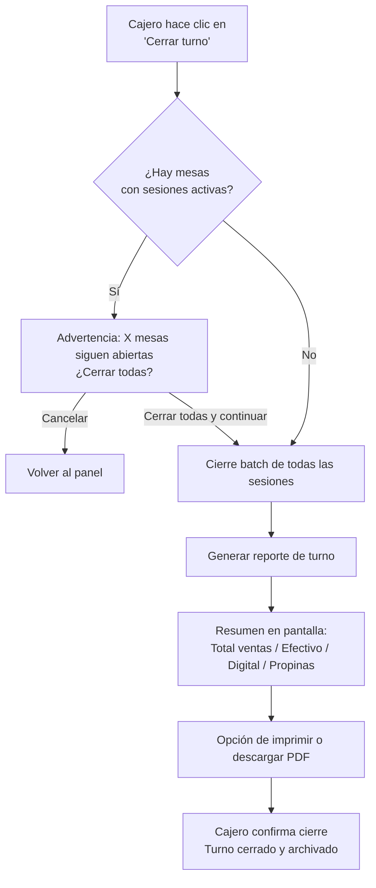

# PRD-013 — Gestión Operativa del Restaurante

> **📜 Documento heredado de Mesto.** Se escribió para la plataforma SaaS multi-tenant de la que
> Mesto Beach se separó en agosto de 2026 (**ADR-023**), y su contenido sigue vigente salvo en
> tres puntos que **manda la documentación nueva**:
> - **Moneda**: los importes de este documento están en pesos colombianos. Hoy todo entero monetario
>   son **céntimos de euro** (**ADR-031**); los nombres de campo llevan el sufijo `Cents`.
> - **Facturación**: la emite el TPV del local, no nosotros (**ADR-028**). Ignora aquí cualquier
>   referencia a pasarelas o autoridades fiscales colombianas.
> - **Ejemplos**: los platos, precios y direcciones son de la época de Mesto y no reflejan la carta
>   ni el local de Playa Demo.
>
> Lo específico de este cliente está en **PRD-018** y en los **ADR-023…035**.

## Metadata

| Campo | Valor |
|---|---|
| **ID** | PRD-013 |
| **Versión** | 1.0 |
| **Estado** | Aprobado |
| **Fecha** | Junio 2026 |
| **Apps relacionadas** | `staff` (cajero/cierre de turno), `admin` (reportes) |
| **Módulos de API** | Orders, Sessions, Payments, Identity |
| **Depende de** | PRD-003 (cajero), PRD-005 (pagos), PRD-006 (analytics) |
| **PRDs que dependen de este** | ninguno directamente |

---

## 1. Propósito y Objetivos

### Propósito

Definir las herramientas operativas del día a día de un restaurante: cierre de turno, reporte de caja, historial de sesiones, exportación de datos y operaciones batch. Este PRD cubre las necesidades del cajero al final del turno y del dueño que necesita revisar la operación sin abrir un sistema externo.

### Objetivos

| # | Objetivo | Métrica |
|---|---|---|
| OBJ-01 | El cajero puede hacer el cierre de caja del turno en menos de 5 minutos | Tiempo medido en pruebas |
| OBJ-02 | El dueño puede revisar la operación de cualquier día en menos de 2 minutos | Acceso a reporte histórico sin demora |
| OBJ-03 | Los datos exportados son suficientes para conciliación contable manual | Verificado con contador externo |

---

## 2. Alcance

### In Scope
- Cierre de turno y reporte de caja
- Historial de sesiones de mesa cerradas
- Exportación de datos (CSV, PDF) por rango de fechas
- Operaciones batch del cajero: cerrar todas las mesas activas
- Gestión de turnos del staff: registrar inicio/fin de turno

### Out of Scope
- Integración contable directa (SIIGO, Alegra, etc.) — v2
- Facturación DIAN — fuera del MVP
- Módulo de reservaciones — v2
- Gestión de múltiples sucursales — v2

---

## 3. Flujo de Cierre de Turno



---

## 4. Historias de Usuario

### Épica 1: Cierre de Turno y Caja

```
US-1301
Como cajero al final de mi turno,
quiero generar un reporte de cierre de caja con el resumen de todo lo vendido,
para entregar el cuadre al dueño sin errores.

Criterio de aceptación:
- El reporte de turno incluye:
  - Rango horario del turno
  - Número de mesas atendidas
  - Número total de pedidos
  - Total de ventas brutas
  - Desglose por método de pago (efectivo, digital, tarjeta)
  - Total de propinas recibidas
  - Descuentos aplicados (si aplica)
- El reporte se puede descargar como PDF
- El reporte queda guardado en el historial del restaurante

US-1302
Como cajero,
quiero poder cerrar todas las mesas activas con un solo clic al final del turno,
para no tener que cerrarlas una por una.

Criterio de aceptación:
- En el panel del cajero hay un botón "Cerrar turno"
- Si hay mesas activas, muestra una advertencia con el listado de mesas abiertas
- Al confirmar, todas las sesiones se cierran simultáneamente
- Se genera automáticamente el reporte de turno

US-1303
Como cajero,
quiero registrar el inicio y fin de mi turno,
para que el dueño pueda ver quién atendió cada pedido.

Criterio de aceptación:
- Al entrar a la app, se registra el inicio de turno automáticamente
- Al hacer clic en "Cerrar turno", se registra el fin
- El dueño puede ver en el historial: cajero responsable, horario y resumen de ventas por turno
```

### Épica 2: Historial de Sesiones

```
US-1304
Como dueño,
quiero ver el historial completo de sesiones de cualquier día,
para revisar la operación y resolver disputas con clientes.

Criterio de aceptación:
- En el Admin Panel hay una sección "Historial de sesiones"
- Puedo filtrar por: fecha, mesa, cajero que cerró la sesión, estado (completada, cancelada)
- Cada sesión muestra: mesa, hora de apertura/cierre, número de participantes, total y modo (staffed/self-service)
- Puedo hacer clic en una sesión para ver el detalle completo (pedidos, pagos, participantes)

US-1305
Como dueño,
quiero poder buscar pedidos por nombre de cliente o número de mesa,
para responder a consultas o disputas rápidamente.

Criterio de aceptación:
- Hay un buscador en el historial que acepta: nombre del participante, mesa, o fecha
- Los resultados aparecen en menos de 2 segundos
- Puedo ver el detalle de cada pedido encontrado
```

### Épica 3: Exportación de Datos

```
US-1306
Como dueño,
quiero exportar los datos de ventas de un período de tiempo en CSV,
para poder pasarlos a mi contador o hacer análisis en Excel.

Criterio de aceptación:
- En el Admin Panel hay una opción "Exportar datos"
- Puedo seleccionar: rango de fechas, tipo de datos (ventas, pedidos, sesiones)
- El archivo CSV se descarga en menos de 30 segundos para períodos de hasta 30 días
- Las columnas del CSV son claras y tienen encabezados en español
- Las fechas están en formato dd/mm/yyyy y los montos en pesos colombianos

US-1307
Como dueño,
quiero exportar el reporte de un turno específico como PDF,
para enviárselo a mi socio o contador por WhatsApp.

Criterio de aceptación:
- Desde el historial de turnos puedo descargar el PDF de cualquier turno
- El PDF incluye: nombre del restaurante, fecha, cajero, resumen de ventas y desglose
- El PDF tiene el logo del restaurante en el encabezado
- El tamaño del PDF es menor a 500KB
```

### Épica 4: Operaciones Batch

```
US-1308
Como cajero al inicio de la jornada,
quiero poder abrir todas las mesas de una zona con un clic (solo modo staffed),
para agilizar la apertura del restaurante.

Criterio de aceptación:
- En el panel del cajero hay una opción "Abrir todas las mesas de: [zona]"
- Al confirmar, se crean sesiones para todas las mesas inactivas de esa zona
- Solo disponible en modo STAFFED
- El cajero puede deshacer la apertura batch en los primeros 30 segundos si fue un error

US-1309
Como dueño,
quiero poder desactivar temporalmente todas las mesas de una zona,
para cuando hay un evento privado o esa zona está cerrada por mantenimiento.

Criterio de aceptación:
- Desde el Admin Panel puedo marcar una zona como "Cerrada temporalmente"
- Los QRs de esa zona muestran "Esta zona no está disponible" al escanearse
- Las mesas cerradas temporalmente se excluyen del panel del cajero
- Puedo reactivar la zona en cualquier momento
```

---

## 5. Estructura del Reporte de Turno

```
REPORTE DE TURNO — La Parrilla
────────────────────────────────────────────
Cajero: María García
Turno:  Sábado 07 Jun 2026  18:00 → 23:45
────────────────────────────────────────────
RESUMEN DE VENTAS
  Mesas atendidas:        12
  Pedidos totales:        47
  Clientes atendidos:     34

INGRESOS
  Total ventas:     $892.000
  Propinas:          $78.500
  Descuentos:        -$15.000
  ─────────────────────────
  TOTAL NETO:       $955.500

MÉTODOS DE PAGO
  Efectivo:         $423.000   (44%)
  Digital Wompi:    $469.000   (49%)
  Cortesía:          $63.500   ( 7%)

TOP 5 PRODUCTOS
  1. Chorizo x18           $162.000
  2. Costilla x12          $204.000
  3. Limonada x27           $94.500
  4. Ensalada mixta x9      $81.000
  5. Papas fritas x21       $63.000
────────────────────────────────────────────
Generado por Mesto · mesto.app
```

---

## 6. Requisitos Técnicos

### RT-1301 — Generación de reportes
- Los reportes se generan en el backend (no en el cliente) para garantizar consistencia
- Para períodos largos (> 30 días), la generación es asíncrona: el dueño recibe el archivo por email
- Los reportes se cachean en Azure Blob Storage con TTL de 24 horas (el mismo reporte no se regenera si ya existe)

### RT-1302 — Cierre batch de sesiones
- El cierre batch es una transacción atómica en la base de datos
- Si el cierre de una sesión falla, el proceso continúa con las demás y reporta las fallidas
- Al cerrar batch, se emite un evento `session.batch_closed` que invalida todos los tokens simultáneamente en Redis

### RT-1303 — Retención de datos históricos
- Los datos de sesiones, pedidos y pagos se retienen por 5 años (mínimo legal para efectos contables)
- Los datos de los últimos 90 días están en PostgreSQL "activo"
- Los datos más antiguos se archivan en Azure Blob Storage (cold storage) y son accesibles bajo demanda

---

## 7. Criterios de Aceptación

- [ ] El cajero puede generar el reporte de turno en menos de 30 segundos
- [ ] El cierre batch de mesas cierra todas las sesiones activas de forma atómica
- [ ] El historial de sesiones permite búsqueda y filtrado por fecha, mesa y cajero
- [ ] El dueño puede descargar un CSV de ventas del último mes en menos de 30 segundos
- [ ] El PDF del reporte de turno incluye el logo del restaurante y todos los campos requeridos

---

## 8. Métricas de Éxito

| Métrica | Meta |
|---|---|
| Tiempo de cierre de turno completo (caja + reporte) | < 5 minutos |
| % de dueños que generan al menos 1 reporte por semana | > 60% |
| % de cajeros que usan el cierre batch al final del turno | > 70% |

---

## 9. Open Questions

| # | Pregunta | Responsable | Estado |
|---|---|---|---|
| OQ-1301 | ¿El reporte de turno debe incluir los productos más vendidos o es solo para la sección de analytics? | Product | **Resuelto**: El reporte de turno incluye top 5 productos del turno (por unidades). Los analytics globales están en PRD-006. |
| OQ-1302 | ¿Se necesita un registro de "cortesías" (pedidos sin costo) separado en el reporte? | Product + Ops | **Resuelto**: Sí. Las cortesías aparecen como línea separada en el reporte de turno: cantidad de cortesías + valor total. El cajero las marca al cerrar cada sesión. |
| OQ-1303 | ¿El cajero puede agregar notas al reporte de turno antes de cerrarlo? | Product | **Resuelto**: Sí. Antes de confirmar el cierre de turno, el cajero puede ingresar una nota libre de texto (máx 500 caracteres) que queda en el reporte. |

---

*PRD-013 — Gestión Operativa del Restaurante*
*Versión 1.1 — Junio 2026 — OQs cerrados: 1301 (reporte incluye top 5 productos), 1302 (cortesías separadas en reporte), 1303 (nota libre del cajero al cerrar turno)*
