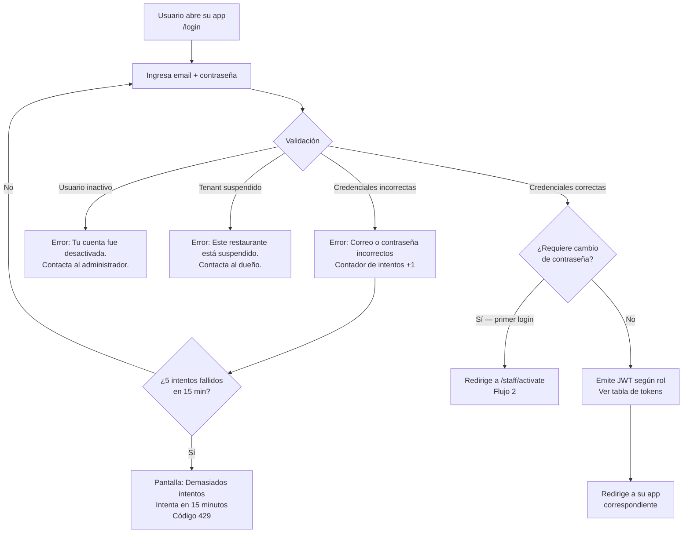
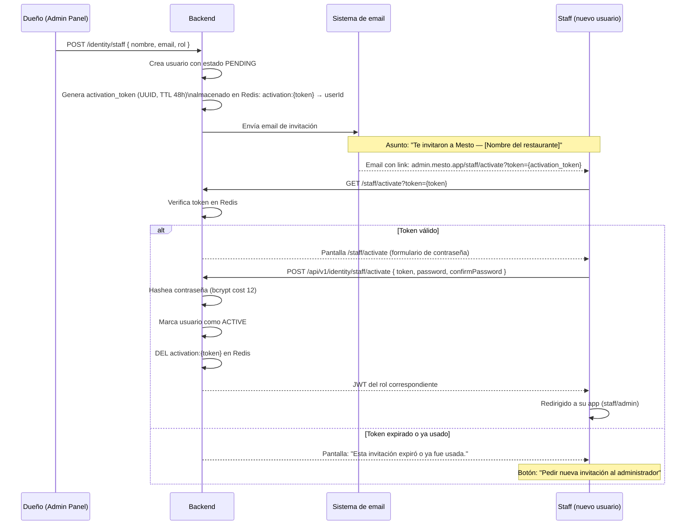
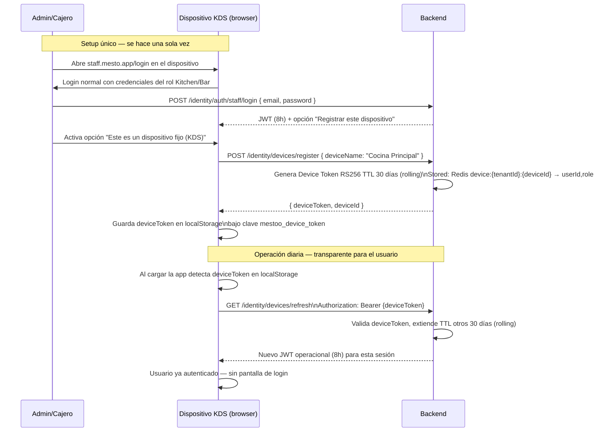
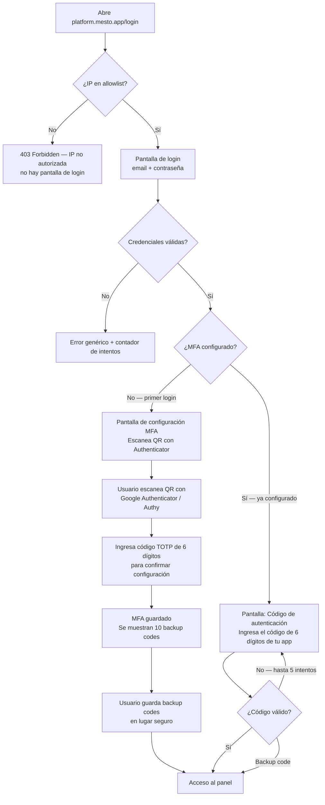
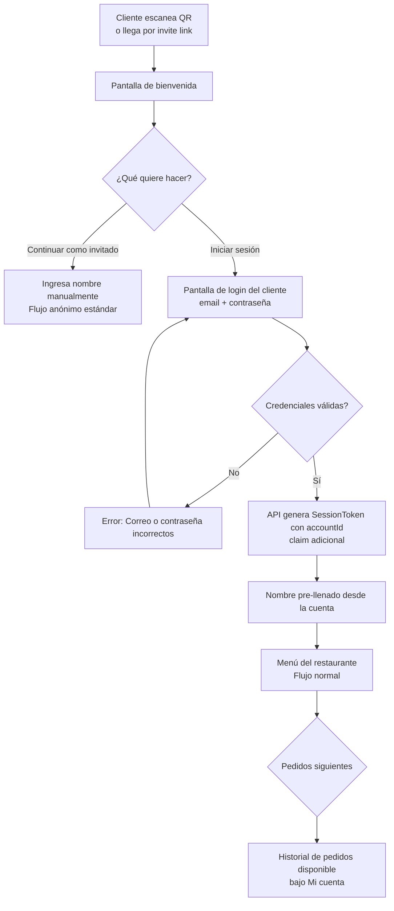

# PRD-014 — Autenticación y Login

> **📜 Documento heredado de Mesto.** Se escribió para la plataforma SaaS multi-tenant de la que
> Mesto Beach se separó en agosto de 2026 (**ADR-023**), y su contenido sigue vigente salvo en
> tres puntos que **manda la documentación nueva**:
> - **Moneda**: los importes de este documento están en pesos colombianos. Hoy todo entero monetario
>   son **céntimos de euro** (**ADR-031**); los nombres de campo llevan el sufijo `Cents`.
> - **Facturación**: la emite el TPV del local, no nosotros (**ADR-028**). Ignora aquí cualquier
>   referencia a pasarelas o autoridades fiscales colombianas.
> - **Ejemplos**: los platos, precios y direcciones son de la época de Mesto y no reflejan la carta
>   ni el local de Playa Demo.
>
> Lo específico de este cliente está en **PRD-018** y en los **ADR-023…035**.

## Metadata

| Campo | Valor |
|---|---|
| **ID** | PRD-014 |
| **Versión** | 1.4 |
| **Estado** | Aprobado |
| **Fecha** | Junio 2026 |
| **Apps relacionadas** | Todas (`menu`, `staff`, `admin`, `platform`) |
| **Módulos de API** | Identity |
| **Depende de** | PRD-001 (roles y personas), PRD-010 (seguridad técnica), PRD-009 (onboarding dueño) |
| **PRDs que dependen de este** | PRD-002 (cliente con cuenta), PRD-003 (staff login), PRD-004 (invitación staff), PRD-009 (post-registro) |

---

> **v1.4 — Identidad unificada y login sin "Tenant ID".** Una persona tiene **una sola cuenta** (correo único + una contraseña) que sirve para **todos los restaurantes** donde es miembro; ya no se pide escribir el id del restaurante.
> - **Login en 2 pasos**: el usuario ingresa correo + contraseña → el sistema busca a qué restaurantes puede entrar. Si es **uno**, entra directo; si son **varios**, muestra un **selector de restaurante**. Aplica a `admin` y `staff` (caja/cocina/salón).
> - **Roles por restaurante y múltiples**: la misma persona puede ser Admin en un restaurante y Cajero en otro, e incluso tener **varios roles** en el mismo (p. ej. Cajero + Mesero). El rol vive en la **membresía**, no en la cuenta.
> - **Invitar a alguien que ya tiene cuenta** le da acceso inmediato con su contraseña actual (no se reenvía activación).
> - **Quitar a un miembro** de un restaurante solo afecta ese restaurante; conserva su cuenta y el acceso a los demás.
> - Activación, restablecimiento y cambio de contraseña son **globales** (afectan la única cuenta de la persona).
> - Implementación: ver SDD-001 v1.3 (`users` + `user_memberships`, `POST /auth/login/resolve`).

---

## 1. Propósito y Objetivos

### Propósito

Definir todos los flujos de autenticación y acceso en Mesto: cómo cada tipo de usuario obtiene acceso al sistema, cómo renueva su sesión, cómo la cierra, y qué pasa en casos de borde (olvidó contraseña, cuenta inactiva, dispositivo fijo). Este PRD es la fuente de verdad para el módulo `Identity`.

> PRD-010 cubre la **seguridad técnica** (hashing, JWT claims, rate limiting). Este PRD cubre la **experiencia de producto** de los flujos de autenticación.

### Objetivos

| # | Objetivo | Métrica |
|---|---|---|
| OBJ-01 | Un mesero puede estar listo para trabajar en menos de 30 segundos desde que abre la app | Medido en pruebas |
| OBJ-02 | El KDS fijo funciona sin interrupciones durante un turno de 12 horas sin re-login manual | 0 re-logins manuales en KDS fijo por turno |
| OBJ-03 | El staff invitado puede activar su cuenta y hacer su primer login en menos de 5 minutos | Medido desde recibir el email |
| OBJ-04 | El reset de contraseña toma menos de 3 minutos | Medido end-to-end |

---

## 2. Mapa de Actores y Mecanismos

| Actor | App | Mecanismo de acceso | Token | Refresh | Logout |
|---|---|---|---|---|---|
| **Cliente anónimo** | `menu` | QR scan / invite link / QR dinámico | Session Token JWT (4h) | No — expira con la sesión | Implícito al cerrar la mesa |
| **Cliente con cuenta** | `menu` | QR scan → opción "Iniciar sesión" (email + pass) | Session Token JWT + `accountId` claim (4h) | No | Implícito al cerrar la mesa |
| **Mesero** | `staff` (`/salon`) | Email + contraseña | JWT RS256 (8h) + Refresh Token (7 días) | Sí — silent background | Botón explícito |
| **Cocina / Barra (KDS fijo)** | `staff` | Email + contraseña — setup único | Device Token JWT (30 días, rolling) | Sí — automático | Solo desde Admin Panel |
| **Cajero** | `staff` | Email + contraseña | JWT RS256 (8h) — sin refresh | No | Botón explícito; re-login al inicio del turno |
| **Dueño / Admin** | `admin` | Registro self-service o invitación → email + pass | JWT RS256 (8h) + Refresh Token (7 días) | Sí — silent background | Botón explícito |
| **Platform Admin** | `platform` | Email + contraseña + TOTP (MFA) | JWT RS256 (8h) — sin refresh | No | Botón explícito |

---

## 3. Flujo 1 — Login del Staff

### Aplica a: Mesero, Cajero, Cocina, Barra, Dueño/Admin



### Tabla de emisión de tokens por rol

| Rol | JWT emitido | Refresh Token |
|---|---|---|
| `Waiter` | RS256, 8h, claims: `{sub, tid, role: "waiter"}` | Sí — JWT RS256, 7 días, almacenado en `HttpOnly cookie` |
| `Kitchen` / `Bar` (modo fijo) | RS256, 8h → luego canjea por Device Token de 30 días | Sí — Device Token, rolling 30 días, en `localStorage` del dispositivo |
| `Cashier` | RS256, 8h, claims: `{sub, tid, role: "cashier"}` | No |
| `RestaurantAdmin` / `Owner` | RS256, 8h, claims: `{sub, tid, role: "admin"}` | Sí — JWT RS256, 7 días, `HttpOnly cookie` |
| `PlatformAdmin` | RS256, 8h, claims: `{sub, role: "platform_admin"}` — sin `tid` | No |

### Wireframe — Pantalla de Login

```
┌────────────────────────────────┐
│         [Logo Mesto]           │
│                                │
│   Bienvenido de nuevo          │
│                                │
│   ┌──────────────────────────┐ │
│   │ tu@email.com             │ │
│   └──────────────────────────┘ │
│   ┌──────────────────────────┐ │
│   │ ••••••••                 │ │
│   └──────────────────────────┘ │
│                                │
│   [      Iniciar sesión      ] │
│                                │
│   ¿Olvidaste tu contraseña?    │
│                                │
└────────────────────────────────┘

Estados de error:
┌─────────────────────────────────┐
│ ⚠ Correo o contraseña          │
│   incorrectos                   │
└─────────────────────────────────┘

┌─────────────────────────────────┐
│ 🔒 Demasiados intentos.         │
│   Intenta de nuevo en 14 min.   │
└─────────────────────────────────┘
```

---

## 4. Flujo 2 — Primer Login del Staff Invitado

### Aplica a: cualquier usuario de staff creado por el dueño, y al `RestaurantAdmin` bootstrap creado automáticamente cuando Ops da de alta un tenant desde Platform Admin



### Reglas del flujo

- El `activation_token` es de un solo uso — se borra de Redis al activar
- TTL de 48 horas. Si expira, el dueño debe crear una nueva invitación desde el panel
- Para el `RestaurantAdmin` bootstrap, la invitación inicial la genera Platform Admin en el momento de crear el tenant; no requiere una acción adicional del dueño
- En el modo **enlace de activación**, la **contraseña temporal nunca existe** — el email no contiene una contraseña sino solo el link (en el modo **acceso directo**, ver §4.1, sí se genera una clave temporal de un solo uso)
- El link no autentica directamente — solo abre la pantalla de "elige tu contraseña"
- El login del Admin Panel requiere `tenantId`; por eso el flujo de activación y el portal Platform deben mostrarlo explícitamente a Ops y al owner
- Requisitos de contraseña: mínimo 8 caracteres, al menos 1 número, al menos 1 letra

### Wireframe — Pantalla /activar-cuenta

```
┌────────────────────────────────┐
│         [Logo Mesto]           │
│                                │
│  Hola, [Nombre]                │
│  Crea tu contraseña para       │
│  empezar en [Restaurante]      │
│                                │
│   ┌──────────────────────────┐ │
│   │ Nueva contraseña         │ │
│   └──────────────────────────┘ │
│   ┌──────────────────────────┐ │
│   │ Confirmar contraseña     │ │
│   └──────────────────────────┘ │
│                                │
│   ✅ Mínimo 8 caracteres       │
│   ✅ Al menos 1 número         │
│                                │
│   [   Activar mi cuenta    ]   │
│                                │
└────────────────────────────────┘
```

### Re-invitación (link expirado)

El dueño puede reenviar la invitación desde `Admin Panel → Personal → [usuario] → Reenviar enlace`. Esto genera un nuevo `activation_token`, invalida el anterior y muestra el enlace directamente en el panel. El email también se envía como canal secundario (no requerido para el prototipo).

---

## 4.1. Variante A — Acceso Directo con Contraseña Temporal

Al dar de alta a un colaborador, el Admin elige el **modo de acceso** (`accessMode`):

- **Enlace de activación** (`ACTIVATION_LINK`, default): el flujo descrito en §4.
- **Acceso directo** (`DIRECT_ACCESS`): el sistema genera una **contraseña temporal**; la cuenta queda **ACTIVE** de inmediato con el flag `must_change_password = true`. El Admin entrega usuario + clave temporal al colaborador (verbalmente o por el canal que prefiera), y el colaborador **debe cambiarla en su primer ingreso**.

Esta variante elimina la dependencia del enlace/correo cuando el Admin tiene al colaborador presente — es el equivalente para staff de cómo Platform entrega el acceso inicial del owner al crear un tenant.

### Diagrama de secuencia (acceso directo)

```
Admin Panel          Backend (Identity)            Colaborador
    │                       │                            │
    │ POST /staff/invite    │                            │
    │ accessMode=DIRECT     │                            │
    │──────────────────────▶│                            │
    │                       │ genera clave temporal      │
    │                       │ staff = ACTIVE             │
    │                       │ must_change_password=true  │
    │  201 { temporaryPassword }                         │
    │◀──────────────────────│                            │
    │  muestra credenciales una vez                      │
    │────────────── entrega usuario + clave ────────────▶│
    │                       │                            │
    │                       │  POST /auth/login          │
    │                       │◀───────────────────────────│
    │                       │  200 mustChangePassword=true
    │                       │  (frontend fuerza /change-password)
    │                       │  POST /auth/change-password │
    │                       │◀───────────────────────────│
    │                       │  204 must_change_password=false
    │                       │  → acceso normal según rol  │
```

### Reglas del flujo (acceso directo)

- La contraseña temporal se genera con un alfabeto sin caracteres ambiguos y cumple la política (≥8, mayúscula, minúscula, dígito).
- Se devuelve **una sola vez** en la respuesta del invite (texto plano); nunca se persiste sin hashear ni se reenvía. Si se pierde, el Admin puede usar "Olvidé mi contraseña" (§5) o re-crear el acceso.
- La cuenta queda ACTIVE pero **el frontend bloquea el acceso** hasta completar el cambio: el login devuelve `mustChangePassword = true` y redirige obligatoriamente a `/change-password` en las apps de staff (admin, staff).
- Mientras el flag esté activo **no se emite Refresh Token** (la sesión previa al cambio es de corta duración).
- `POST /auth/change-password` valida la clave temporal como `currentPassword`, exige que la nueva sea distinta, y limpia el flag.

### Wireframe — Pantalla /change-password (cambio forzado)

```
┌────────────────────────────────┐
│  Cambia tu contraseña          │
│  Tu acceso usa una contraseña  │
│  temporal. Define una nueva.   │
│                                │
│   ┌──────────────────────────┐ │
│   │ Contraseña temporal      │ │
│   └──────────────────────────┘ │
│   ┌──────────────────────────┐ │
│   │ Nueva contraseña         │ │
│   └──────────────────────────┘ │
│   ┌──────────────────────────┐ │
│   │ Confirmar nueva          │ │
│   └──────────────────────────┘ │
│   [   Cambiar contraseña   ]   │
└────────────────────────────────┘
```

---

## 5. Flujo 3 — Olvidé mi Contraseña

### Aplica a: staff + dueños + clientes con cuenta registrada

```mermaid
flowchart TD
    A[En /login toca\n¿Olvidaste tu contraseña?] --> B[Pantalla /reset-password\nIngresa tu email]
    B --> C{¿Email registrado?}
    C -->|No existe| D[Respuesta idéntica a si existe\npor seguridad: No se confirma ni niega]
    C -->|Existe| E[Genera reset_token\nUUID, TTL 1 hora\nRedis: reset:{token} → userId]
    D --> F[Pantalla: Si ese correo existe,\nrecibirás un link en minutos.]
    E --> G[Envía email con link:\nmesto.app/nueva-password?t={token}]
    G --> F
    F --> H[Usuario abre link en email]
    H --> I{¿Token válido\ny no usado?}
    I -->|No / expirado| J[Pantalla: Este link expiró.\nSolicita uno nuevo en /reset-password]
    I -->|Sí| K[Pantalla /nueva-password\nNueva contraseña + confirmar]
    K --> L[POST /identity/reset-password\n{ token, password }]
    L --> M[API: hashea, guarda, DEL reset token]
    M --> N[Invalida TODOS los JWTs activos\ndel usuario via blacklist en Redis]
    N --> O[Redirige a /login con banner:\nContraseña actualizada. Inicia sesión.]
```

### Reglas de seguridad

- La respuesta del API es **siempre la misma** independientemente de si el email existe o no (evita enumeración de usuarios)
- El token de reset es de **un solo uso**
- TTL: **1 hora** (stricto — no se extiende)
- Al completar el reset se invalidan **todos** los JWTs activos del usuario (incluyendo refresh tokens): `SADD auth_blacklist:{userId} "all"` — el middleware verifica este key
- El reset desloguea al usuario en todos sus dispositivos. Debe hacer login de nuevo.
- Al completar el reset se **limpia el flag `must_change_password`** (el usuario está definiendo su propia contraseña, no una temporal): si la cuenta venía de un alta por acceso directo o de un reset iniciado por Admin/Ops, no se le vuelve a forzar el cambio.

### 5.1 Reset iniciado por Admin u Ops (sin depender del email)

Como en dev el correo de staff es un canal secundario (y en general el usuario puede no tener acceso a su email), el restablecimiento puede ser **iniciado por un tercero autorizado**, que **genera el enlace y lo comparte**:

- **Admin del restaurante → su personal:** desde `Admin Panel → Personal`, sobre un colaborador **activo**, la acción **"Resetear contraseña"** genera un enlace de restablecimiento (TTL 1h) que el Admin entrega al colaborador. El colaborador abre el enlace y define su nueva contraseña (misma pantalla `/staff/password-reset` y confirmación del flujo §5). No aplica a cuentas `PENDING` (esas usan "Reenviar enlace" de invitación).
- **Mesto Ops → administrador de un tenant:** desde el detalle del tenant en el portal Platform, la acción **"Resetear contraseña admin"** genera el enlace de restablecimiento para el administrador propietario (cuando está activo) y Ops lo comparte con el dueño. Ver PRD-015.

En ambos casos el enlace usa el mismo mecanismo (`reset:staff:{token}`, TTL 1h, un solo uso) y termina en la misma pantalla donde el usuario define su contraseña. No se expone ni se transmite ninguna contraseña en claro.

---

## 6. Flujo 4 — Autenticación de Dispositivos KDS Fijos

### Aplica a: Cocina (`Kitchen`) y Barra (`Bar`) en displays permanentes

Los KDS de cocina y barra son pantallas que están encendidas 12+ horas al día. No es práctico ni seguro pedir un re-login manual cada 8 horas. Usan un **Device Token** de larga duración.



### Reglas del Device Token

| Propiedad | Valor |
|---|---|
| Almacenamiento | `localStorage` del navegador del dispositivo (única excepción a la regla de "solo en memoria") |
| TTL | 30 días — **rolling**: cada vez que se usa, se extiende otros 30 días |
| Renovación | Automática al cargar la app (silent background, no interrumpe al usuario) |
| Revocación | Solo desde Admin Panel: `Configuración → Dispositivos → [dispositivo] → Revocar` |
| Si se revoca | El dispositivo regresa a la pantalla de login normal |
| Multi-dispositivo | Un restaurante puede registrar N dispositivos. Cada uno tiene su propio `deviceId` |

### Wireframe — Panel de Dispositivos (Admin Panel)

```
CONFIGURACIÓN → DISPOSITIVOS
┌─────────────────────────────────────────────────────┐
│ Dispositivos registrados                            │
├─────────────────────────────────────────────────────┤
│  📱 Cocina Principal        Kitchen  Activo         │
│     Último uso: hace 2 min               [Revocar]  │
│                                                     │
│  📱 Barra Norte             Bar      Activo         │
│     Último uso: hace 15 min              [Revocar]  │
│                                                     │
│  📱 Cocina Parrilla         Kitchen  Sin uso 5 días │
│     Último uso: 5 días ago               [Revocar]  │
└─────────────────────────────────────────────────────┘
```

---

## 7. Flujo 5 — Platform Admin con MFA (TOTP)

### Aplica a: equipo interno de Mesto (`PlatformAdmin`)



### Detalles técnicos MFA

- **Proveedor TOTP**: compatible RFC 6238 — funciona con Google Authenticator, Authy, 1Password, Bitwarden
- **Librería .NET**: `Otp.NET` (NuGet)
- **Backup codes**: 10 códigos de 8 caracteres alfanuméricos generados al activar. Cada uno es de un solo uso.
- **IP allowlist**: configurada en Azure App Service (IP restrictions), no a nivel de aplicación — el backend nunca recibe requests de IPs no autorizadas
- **Sin refresh token**: cada sesión requiere email + pass + TOTP. TTL de JWT: 8 horas.

---

## 8. Flujo 6 — Cliente con Cuenta Registrada

### Aplica a: clientes que crearon cuenta en una visita anterior (PRD-012)

El cliente llega a una mesa, escanea el QR, y puede optar por iniciar sesión con su cuenta para que su nombre aparezca pre-llenado y pueda ver su historial.



### Diferencia entre anónimo y con cuenta

| Aspecto | Anónimo | Con cuenta |
|---|---|---|
| Nombre | Ingresado manualmente | Pre-llenado desde el perfil |
| Session Token | `{ sid, tid, pid, tbl }` | `{ sid, tid, pid, tbl, accountId }` |
| Historial de pedidos | Solo en la sesión actual | Persistente entre visitas |
| Favoritos | No | Sí (PRD-012) |
| Expiración del token | Igual — 4h / cierre de sesión | Igual |
| Invalidación | Igual — blacklist Redis | Igual |

### Password reset del cliente

Usa exactamente el mismo flujo del Flujo 3 (`/reset-password`). El formulario de login de la app `menu` también tiene el link "¿Olvidaste tu contraseña?".

### Wireframe — Pantalla de bienvenida con opción de login

```
┌─────────────────────────┐
│  [Logo del restaurante] │
│                         │
│  Bienvenido a           │
│  La Parrilla            │
│                         │
│  ¿Cómo te llamamos?     │
│  ┌─────────────────┐    │
│  │  Tu nombre      │    │
│  └─────────────────┘    │
│                         │
│  [  Continuar  ]        │
│                         │
│  ─────── o ──────────   │
│                         │
│  [  Iniciar sesión  ]   │
│   (pre-llena tu nombre  │
│    y ver tu historial)  │
│                         │
└─────────────────────────┘
```

---

## 9. Flujo 7 — Logout por Rol

| Actor | Cómo se cierra la sesión |
|---|---|
| **Mesero** | Botón "Cerrar sesión" en su app. API: invalida JWT en Redis blacklist (`auth_blacklist:{userId}`), borra refresh token cookie. |
| **Cajero** | Botón "Cerrar sesión". JWT expira en 8h, no hay refresh — el logout solo invalida el JWT activo. |
| **Dueño / Admin** | Botón "Cerrar sesión". Invalida JWT y refresh token. |
| **Cocina / Barra (KDS fijo)** | **Sin botón de logout visible**. El Device Token persiste. Solo se puede revocar desde Admin Panel. |
| **Platform Admin** | Botón "Cerrar sesión". JWT expira en 8h, no hay refresh. |
| **Cliente (cualquier tipo)** | **Sin logout manual**. La sesión termina cuando el cajero cierra la mesa (`SADD blacklist:{tenantId} sessionId`). |

### Logout en todos los dispositivos (staff)

Desde el perfil de usuario (Admin Panel o la vista `/salon` de `staff`) hay una opción **"Cerrar sesión en todos mis dispositivos"**. Esto:
1. Revoca el refresh token activo
2. Agrega el `userId` a una blacklist de "invalidar todos" en Redis: `SADD auth_all_invalidated {userId}:{timestamp}`
3. El middleware verifica este key en cada request — si el JWT fue emitido antes del timestamp, lo rechaza

---

## 10. Matriz de Tokens del Sistema

| Token | Tipo | Firmado con | TTL | Almacenado en | Invalidación |
|---|---|---|---|---|---|
| **Staff JWT** | JWT RS256 | Clave privada en Key Vault | 8h | Memoria (in-memory del cliente) | Redis blacklist por userId |
| **Refresh Token** (mesero/admin) | JWT RS256 | Clave privada en Key Vault | 7 días | `HttpOnly cookie` | Borra la cookie; Redis blacklist |
| **Device Token** (KDS fijo) | JWT RS256 | Clave privada en Key Vault | 30 días rolling | `localStorage` del dispositivo KDS | Redis: `DEL device:{tid}:{deviceId}` |
| **Session Token** (cliente) | JWT simétrico | HMAC-SHA256 (Key Vault) | 4h | Memoria del browser (no localStorage) | Redis blacklist por sessionId |
| **Activation Token** (invitación staff) | UUID opaco | N/A | 48h | Redis: `activation:{token}` → userId | Borra key al usar |
| **Reset Token** (contraseña) | UUID opaco | N/A | 1h | Redis: `reset:{token}` → userId | Borra key al usar |
| **Invite Link Token** (sesión mesa) | JWT RS256 | Clave privada en Key Vault | TTL sesión activa | Redis: `invite:{tid}:{sid}:token` | DEL al regenerar PIN o cerrar sesión |
| **QR Dinámico Token** (sesión mesa) | JWT RS256 | Clave privada en Key Vault | TTL sesión activa | Redis: `qr:{tid}:{sid}:token` | DEL al cerrar sesión |
| **Platform Admin JWT** | JWT RS256 | Clave privada en Key Vault | 8h | Memoria | Redis blacklist por userId |

---

## 11. Historias de Usuario

### Épica 1: Login del staff

```
US-1401
Como mesero,
quiero poder iniciar sesión en mi app en menos de 30 segundos,
para estar listo para trabajar al comenzar el turno.

Criterio de aceptación:
- La pantalla de login está en /login y tiene email y contraseña
- El login es exitoso en menos de 2 segundos con conexión normal
- Si las credenciales son incorrectas, veo un mensaje claro (sin indicar si el email o la contraseña son el problema)
- Si ingreso mal la contraseña 5 veces en 15 minutos, veo el countdown de bloqueo
- Al hacer login exitoso soy redirigido a la pantalla de alertas de mi app

US-1402
Como cajero que trabaja en turnos de 8 horas,
quiero que mi sesión dure exactamente mi turno sin necesidad de renovarla,
para no interrumpir mi trabajo con re-logins.

Criterio de aceptación:
- Mi JWT dura 8 horas exactas
- No hay refresh automático — al vencer el JWT, la app me redirige a /login
- En la pantalla de login hay un banner: "Tu sesión expiró. Inicia sesión para continuar."
- Los datos de las mesas activas no se pierden — cuando vuelvo a loguearme, todo está igual

US-1403
Como pantalla de cocina fija,
quiero funcionar durante toda la jornada sin que nadie tenga que hacer login manual,
para que la operación de cocina no dependa de recordar contraseñas.

Criterio de aceptación:
- Una vez configurado como dispositivo fijo, la app carga y se autentica automáticamente
- El Device Token se renueva sin intervención humana
- Si el Device Token es revocado por el admin, la app regresa a /login
- El admin puede ver en el panel cuándo fue el último uso del dispositivo
```

### Épica 2: Invitación y primer login

```
US-1404
Como staff recién invitado,
quiero activar mi cuenta y crear mi contraseña desde el link de activación,
para empezar a trabajar sin depender de que alguien me dé una contraseña temporal.

Criterio de aceptación:
- El email de invitación llega en menos de 2 minutos (si el email funciona)
- El enlace de activación también aparece visible en Admin Panel → Personal justo después de invitar
- El link es válido por 48 horas
- La pantalla /activar-cuenta solo me pide crear una contraseña (no hay campo de email)
- Después de activar, quedo autenticado y en mi app directamente
- Si el link expiró, veo un mensaje claro con instrucción de pedir nuevo enlace al administrador

US-1405
Como dueño,
quiero poder reenviar el enlace de activación a un empleado que no pudo activar su cuenta,
para no tener que eliminar y volver a crear el usuario.

Criterio de aceptación:
- En Admin Panel → Personal → [usuario pendiente] hay un botón "Reenviar enlace"
- Solo aparece para usuarios en estado PENDING
- Al reenviar, el enlace anterior queda inválido y se genera uno nuevo
- El nuevo enlace de activación aparece visible inline en el Admin Panel (recuadro azul con opción de copiar)
- El nuevo enlace también se envía por email si el servicio de correo está activo
```

### Épica 3: Recuperación de contraseña

```
US-1406
Como mesero que olvidó su contraseña,
quiero resetearla desde mi celular sin necesitar al dueño,
para poder entrar a mi app sin interrumpir la operación.

Criterio de aceptación:
- En la pantalla de login hay un link "¿Olvidaste tu contraseña?"
- Ingreso mi email y el sistema me dice que si el correo existe recibiré un link
- El link de reset llega en menos de 2 minutos
- El link es válido por 1 hora
- Al crear la nueva contraseña, soy redirigido a /login
- Mi sesión anterior (si tenía una activa) queda cerrada
```

### Épica 4: Cliente con cuenta

```
US-1407
Como cliente frecuente que tiene cuenta en Mesto,
quiero poder iniciar sesión al llegar a un restaurante,
para que mi nombre aparezca automáticamente y pueda ver mis pedidos anteriores.

Criterio de aceptación:
- En la pantalla de bienvenida de la app del cliente hay un botón "Iniciar sesión"
- Ingreso email y contraseña
- Mi nombre se pre-llena en el campo correspondiente
- En la sección "Mi cuenta" dentro de la app puedo ver mis visitas anteriores a ese mismo restaurante
- Si no recuerdo mi contraseña, hay opción de "Olvidé mi contraseña" que me lleva al flujo estándar

US-1408
Como cliente,
quiero poder continuar como invitado sin crear cuenta,
para no tener fricción cuando solo quiero pedir rápido.

Criterio de aceptación:
- El botón "Continuar" (sin cuenta) siempre está visible y es más prominente que el botón de login
- No hay pop-ups insistentes para que cree una cuenta
- La opción de crear cuenta se ofrece una sola vez al final de la sesión (en la pantalla de pago)
```

### Épica 5: Platform Admin MFA

```
US-1409
Como administrador de plataforma,
quiero que mi acceso a platform.mesto.app requiera doble factor,
para que incluso si mis credenciales son comprometidas, el atacante no pueda acceder.

Criterio de aceptación:
- El primer login requiere configurar TOTP con una app de autenticación
- Los logins siguientes requieren el código de 6 dígitos después de email + contraseña
- Tengo 10 backup codes para usar si pierdo acceso a mi app de autenticación
- Si fallo el código TOTP 5 veces, mi acceso se bloquea y requiero asistencia del equipo
- La plataforma no es accesible desde IPs no autorizadas (el servidor no responde)
```

---

## 12. Requisitos Funcionales

### RF-1401 — Modelo híbrido de refresh tokens
- `Waiter` y `RestaurantAdmin`: refresh token JWT RS256 con TTL 7 días almacenado en `HttpOnly cookie` (`SameSite=Strict`)
- `Kitchen` / `Bar` en modo fijo: Device Token con TTL rolling de 30 días almacenado en `localStorage` del dispositivo (única excepción documentada)
- `Cashier` y `PlatformAdmin`: sin refresh token — re-login al vencer el JWT de 8h
- El endpoint de refresh es `POST /identity/auth/refresh` y solo acepta el refresh token via cookie (nunca en el body)

### RF-1402 — Activation Token (invitación staff)
- UUID v4 generado con `SecureRandom`
- Almacenado en Redis: `activation:{token}` → `{ userId, expiresAt }` con TTL 48h
- Un usuario puede tener solo un activation token activo a la vez (el anterior se borra al reenviar)
- Al activar: el token se borra, la contraseña se hashea con bcrypt cost 12, el usuario pasa a `ACTIVE`

### RF-1403 — Reset Token (contraseña olvidada)
- UUID v4 opaco (no JWT — no debe ser decodificable)
- Redis: `reset:{token}` → `{ userId, expiresAt }` con TTL 1h
- Al usar: borra el token, hashea la nueva contraseña, agrega el userId a `auth_all_invalidated` en Redis con timestamp
- La respuesta del endpoint `POST /identity/auth/forgot-password` es siempre `200 OK` independientemente de si el email existe

### RF-1404 — Device Token (KDS fijo)
- JWT RS256 firmado con la misma clave que el staff JWT pero con claim adicional `type: "device"`
- Claims: `{ sub: userId, tid: tenantId, role: "kitchen" | "bar", deviceId, type: "device" }`
- Redis: `device:{tenantId}:{deviceId}` → `{ userId, role, lastUsed }` con TTL 30 días
- Al usar para refresh: extiende TTL otros 30 días y emite un nuevo JWT operacional de 8h
- Revocación: `DEL device:{tenantId}:{deviceId}` desde el Admin Panel

### RF-1405 — MFA (Platform Admin)
- Librería: `Otp.NET` (NuGet)
- TOTP con SHA-1, 6 dígitos, paso de 30 segundos (estándar RFC 6238)
- La clave secreta TOTP se almacena cifrada en PostgreSQL (columna `totp_secret` en tabla `users`)
- Backup codes: 10 strings de 8 caracteres `[A-Z0-9]` generados con `SecureRandom`, hasheados en DB
- Máximo 5 intentos TOTP fallidos → bloqueo de cuenta hasta que Mesto Ops la desbloquee manualmente

### RF-1406 — Cliente con cuenta
- El login del cliente usa el mismo endpoint de autenticación pero emite un SessionToken en lugar de JWT staff
- Claims del SessionToken con cuenta: `{ sid, tid, pid, tbl, accountId }` — el `accountId` es el link a `customer_accounts` en PostgreSQL
- Si la cuenta está en otro tenant, el login está igualmente permitido (las cuentas de cliente son cross-tenant)
- El SessionToken con `accountId` tiene las mismas restricciones de invalidación que el anónimo

### RF-1407 — Logout global ("en todos los dispositivos")
- Redis: `SADD auth_all_invalidated {userId}` con el timestamp del logout global
- El middleware staff verifica `SISMEMBER auth_all_invalidated {userId}` y compara el `iat` del JWT con el timestamp almacenado
- Costo: un SISMEMBER adicional por request de staff autenticado (O(1), latencia < 1ms en Redis)
- TTL del SET: 8 días (cubre el período máximo de un refresh token de 7 días)

---

## 13. Requisitos Técnicos

### RT-1401 — Seguridad de cookies
- Los refresh tokens se transmiten exclusivamente via `HttpOnly; SameSite=Strict; Secure` cookies
- El dominio de la cookie es el subdominio correspondiente (ej: `staff.mesto.app`) — no cross-domain
- El flag `Secure` garantiza que solo se envíen sobre HTTPS

### RT-1402 — Endpoints de autenticación
```
POST /api/v1/identity/auth/staff/login        → Login staff (email + password)
POST /api/v1/identity/auth/staff/refresh      → Renovar JWT con refresh token (cookie)
POST /api/v1/identity/auth/logout             → Logout del usuario actual
POST /api/v1/identity/auth/logout-all         → Logout en todos los dispositivos
POST /api/v1/identity/auth/forgot-password    → Solicitar link de reset
POST /api/v1/identity/auth/reset-password     → Completar reset de contraseña
GET  /api/v1/identity/activate?t={token}      → Verificar invitation token
POST /api/v1/identity/activate                → Completar activación (crear contraseña)
POST /api/v1/identity/devices/register        → Registrar dispositivo KDS fijo
GET  /api/v1/identity/devices                 → Listar dispositivos registrados (admin)
DELETE /api/v1/identity/devices/{deviceId}    → Revocar dispositivo
POST /api/v1/identity/auth/mfa/setup          → Iniciar setup TOTP (Platform Admin)
POST /api/v1/identity/auth/mfa/verify         → Verificar código TOTP
POST /api/v1/identity/auth/client/session     → Crear sesión anónima de cliente
POST /api/v1/identity/auth/client/login       → Login de cliente con cuenta
```

### RT-1403 — Rate limiting de endpoints de auth
Ver tabla completa en PRD-010 §6. Resumen de los más críticos:
- `POST /auth/staff/login`: 10 intentos / 15 min / IP
- `POST /auth/forgot-password`: 3 / hora / IP
- `POST /auth/reset-password`: 5 intentos / token
- `POST /auth/mfa/verify`: 5 intentos / sesión → bloqueo manual

---

## 14. Criterios de Aceptación

- [ ] El staff puede hacer login con email + contraseña y recibir JWT en menos de 2 segundos
- [ ] Después de 5 intentos fallidos, la pantalla de login muestra el countdown de 15 minutos
- [ ] El staff invitado activa su cuenta desde el email sin necesitar contraseña temporal
- [ ] Un link de activación expirado muestra un mensaje claro con instrucción de pedir reenvío
- [ ] El reset de contraseña funciona end-to-end en menos de 3 minutos
- [ ] Al resetear la contraseña, las sesiones activas del usuario quedan invalidadas
- [ ] El KDS fijo carga automáticamente al encender el dispositivo sin pantalla de login
- [ ] El cajero puede revocar un Device Token desde Admin Panel y el dispositivo regresa a /login
- [ ] El Platform Admin no puede acceder desde una IP no autorizada (503 antes de ver la pantalla de login)
- [ ] El Platform Admin debe completar TOTP correctamente para acceder al panel
- [ ] El cliente con cuenta ve su nombre pre-llenado al iniciar sesión en la app del menú
- [ ] El cliente puede continuar como invitado sin crear cuenta y sin pop-ups insistentes
- [ ] El botón "Cerrar sesión en todos mis dispositivos" invalida el refresh token y los JWTs activos

---

## 15. Open Questions

| # | Pregunta | Responsable | Estado |
|---|---|---|---|
| OQ-1401 | ¿Los meseros tienen un perfil donde pueden cambiar su propio email/contraseña? ¿O solo el dueño puede hacerlo desde el Admin Panel? | Product | **Resuelto**: Solo el **Admin del restaurante** puede resetear la contraseña del staff desde el Admin Panel. El staff NO tiene auto-servicio para cambiar su propio email ni contraseña. El email es el identificador inmutable. Para cambiar contraseña olvidada → reset por email (PRD-014 §5). |
| OQ-1402 | ¿El cliente puede crear una cuenta desde la app del cliente (self-service), o la cuenta la crea el restaurante? (Ver PRD-012 para OAuth/Google) | Product | **Resuelto**: La cuenta de cliente es **self-service desde el menú**. El cliente puede registrarse en la pantalla de bienvenida al escanear el QR. Datos: email+contraseña (requeridos), nombre (requerido), teléfono y fecha de nacimiento (opcionales), Login con Google. Ver PRD-012 §5 para detalle. |
| OQ-1403 | ¿El Device Token de KDS debe revocar automáticamente si el dispositivo no se usa en X días? ¿Cuántos? | Tech + Product | **Resuelto**: Sin auto-revocación adicional. Los Device Tokens son rolling 30d: si el dispositivo hace alguna petición antes de que venzan, se renuevan; si no se conecta en 30 días, expiran solos. El Admin puede revocarlos manualmente desde el panel de staff. |
| OQ-1404 | ¿El Platform Admin necesita un proceso de recuperación de cuenta (si pierde el TOTP y los backup codes)? ¿Quién lo autoriza? | Ops + Legal | **Resuelto**: Al configurar el TOTP, el sistema genera un **código de emergencia de 24 dígitos** de un solo uso, que el Platform Admin guarda offline (impreso o gestor de contraseñas). Si pierde el autenticador, usa ese código para hacer reset del TOTP desde la pantalla de login. Si también pierde el código de emergencia, el reset solo es posible directamente en base de datos por el técnico fundador. |
| OQ-1405 | ¿Es necesario enviar un email de notificación al staff cuando alguien hace un "logout global" de su cuenta? (seguridad) | Product + Security | **Resuelto**: Sin email. El logout global invalida los tokens en Redis mestobeachsamente. El staff simplemente verá que necesita iniciar sesión de nuevo. No se envía notificación. |

---

*PRD-014 — Autenticación y Login*
*Versión 1.3 — Junio 2026 — Reset de contraseña iniciado por Admin (a su personal) y por Ops (al admin de un tenant) generando enlace (§5.1); el reset limpia el cambio forzado. Base v1.2: alta de personal híbrida (§4.1, acceso directo con clave temporal + cambio forzado `/auth/change-password`). OQs cerrados: 1401 (solo Admin resetea contraseñas), 1402 (registro self-service desde menú), 1403 (Device Token rolling 30d, sin auto-revocación), 1404 (código emergencia TOTP 24 dígitos offline), 1405 (sin email en logout global)*
