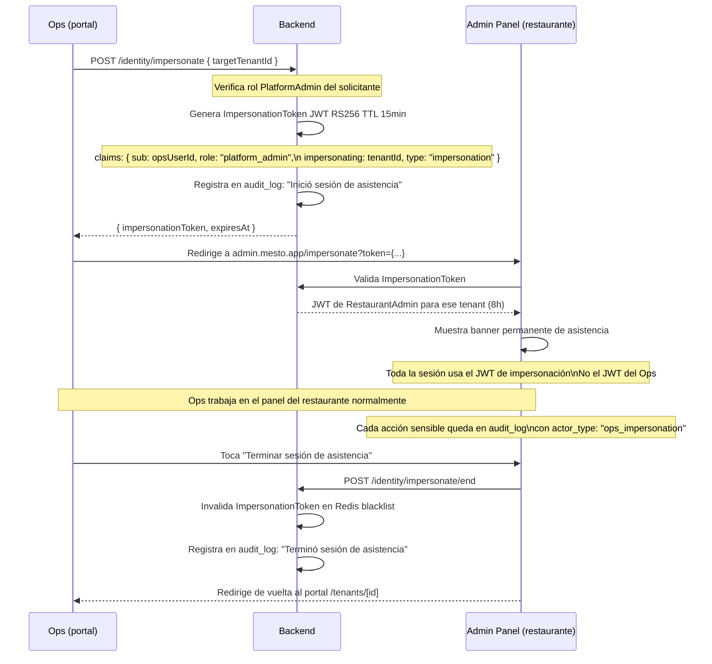

# PRD-015 — Portal Back-Office de Mesto (Platform Admin)

> **📜 Documento heredado de Mesto.** Se escribió para la plataforma SaaS multi-tenant de la que
> Mesto Beach se separó en agosto de 2026 (**ADR-023**), y su contenido sigue vigente salvo en
> tres puntos que **manda la documentación nueva**:
> - **Moneda**: los importes de este documento están en pesos colombianos. Hoy todo entero monetario
>   son **céntimos de euro** (**ADR-031**); los nombres de campo llevan el sufijo `Cents`.
> - **Facturación**: la emite el TPV del local, no nosotros (**ADR-028**). Ignora aquí cualquier
>   referencia a pasarelas o autoridades fiscales colombianas.
> - **Ejemplos**: los platos, precios y direcciones son de la época de Mesto y no reflejan la carta
>   ni el local de Playa Demo.
>
> Lo específico de este cliente está en **PRD-018** y en los **ADR-023…035**.

## Metadata

| Campo | Valor |
|---|---|
| **ID** | PRD-015 |
| **Versión** | 2.3 |
| **Estado** | Aprobado |
| **Fecha** | Junio 2026 |
| **App relacionada** | `platform` (Next.js — `platform.mesto.app`) |
| **Módulos de API** | Identity, Catalog, Orders, Payments, Analytics, todos los módulos (cross-tenant) |
| **Depende de** | PRD-001 (modelo de negocio), PRD-009 (estados de tenant), PRD-014 (auth MFA + impersonación) |
| **PRDs que dependen de este** | Ninguno directamente — este PRD gestiona todos los demás desde arriba |

---

## 1. Propósito y Objetivos

### Propósito

Definir el portal interno de Mesto — la herramienta que el equipo operativo (Mesto Ops) usa para gestionar todos los restaurantes de la plataforma, asistirlos con su configuración, monitorear la salud del negocio y controlar los parámetros comerciales de cada tenant.

El portal back-office es la diferencia entre una plataforma que escala y un equipo de soporte que responde emails. Bien diseñado, permite que un equipo de 2-3 personas administre cientos de restaurantes con autonomía total.

### Objetivos

| # | Objetivo | Métrica |
|---|---|---|
| OBJ-01 | Ops puede crear un restaurante nuevo y dejarlo listo para el wizard en menos de 2 minutos | Medido desde "Crear" hasta que el dueño recibe el email |
| OBJ-02 | Ops puede resolver el 80% de los tickets de soporte sin pedirle nada al cliente | Porcentaje de tickets cerrados sin intervención del cliente |
| OBJ-03 | Ops detecta un restaurante con problemas antes de que el cliente lo reporte | Alertas activas visibles en el dashboard de monitoreo |
| OBJ-04 | El equipo de Ops tiene trazabilidad completa de quién hizo qué en cada tenant | 100% de las acciones registradas en audit log con actor + timestamp |

---

## 2. Usuarios y Roles

El equipo Ops tiene tres roles diferenciados con permisos granulares. Un agente puede tener **más de un rol** (acumulables).

| Persona | Rol(es) típicos | Dispositivo |
|---|---|---|
| Agente de soporte | `Soporte` | PC |
| Especialista de cobros | `Billing` | PC |
| Agente full-service | `Soporte` + `Billing` | PC |
| Técnico / founder | `Admin` | PC o tablet |

### Matriz de permisos por rol

| Acción | Soporte | Billing | Admin |
|---|---|---|---|
| Ver lista de tenants | ✅ | ✅ | ✅ |
| Ver detalle del tenant (config, staff, mesas) | ✅ | ✅ | ✅ |
| Impersonar tenant (modo asistencia) | ✅ | ✅ (solo billing) | ✅ |
| Enviar comunicaciones | ✅ | ❌ | ✅ |
| Crear/eliminar tenants | ✅ | ❌ | ✅ |
| Ver datos de billing | ✅ | ✅ | ✅ |
| Cambiar plan del tenant | ✅ | ✅ | ✅ |
| Aplicar descuentos / promociones | ❌ | ✅ | ✅ |
| Emitir reembolsos / créditos | ❌ | ✅ | ✅ |
| Registrar pago manual | ✅ | ✅ | ✅ |
| Ver y gestionar CRM de trials | ✅ | ✅ | ✅ |
| Marcar trial como convertido | ❌ | ✅ | ✅ |
| Crear/editar contratos de fidelización | ❌ | ❌ | ✅ |
| Activar modo mantenimiento | ❌ | ❌ | ✅ |
| Configurar plataforma (planes, precios base) | ❌ | ❌ | ✅ |
| Ver métricas globales | ❌ | ✅ | ✅ |
| Ver audit log global del equipo Ops | ❌ | ❌ | ✅ |
| Gestionar equipo Ops (crear, editar roles) | ❌ | ❌ | ✅ |

Las cuentas y los roles del equipo se gestionan en el Módulo 9.

---

## 3. Alcance

### In Scope
- Gestión completa de tenants (crear, ver, editar estado, suspender, cancelar)
- Modo asistencia con impersonación completa del admin del restaurante
- Acciones rápidas de soporte sin necesidad de impersonar
- Gestión de billing y modelos de cobro por tenant
- Módulo de comunicaciones: anuncios + modo mantenimiento global
- Dashboard de monitoreo de negocio y salud básica de la plataforma
- Gestión del equipo Ops con roles granulares (Soporte, Billing, Admin) + acumulación
- **CRM de trials**: pipeline de seguimiento de conversión de tenants en trial
- **CRM de clientes** [v1.x]: vista cross-tenant de las cuentas de cliente de la red de lealtad con métricas de negocio (visitas, gasto total, ticket promedio, restaurantes favoritos, puntos), segmentación (nuevo/recurrente/VIP/inactivo) y anotaciones de Ops (tags + notas). Ver SDD-009.
- **Contratos de fidelización**: gestión de contratos Mesto-restaurante para el Programa de Lealtad

### Out of Scope
- Monitoreo técnico profundo (logs de Azure, métricas de infraestructura) — eso va en Azure Monitor / Datadog externos
- Facturación electrónica DIAN — fuera del MVP
- Chat de soporte en tiempo real con el restaurante — v2
- App móvil del portal — solo PC

---

## 4. Arquitectura de Navegación

```
platform.mesto.app/
│
├── /tenants                     → Lista de todos los restaurantes
│   ├── /tenants/nuevo           → Crear restaurante
│   └── /tenants/[id]            → Detalle del restaurante
│       └── /tenants/[id]/asistir → Modo asistencia (impersonación)
│
├── /trials                      → CRM pipeline de trials
│
├── /customers                    → CRM de clientes (lista + métricas + segmento)
│   └── /customers/[id]           → Ficha del cliente (favoritos, pedidos, lealtad, tags, notas)
│
├── /billing                     → Gestión global de cobros
│   └── /billing/[tenantId]      → Detalle de billing de un tenant
│
├── /fidelizacion                → Contratos de lealtad Mesto-restaurante
│   ├── /fidelizacion/nuevo      → Crear contrato de fidelización
│   └── /fidelizacion/[id]       → Detalle y edición del contrato
│
├── /comunicaciones              → Anuncios y modo mantenimiento
│   └── /comunicaciones/nuevo    → Redactor de anuncio
│
├── /monitoreo                   → Dashboard de salud y negocio
│
└── /equipo                      → Gestión del equipo Ops
    └── /equipo/audit            → Audit log de acciones
```

---

## 5. Módulo 1 — Listado de Tenants `/tenants`

### Descripción

La pantalla principal del portal. Muestra todos los restaurantes registrados en la plataforma con la información más relevante de un vistazo, y permite actuar sobre ellos sin entrar al detalle.

### Wireframe

```
PORTAL BACK-OFFICE — La Parrilla (ops@mesto.app)        [🔔 3]  [Cerrar sesión]
═══════════════════════════════════════════════════════════════════════════════
  Tenants   Billing   Comunicaciones   Monitoreo   Equipo
═══════════════════════════════════════════════════════════════════════════════

  Restaurantes                                     [+ Crear restaurante]

  🔍 Buscar por nombre o slug...        Estado: [Todos ▼]  Plan: [Todos ▼]  Ciudad: [Todas ▼]

  ┌──────────────────┬───────────────┬──────────┬──────────┬───────────┬──────────┬──────────────┐
  │ Restaurante      │ Slug          │ Ciudad   │ Estado   │ Plan      │ Trial    │ Acciones     │
  ├──────────────────┼───────────────┼──────────┼──────────┼───────────┼──────────┼──────────────┤
  │ La Parrilla      │ la-parrilla   │ Bogotá   │ 🟢 ACTIVO│ Comisión  │ —        │ [Ver] [···]  │
  │ Bar El Retiro    │ bar-el-retiro │ Medellín │ 🟡 TRIAL │ —         │ 18 días  │ [Ver] [···]  │
  │ Café Postal      │ cafe-postal   │ Bogotá   │ 🟡 TRIAL │ —         │ 3 días ⚠ │ [Ver] [···]  │
  │ Mariscos Don Lucho│ mariscos-dl  │ Cali     │ 🟠 PEND. │ —         │ —        │ [Ver] [···]  │
  │ Asadero Rancho   │ asadero-ranch │ Bogotá   │ 🔴 SUSP. │ —         │ —        │ [Ver] [···]  │
  └──────────────────┴───────────────┴──────────┴──────────┴───────────┴──────────┴──────────────┘

  Mostrando 5 de 47 restaurantes                              [← 1  2  3 ... →]

  ── Acciones rápidas desde [···] ──────────────────────────────────────────────
  │ Ver detalle          │
  │ Asistir (modo ops)   │
  │ Extender trial       │
  │ Cambiar estado       │
  │ Copiar slug          │
  ──────────────────────
```

### Columnas y comportamiento

| Columna | Descripción | Ordenable |
|---|---|---|
| Restaurante | Nombre + logo miniatura | Sí |
| Slug | URL identificador (`mesto.app/[slug]`) | Sí |
| Ciudad | Ciudad del restaurante | Filtro |
| Estado | Badge color: 🟢 ACTIVO / 🟡 TRIAL / 🟠 PENDING / 🔴 SUSPENDED / ⚫ CANCELLED | Filtro |
| Plan | Comisión / Suscripción / Híbrido / — (sin plan) | Filtro |
| Trial | Días restantes. Si ≤ 7 días muestra ⚠. Si expiró muestra "Expirado" en rojo | Sí |
| Acciones | [Ver] lleva al detalle. [···] despliega menú contextual | — |

### Contadores en el header

```
47 restaurantes  |  28 activos  |  14 en trial  |  3 pendientes  |  2 suspendidos
```

---

## 6. Módulo 2 — Detalle de Tenant `/tenants/[id]`

### Descripción

Vista completa de un restaurante. Toda la información relevante organizada en pestañas. Es la pantalla desde donde Ops toma decisiones y ejecuta acciones sobre un restaurante específico.

### Wireframe — Header y acciones

```
← Tenants  /  La Parrilla

┌─────────────────────────────────────────────────────────────────────────────┐
│  [🍖 Logo]  La Parrilla                                                     │
│             la-parrilla · Bogotá, Colombia · Registrado: 15 May 2026        │
│             🟢 ACTIVO  |  Plan: Comisión 2.5%  |  Dueño: juan@laparrilla.co │
│                                                                              │
│  [🛠 Asistir]  [✏ Editar]  [··· Más acciones ▼]                            │
│                │ Cambiar estado                                              │
│                │ Cambiar plan                                                │
│                │ Extender trial                                              │
│                │ Suspender restaurante                                       │
│                │ Cancelar cuenta                                             │
└─────────────────────────────────────────────────────────────────────────────┘
```

### Wireframe — Pestañas

```
[Resumen]  [Configuración]  [Staff]  [Mesas]  [Billing]  [Actividad]
```

#### Pestaña Resumen

```
┌────────────────────────────────────────────────────────────────────┐
│  MÉTRICAS HOY                          ESTADO ACTUAL               │
│  ─────────────────────────────         ─────────────────────────── │
│  📦 Pedidos hoy        47              Mesas activas ahora:  3/12  │
│  💰 GMV hoy        $842.000           Sesión más larga:  2h 14min  │
│  🏷 Ticket promedio  $17.915          Última sesión:  hace 23 min  │
│  ──────────────────────────────────────────────────────────────────│
│  COMPARATIVA                                                        │
│  GMV este mes    $14.2M   (+12% vs. mes anterior)                  │
│  Pedidos mes      1.847   (+8% vs. mes anterior)                   │
│  ──────────────────────────────────────────────────────────────────│
│  WIZARD DE CONFIGURACIÓN                                            │
│  ████████████████████░  4/5 pasos completados                      │
│  ✅ Branding  ✅ Menú  ✅ Mesas  ✅ Estaciones  ⬜ Staff            │
│  → El restaurante aún no ha agregado staff                         │
└────────────────────────────────────────────────────────────────────┘
```

#### Pestaña Configuración

```
┌────────────────────────────────────────────────────────────────────┐
│  MODO DE OPERACIÓN          SEGURIDAD QR                           │
│  Modo: STAFFED              QR Mode: FIXED                         │
│  PIN requerido: Sí          Mesas: 12 (2 inactivas)               │
│                                                                    │
│  HORARIOS (Self-Service)                                           │
│  No configurados (QR activo 24/7)                                  │
│                                                                    │
│  BRANDING                                                          │
│  Nombre: La Parrilla                                               │
│  Color primario: #C0392B                                           │
│  Logo: ✅ Configurado                                               │
└────────────────────────────────────────────────────────────────────┘
```

#### Pestaña Staff

```
┌────────────────────────────────────────────────────────────────────┐
│ Nombre           Email                 Rol      Estado             │
│ Juan Pérez       juan@laparrilla.co    Admin    ✅ Activo           │
│ María López      maria@laparrilla.co   Cajero   ✅ Activo           │
│ Pedro Gómez      pedro@laparrilla.co   Mesero   ⏳ Pendiente        │
│                                                                     │
│ Acciones disponibles:                                               │
│ [Reenviar invitación → Pedro]                                       │
└────────────────────────────────────────────────────────────────────┘
```

#### Pestaña Mesas

```
┌────────────────────────────────────────────────────────────────────┐
│ Mesa    Zona         Estado            Sesión activa               │
│ Mesa 1  Salón        🟢 Libre          —                           │
│ Mesa 2  Salón        🔴 Ocupada        2h 14min · 3 participantes  │
│ Mesa 3  Terraza      🔴 Ocupada        45min · 1 participante      │
│ Mesa 4  Terraza      🔴 ATASCADA ⚠    6h 03min · sin actividad    │
│ Mesa 5  Salón        🟢 Libre          —                           │
│                                                                    │
│ [⚡ Cerrar Mesa 4 forzosamente]  ← botón solo visible para mesas  │
│                                     con > 5h sin actividad        │
└────────────────────────────────────────────────────────────────────┘
```

#### Pestaña Actividad

```
┌────────────────────────────────────────────────────────────────────┐
│ Timestamp         Actor                  Acción                    │
│ Hoy 14:32         Juan (Admin)           Abrió sesión Mesa 2       │
│ Hoy 14:20         María (Cajero)         Cerró sesión Mesa 5       │
│ Hoy 13:55         Mesto Ops (soporte)    Asistió el perfil 15 min  │
│ Hoy 11:20         Sistema                Pedido cancelado #4421    │
│ Ayer 09:00        Juan (Admin)           Cambió PIN requerido=false │
└────────────────────────────────────────────────────────────────────┘
```

---

## 7. Módulo 3 — Crear Tenant `/tenants/nuevo`

### Wireframe

```
Crear nuevo restaurante
━━━━━━━━━━━━━━━━━━━━━━━━━━━━━━━━━━━━━━━━━━━━━━━━━━━━━━

  Información básica
  ┌─────────────────────────────────────────────────┐
  │ Nombre del restaurante *                        │
  │ ┌─────────────────────────────────────────────┐ │
  │ │ La Parrilla del Norte                       │ │
  │ └─────────────────────────────────────────────┘ │
  │                                                 │
  │ Slug URL *                        Disponibilidad│
  │ ┌──────────────────────┐                        │
  │ │ la-parrilla-norte    │  ✅ Disponible          │
  │ └──────────────────────┘                        │
  │ → mesto.app/la-parrilla-norte                   │
  │                                                 │
  │ Ciudad *                                        │
  │ ┌─────────────────────────────────────────────┐ │
  │ │ Bogotá                                      │ │
  │ └─────────────────────────────────────────────┘ │
  └─────────────────────────────────────────────────┘

  Contacto del dueño
  ┌─────────────────────────────────────────────────┐
  │ Email del dueño *                               │
  │ ┌─────────────────────────────────────────────┐ │
  │ │ dueno@laparrilla.co                         │ │
  │ └─────────────────────────────────────────────┘ │
  │ → Recibirá un email de bienvenida con acceso   │
  └─────────────────────────────────────────────────┘

  Configuración inicial
  ┌─────────────────────────────────────────────────┐
  │ Plan de cobro                                   │
  │ ○ Sin plan (trial 30 días)                      │
  │ ○ Comisión por transacción    [2.5] %            │
  │ ○ Suscripción mensual         [$] ______         │
  │ ○ Híbrido                                       │
  │                                                 │
  │ Duración del trial: [30] días                   │
  │                                                 │
  │ Notas internas (solo visibles en back-office)   │
  │ ┌─────────────────────────────────────────────┐ │
  │ │ Cliente referido por Mario. Llamada el...   │ │
  │ └─────────────────────────────────────────────┘ │
  └─────────────────────────────────────────────────┘

  [ Cancelar ]    [ Crear restaurante ]
  
  ☑ Después de crear, asistir su configuración inicial
    (te llevará al admin panel del restaurante como Ops)
```

---

## 8. Módulo 4 — Modo Asistencia (Impersonación) `/tenants/[id]/asistir`

### Descripción

El modo asistencia permite que un agente de Ops entre al Admin Panel del restaurante y lo vea y use exactamente como lo ve el dueño, con plena capacidad de editar en su nombre. Es la herramienta más poderosa del portal para resolver tickets de soporte de configuración.

### Flujo de activación



### Banner de asistencia (visible en todo momento dentro del admin del restaurante)

```
┌──────────────────────────────────────────────────────────────────────────┐
│  🛠  Estás asistiendo a La Parrilla como Mesto Ops (soporte@mesto.app)  │
│      Todas tus acciones quedan registradas · Sesión expira en 12 min     │
│                                           [Renovar sesión]  [Terminar]   │
└──────────────────────────────────────────────────────────────────────────┘
```

### Reglas del ImpersonationToken

| Propiedad | Valor |
|---|---|
| TTL | 15 minutos |
| Renovable | Sí — botón "Renovar sesión" emite un nuevo token de 15 min |
| Alcance | Solo el tenant especificado |
| Permisos en el admin | Idénticos a `RestaurantAdmin` — puede leer y editar todo |
| Lo que NO puede hacer | Cambiar el email del dueño, cancelar la cuenta, cambiar el plan (esas acciones solo desde el portal) |
| Audit log | Cada write queda con `actor_type: "ops_impersonation"` y `ops_user_id` |
| Visibilidad para el dueño | Sí — en Pestaña Actividad del detalle del tenant, el dueño ve "Asistencia de Mesto Ops" |

---

## 9. Módulo 5 — Acciones Rápidas de Soporte

Desde el detalle de cualquier tenant, sin necesidad de entrar en modo asistencia completo.

### Wireframe — Panel de acciones rápidas

```
ACCIONES DE SOPORTE                                   Requiere confirmación
────────────────────────────────────────────────────────────────────────────
Comunicación con el restaurante
  [📧 Reenviar email de verificación]          Solo si estado: PENDING
  [📧 Reenviar invitación a staff]             Dropdown de usuarios pendientes
  [🔑 Resetear contraseña del admin]           Genera enlace de reset (admin activo)

Sesiones y operación
  [🔒 Cerrar sesión atascada]                  Dropdown de mesas activas > 5h
  [🔄 Regenerar PIN de una mesa]               Dropdown de mesas activas
  [⏹ Forzar cierre de turno]                  Cierra TODAS las sesiones activas

Cuenta y acceso
  [⏱ Extender trial]                           Input: días adicionales (1-90)
  [✅ Activar cuenta manualmente]               PENDING / TRIAL → ACTIVE
  [⏸ Suspender restaurante]                    ACTIVE → SUSPENDED + motivo
  [▶ Reactivar restaurante]                    SUSPENDED → ACTIVE
  [❌ Cancelar cuenta]                          Requiere confirmación de texto

Configuración asistida (sin impersonar)
  [🔁 Forzar recarga del menú]                 Invalida caché Redis del catálogo
  [📥 Descargar QRs de todas las mesas]        ZIP con PDFs
  [📋 Ver logs de errores del tenant]          Últimas 50 acciones con errores
────────────────────────────────────────────────────────────────────────────
```

Todas las acciones de esta sección requieren un diálogo de confirmación. Las acciones destructivas (suspender, cancelar, forzar cierre) requieren además un campo de texto libre "Motivo" que queda en el audit log.

---

## 10. Módulo 6 — Billing `/billing`

### Vista global

```
Billing                          GMV total este mes: $48.7M    Comisiones: $1.2M
─────────────────────────────────────────────────────────────────────────────────

  Filtros: [Estado pago: Todos ▼]  [Plan: Todos ▼]  [Mes: Jun 2026 ▼]

  ┌─────────────────┬────────────┬────────────┬──────────┬───────────┬──────────┐
  │ Restaurante     │ Plan       │ GMV mes    │ Cobro    │ Estado    │ Acción   │
  ├─────────────────┼────────────┼────────────┼──────────┼───────────┼──────────┤
  │ La Parrilla     │ Com. 2.5%  │ $14.2M     │ $355.000 │ ✅ Al día │ [Ver]    │
  │ Bar El Retiro   │ Trial      │ $3.1M      │ —        │ —         │ [Ver]    │
  │ Café Postal     │ Sus. $80k  │ $1.8M      │ $80.000  │ ⚠ Mora    │ [Ver]    │
  │ Mariscos Lucho  │ Sin plan   │ $0         │ —        │ —         │ [Ver]    │
  └─────────────────┴────────────┴────────────┴──────────┴───────────┴──────────┘
```

### Detalle de billing `/billing/[tenantId]`

```
Billing — La Parrilla
─────────────────────────────────────────────────────────

  Modelo actual: Comisión 2.5%         [Cambiar modelo]

  HISTORIAL DE COBROS
  ┌──────────────┬──────────┬──────────┬────────────────────┐
  │ Período      │ GMV      │ Cobro    │ Estado             │
  ├──────────────┼──────────┼──────────┼────────────────────┤
  │ Jun 2026     │ $14.2M   │ $355.000 │ ✅ Pagado 05-Jun   │
  │ May 2026     │ $12.8M   │ $320.000 │ ✅ Pagado 03-May   │
  │ Abr 2026     │ $11.1M   │ $277.500 │ ✅ Pagado 02-Abr   │
  └──────────────┴──────────┴──────────┴────────────────────┘

  [+ Registrar pago manual]    [Emitir factura manual]
```

---

## 11. Módulo 7 — Comunicaciones `/comunicaciones`

### Sub-módulo 7A — Anuncios

```
Comunicaciones
────────────────────────────────────────────────────────────────────────────

  [📣 Nuevo anuncio]    [⚙ Modo mantenimiento]

  HISTORIAL DE ANUNCIOS
  ┌────────────────────┬──────────────────────┬──────────────┬─────────────┐
  │ Asunto             │ Destinatarios        │ Enviado      │ Estado      │
  ├────────────────────┼──────────────────────┼──────────────┼─────────────┤
  │ Nuevas funciones..│ Todos (47)            │ 01-Jun-2026  │ ✅ Enviado  │
  │ Mantenimiento...  │ Activos (28)          │ 25-May-2026  │ ✅ Enviado  │
  │ Recordatorio trial│ En trial (14)         │ 20-May-2026  │ ✅ Enviado  │
  │ Bienvenida mayo   │ La Parrilla           │ 15-May-2026  │ ✅ Enviado  │
  └────────────────────┴──────────────────────┴──────────────┴─────────────┘
```

### Redactor de anuncio `/comunicaciones/nuevo`

```
Nuevo anuncio
─────────────────────────────────────────────────────────────────────────────

  Destinatarios
  ○ Todos los restaurantes (47)
  ○ Solo activos (28)
  ○ Solo en trial (14)
  ○ Restaurante específico → [Buscar restaurante...]

  Asunto
  ┌─────────────────────────────────────────────────────────┐
  │ Nuevas funciones disponibles en Mesto                   │
  └─────────────────────────────────────────────────────────┘

  Mensaje
  ┌─────────────────────────────────────────────────────────┐
  │  [B] [I] [U] [Link] [Lista]                             │
  │                                                         │
  │  Hola, [nombre del restaurante],                        │
  │                                                         │
  │  Tenemos nuevas funciones...                            │
  │                                                         │
  └─────────────────────────────────────────────────────────┘

  Variables disponibles: {nombre_restaurante} {slug} {dias_trial}

  Programación: ○ Enviar ahora  ○ Programar para: [fecha/hora]

  [Vista previa del email]   [ Cancelar ]   [ Enviar anuncio ]
```

### Sub-módulo 7B — Modo Mantenimiento

```
Modo Mantenimiento
─────────────────────────────────────────────────────────────────────────────
  Estado actual: ⚫ INACTIVO

  ┌──────────────────────────────────────────────────────────────────────┐
  │  ⚠ El modo mantenimiento muestra un banner en las apps de TODOS los  │
  │     restaurantes activos. Los clientes verán el mensaje configurado.  │
  │     El staff puede seguir operando (el banner es informativo).        │
  └──────────────────────────────────────────────────────────────────────┘

  Mensaje del banner (máx. 120 caracteres)
  ┌─────────────────────────────────────────────────────────┐
  │ Estaremos en mantenimiento el domingo 8 Jun de 2am a 4am│
  └─────────────────────────────────────────────────────────┘

  Apps afectadas
  ☑ menu (clientes)   ☑ staff (cocina/caja/mesero)
  ☑ admin (dueños)

  Inicio:  [08-Jun-2026] [01:50 AM]
  Fin:     [08-Jun-2026] [04:00 AM]
  (El banner desaparece automáticamente al llegar la hora de fin)

  [   Activar modo mantenimiento   ]
```

El banner que ven los usuarios en sus apps:

```
┌──────────────────────────────────────────────────────────────────────┐
│ 🔧 Estaremos en mantenimiento el domingo 8 Jun de 2am a 4am         │
│                                                               [×]    │
└──────────────────────────────────────────────────────────────────────┘
```

---

## 12. Módulo 8 — Monitoreo `/monitoreo`

### Wireframe

```
Monitoreo de la plataforma              Última actualización: hace 45 seg  [🔄]
═══════════════════════════════════════════════════════════════════════════════

  ACTIVIDAD EN TIEMPO REAL
  ┌─────────────────────────────────────────────────────────────────────┐
  │  Restaurantes activos ahora:  8          Sesiones de mesa abiertas: 23  │
  │  Pedidos en curso:           47          Pedidos completados hoy:  312  │
  │  GMV del día:          $4.8M             GMV ayer mismo horario:  $4.2M  │
  │  Errores de pago (24h):       2          Pagos exitosos (24h):    156  │
  └─────────────────────────────────────────────────────────────────────┘

  SALUD DE LOS SERVICIOS                    ALERTAS ACTIVAS
  ┌──────────────────────────────┐          ┌──────────────────────────────┐
  │  API (backend)   ✅ Operativo│          │ ⚠ Café Postal: trial expira  │
  │  Redis           ✅ Operativo│          │   en 3 días sin plan activo  │
  │  PostgreSQL      ✅ Operativo│          │                              │
  │  MongoDB         ✅ Operativo│          │ ⚠ Mesa 4 (La Parrilla):      │
  │  SignalR         ✅ Operativo│          │   sesión abierta > 6 horas   │
  │  Vercel CDN      ✅ Operativo│          │   sin actividad reciente     │
  └──────────────────────────────┘          │                              │
                                            │ ℹ Bar El Retiro: primer      │
  LATENCIA (última hora)                    │   login completado hoy       │
  ┌──────────────────────────────┐          └──────────────────────────────┘
  │  P50:   42ms                 │
  │  P95:   180ms                │          [Ver todas las alertas →]
  │  P99:   310ms                │
  │  Errores 5xx:   0.02%        │
  └──────────────────────────────┘

  RESTAURANTES MÁS ACTIVOS HOY
  ┌────────────────────────┬──────────┬──────────────┐
  │ Restaurante            │ Pedidos  │ GMV          │
  ├────────────────────────┼──────────┼──────────────┤
  │ 🥇 La Parrilla         │ 127      │ $2.1M        │
  │ 🥈 Bar El Retiro       │ 94       │ $1.4M        │
  │ 🥉 Café Postal         │ 71       │ $0.9M        │
  └────────────────────────┴──────────┴──────────────┘
```

### Alertas automáticas configuradas

| Condición | Alerta |
|---|---|
| Trial expira en ≤ 7 días sin plan activo | ⚠ Aviso para hacer seguimiento |
| Sesión de mesa abierta > 5h sin actividad | ⚠ Posible sesión atascada |
| Latencia P95 > 500ms | ⚠ Degradación de servicio |
| Tasa de errores 5xx > 1% en 15 min | 🔴 Incidente activo |
| Restaurante con 0 pedidos en 7 días (si estaba activo antes) | ⚠ Posible churn |
| Primer login del dueño completado | ℹ Informativo (para hacer seguimiento) |

---

## 13. Módulo 9 — Gestión del Equipo Ops `/equipo`

### Wireframe

```
Equipo de Ops                                        [+ Agregar miembro]
═══════════════════════════════════════════════════════════════════════

  ┌──────────────────┬────────────────────┬──────────────────────┬────────┬────────┬──────────┐
  │ Nombre           │ Email              │ Roles                │ MFA    │ Último │ Acción   │
  ├──────────────────┼────────────────────┼──────────────────────┼────────┼────────┼──────────┤
  │ Carlos Founder   │ carlos@mesto.app   │ Admin                │ ✅ ON  │ Hoy    │ [···]    │
  │ Soporte María    │ maria@mesto.app    │ Soporte + Billing    │ ✅ ON  │ Ayer   │ [···]    │
  │ Tech Juan        │ juan@mesto.app     │ Soporte              │ ⚠ OFF  │ 3 días │ [···]    │
  │ Billing Andrea   │ andrea@mesto.app   │ Billing              │ ✅ ON  │ Hoy    │ [···]    │
  └──────────────────┴────────────────────┴──────────────────────┴────────┴────────┴──────────┘

  ⚠ Juan aún no ha configurado MFA. Enviar recordatorio: [Recordar →]
```

Desde [···] (solo disponible para Admin):
- Editar roles del agente (checkboxes: Soporte, Billing, Admin)
- Desactivar cuenta del agente
- Forzar reset de TOTP

### Sub-módulo — Audit Log del equipo Ops `/equipo/audit`

```
Audit Log — Acciones del equipo Ops
═══════════════════════════════════════════════════════════════════════

  Filtros: [Agente: Todos ▼]  [Tipo: Todos ▼]  [Tenant: Todos ▼]  [Fecha ▼]

  ┌─────────────────┬──────────────┬───────────────────────┬────────────────────────┐
  │ Timestamp       │ Agente       │ Tenant                │ Acción                 │
  ├─────────────────┼──────────────┼───────────────────────┼────────────────────────┤
  │ Hoy 16:22       │ María        │ Bar El Retiro         │ Inició asistencia      │
  │ Hoy 16:35       │ María        │ Bar El Retiro         │ Editó nombre restaurante│
  │ Hoy 16:37       │ María        │ Bar El Retiro         │ Terminó asistencia     │
  │ Hoy 14:10       │ Carlos       │ Café Postal           │ Extendió trial +15 días│
  │ Hoy 11:05       │ Juan         │ —                     │ Login exitoso (MFA)    │
  │ Ayer 18:00      │ Carlos       │ Asadero Rancho        │ Suspendió cuenta       │
  │                 │              │                       │  Motivo: Pago vencido  │
  └─────────────────┴──────────────┴───────────────────────┴────────────────────────┘
```

---

## 14. Módulo 10 — CRM de Trials `/trials`

### Descripción

Pipeline de seguimiento comercial de todos los tenants que están en período de prueba. Permite que Ops gestione el proceso de conversión desde trial a cliente pagador de forma centralizada, sin necesitar un CRM externo.

### Wireframe

```
Pipeline de Trials                                            [Exportar CSV]
═══════════════════════════════════════════════════════════════════════════════

  Filtros: [Días restantes ▼]  [Agente asignado ▼]  [Estado ▼]  🔍 Buscar...

  ┌──────────────────┬───────────┬──────────────┬──────────────┬────────────┬──────────────┬──────────────┐
  │ Restaurante      │ Dueño     │ Días rest.   │ Últ. activ.  │ Pedidos    │ Estado       │ Asignado a   │
  ├──────────────────┼───────────┼──────────────┼──────────────┼────────────┼──────────────┼──────────────┤
  │ Bar El Retiro    │ Luis M.   │ 18 días      │ Hoy          │ 47 pedidos │ 🟡 En trial  │ María        │
  │ Café Postal      │ Ana R.    │ 3 días ⚠    │ Hace 2 días  │ 12 pedidos │ 🟡 En trial  │ Sin asignar  │
  │ Sushi Kawaii     │ Carlos P. │ 22 días      │ Ayer         │ 89 pedidos │ 🔵 Activo    │ Andrea       │
  │ La Fogata        │ Pedro V.  │ Expirado ⛔  │ Hace 8 días  │ 3 pedidos  │ 🔴 Expirado  │ Sin asignar  │
  │ Burgers & Co.    │ Marta L.  │ —            │ Hace 30 días │ 0 pedidos  │ ⚫ Perdido   │ Juan         │
  └──────────────────┴───────────┴──────────────┴──────────────┴────────────┴──────────────┴──────────────┘

  14 en trial  |  3 expirados  |  8 convertidos este mes  |  2 perdidos este mes
```

### Detalle de un tenant en trial (panel lateral o modal)

```
Bar El Retiro — Detalle de trial
──────────────────────────────────────────────────────────────────
  DATOS DE CONTACTO
  Dueño: Luis Martínez · luis@balelretiro.co · +57 310 555 0001

  MÉTRICAS DE USO
  Pedidos totales en trial:    47
  GMV estimado en trial:       $1.4M COP
  Mesas activas configuradas:  6
  Staff creado:                2 (mesero + cajero)
  Wizard completado:           4/5 pasos ✅
  Último login del dueño:      Hoy, 10:22 AM

  REVENUE POTENCIAL ESTIMADO
  Plan recomendado: Comisión 2.5%
  Proyección mensual: ~$35.000 COP/mes con GMV actual

  NOTAS E HISTORIAL DE CONTACTO
  ┌──────────────────────────────────────────────────────────────┐
  │ 04-Jun: María llamó. Luis está evaluando el plan. Callback   │
  │         el viernes. (María)                                  │
  │ 01-Jun: Primer login del dueño completado. (Sistema)         │
  └──────────────────────────────────────────────────────────────┘

  [+ Agregar nota de contacto]

  ACCIONES
  [⏱ Extender trial]  [✅ Marcar convertido]  [❌ Marcar perdido]
  [👤 Asignar a agente: María ▼]
```

### Estados del pipeline de trials

| Estado | Descripción | Quién lo cambia |
|---|---|---|
| `en_trial` | Tenant activo en período de prueba | Automático |
| `expirado` | Trial venció sin plan activo | Automático |
| `en_negociacion` | Ops está en contacto activo con el dueño | Ops al agregar nota |
| `convertido` | Dueño contrató un plan | Billing u Admin manualmente |
| `perdido` | No van a contratar | Ops manualmente |

### Reglas de negocio

- Solo tenants con `status = 'TRIAL'` o recién expirados aparecen en este módulo
- Los tenants convertidos (con plan activo) desaparecen del pipeline tras 7 días
- Cualquier agente (Soporte, Billing, Admin) puede ver y agregar notas
- Solo Billing y Admin pueden marcar como `convertido`
- La asignación a un agente es solo organizacional — no restringe permisos

---

## 15. Módulo 11 — Contratos de Fidelización `/fidelizacion`

### Descripción

Gestión de los contratos del Programa de Lealtad Mesto con los restaurantes. Exclusivo para el rol **Admin**. Define la tasa de acumulación de puntos, los ítems elegibles para canje y su costo en puntos.

Ver modelo de datos completo en PRD-012 §3.2.

### Wireframe — Lista de contratos

```
Contratos de Fidelización                              [+ Nuevo contrato]
════════════════════════════════════════════════════════════════════════════

  ┌──────────────────┬──────────────┬────────────┬──────────────┬──────────┐
  │ Restaurante      │ Tasa         │ Ítems eleg.│ Estado       │ Acción   │
  ├──────────────────┼──────────────┼────────────┼──────────────┼──────────┤
  │ La Parrilla      │ 1 pt/$1.000  │ 3 ítems    │ ✅ Activo    │ [Ver]    │
  │ Bar El Retiro    │ 1.5 pt/$1.000│ 2 ítems    │ ✅ Activo    │ [Ver]    │
  │ Café Postal      │ 1 pt/$1.000  │ 4 ítems    │ ⏸ Pausado   │ [Ver]    │
  └──────────────────┴──────────────┴────────────┴──────────────┴──────────┘
```

### Wireframe — Detalle de contrato

```
Contrato — La Parrilla                             [⏸ Pausar]  [✏ Editar tasa]
──────────────────────────────────────────────────────────────────────────────

  TÉRMINOS
  Tasa de acumulación: 1 punto por cada $1.000 COP
  Estado: ✅ Activo desde 01-May-2026
  Creado por: Carlos (Admin) · 28-Abr-2026
  Notas del contrato: Plan básico acordado en reunión 25-Abr.

  ÍTEMS ELEGIBLES PARA CANJE                            [+ Agregar ítem]
  ┌────────────────────────────┬──────────────┬──────────┬──────────────┐
  │ Ítem                       │ Costo puntos │ Estado   │ Acción       │
  ├────────────────────────────┼──────────────┼──────────┼──────────────┤
  │ Café Americano             │ 250 pts      │ ✅ Activo │ [···]        │
  │ Agua Cristal 500ml         │ 100 pts      │ ✅ Activo │ [···]        │
  │ Jugo Natural pequeño       │ 200 pts      │ ⏸ Inact. │ [···]        │
  └────────────────────────────┴──────────────┴──────────┴──────────────┘

  SETTLEMENT — HISTÓRICO DE CANJES
  ┌──────────────┬───────────┬──────────────┬─────────────────┐
  │ Período      │ Canjes    │ Valor COP    │ Estado          │
  ├──────────────┼───────────┼──────────────┼─────────────────┤
  │ Jun 2026     │ 23 canjes │ $138.000     │ ⏳ Pendiente    │
  │ May 2026     │ 18 canjes │ $107.000     │ ✅ Aplicado     │
  └──────────────┴───────────┴──────────────┴─────────────────┘
```

### Reglas de negocio

- Solo el rol **Admin** puede crear, editar o pausar contratos
- Pausar un contrato detiene nuevas acumulaciones y nuevos canjes, pero no elimina los puntos acumulados
- Los ítems elegibles se referencian por `catalog_item_id` de MongoDB; se guarda un snapshot del nombre para el historial
- Un restaurante solo puede tener un contrato activo a la vez
- El settlement de canjes es calculado por el job de billing mensual (PRD-005)

---

## 16. Historias de Usuario

### Épica 1 — Gestión de tenants

```
US-1501
Como Ops,
quiero ver todos los restaurantes con su estado en una tabla clara,
para tener un panorama inmediato de la salud del negocio al empezar el día.

Criterio de aceptación:
- La tabla carga en menos de 2 segundos con hasta 200 restaurantes
- Puedo filtrar por estado, plan, ciudad y buscar por nombre/slug simultáneamente
- Los restaurantes con trial expirando en ≤ 7 días tienen un indicador visual de advertencia
- Puedo ordenar por cualquier columna

US-1502
Como Ops,
quiero crear un nuevo restaurante en menos de 2 minutos y que el dueño reciba el email de bienvenida inmediatamente,
para no hacer esperar a un cliente que acaba de firmar.

Criterio de aceptación:
- El formulario de creación tiene validación del slug en tiempo real (disponibilidad)
- Al confirmar, el tenant queda creado con configuración por defecto (12 mesas, branding vacío)
- El sistema crea automáticamente un staff `Admin` bootstrap asociado al `ownerEmail`
- El dueño recibe el email de bienvenida y el email de activación en menos de 1 minuto
- Platform muestra el `tenantId`, el estado del admin bootstrap y, si sigue pendiente, el enlace de activación para soporte operativo
- Puedo elegir entrar inmediatamente en modo asistencia para ayudar con la configuración inicial
- Queda registrado en audit log: "Tenant creado por [ops agent]"

US-1503
Como Ops,
quiero ver el progreso del wizard de configuración de cada restaurante,
para identificar los que están atascados y proactivamente ofrecerles ayuda.

Criterio de aceptación:
- En el detalle del tenant veo qué pasos del wizard completó y cuáles no
- Si llevan más de 3 días sin completar el wizard, aparece un indicador de alerta
- Puedo hacer clic en un paso incompleto para entrar en modo asistencia directamente en ese paso

US-1508
Como Ops,
quiero activar manualmente un restaurante que quedó atascado en estado PENDING,
para desbloquear a dueños cuya verificación de email no se completó, sin tener que recrear el tenant.

Criterio de aceptación:
- En el detalle de un tenant en estado `PENDING` aparece el botón **"Activar restaurante"** (no aparece en otros estados)
- Al confirmar con un motivo (mín. 10 caracteres) y los días de trial, el tenant pasa de `PENDING` a `TRIAL` e inicia su período de prueba
- Tras la activación, el staff no-Admin del restaurante (Cajero, Mesero) puede iniciar sesión — antes recibía "Restaurante no encontrado" porque un tenant `PENDING` solo admite al rol Admin
- Si el tenant no tenía pipeline de trial (los nacidos en `PENDING` no lo tienen), se crea uno para que aparezca en el CRM de trials
- La acción queda registrada en audit log: `tenant.activated` con actor, tenant, motivo y `previousStatus = PENDING`
- La acción solo es válida desde `PENDING`; intentarla sobre otro estado devuelve error

US-1509
Como Ops,
quiero resetear la contraseña del administrador de un restaurante,
para ayudar a un dueño que perdió el acceso a su cuenta sin tener que recrear nada.

Criterio de aceptación:
- En el detalle del tenant, dentro de la tarjeta **"Acceso Admin del Restaurante"**, cuando el propietario está **activo** aparece el botón **"Resetear contraseña del propietario"** (junto a la info de la cuenta del dueño, no en las acciones genéricas)
- Al ejecutarlo, el sistema genera un **enlace de restablecimiento** (TTL 1h) que Ops copia y comparte con el dueño
- El dueño abre el enlace y define su nueva contraseña en `/staff/password-reset` (mismo flujo que el reset self-service; ver PRD-014 §5.1)
- Si el propietario aún está `PENDING`, la acción no aplica (el camino es el enlace de activación); si está `INACTIVE`, primero hay que reactivarlo
- La acción queda registrada en audit log: `tenant.admin_password_reset` con actor, tenant y el staff afectado
- No se expone ninguna contraseña en claro en ningún momento
```

### Épica 2 — Soporte y asistencia

```
US-1504
Como Ops,
quiero entrar al admin panel de un restaurante y configurar cosas en nombre del dueño,
para resolver su problema sin tener que pedirle que comparta su contraseña.

Criterio de aceptación:
- Hay un botón "Asistir" en el detalle de cada restaurante
- Al activarlo, el admin panel del restaurante se abre con un banner permanente que indica que estoy en modo asistencia
- Puedo editar menú, mesas, configuración y staff exactamente como lo haría el dueño
- NO puedo cambiar el email del dueño, cancelar la cuenta ni cambiar el plan desde el modo asistencia
- Al terminar la sesión de asistencia, soy redirigido de vuelta al portal
- El dueño ve en su historial de actividad que Ops estuvo en su cuenta

US-1505
Como Ops,
quiero cerrar una sesión de mesa atascada de forma inmediata,
para desbloquear una mesa que lleva horas abierta sin actividad.

Criterio de aceptación:
- En la pestaña de mesas del detalle del tenant, las mesas con > 5h sin actividad tienen un botón de cierre forzado
- Al cerrar, todos los tokens de esa sesión se invalidan (misma lógica que cierre normal del cajero)
- Queda registrado: "Sesión cerrada forzosamente por Ops — [motivo]"
- El restaurante recibe una notificación de que la mesa fue cerrada por soporte técnico

US-1506
Como Ops,
quiero poder reenviar la invitación a un miembro del staff que no pudo activar su cuenta,
para no tener que decirle al dueño que lo haga él mismo.

Criterio de aceptación:
- En la pestaña de staff del tenant, los usuarios PENDING tienen un botón "Reenviar invitación"
- El nuevo link de activación tiene TTL de 48h (igual que el original)
- El link anterior queda inválido automáticamente
- El staff recibe el nuevo email en menos de 1 minuto
```

### Épica 3 — Billing

```
US-1507
Como Ops,
quiero ver en una sola pantalla qué restaurantes tienen pagos pendientes o en mora,
para hacer seguimiento proactivo antes de tener que suspender cuentas.

Criterio de aceptación:
- La vista de billing muestra todos los restaurantes con plan activo y su estado de pago
- Los que tienen mora tienen un badge rojo y están ordenados arriba en la lista
- Puedo registrar un pago manual cuando un cliente paga por fuera de la plataforma (transferencia)
- Puedo cambiar el modelo de cobro de un restaurante con un click (con confirmación)

US-1508
Como Ops,
quiero registrar manualmente cuando un cliente hace un pago por transferencia bancaria,
para que el sistema no los marque en mora y sus accesos no se suspendan.

Criterio de aceptación:
- En el detalle de billing del tenant hay un botón "Registrar pago manual"
- Campos: monto, fecha, referencia de la transferencia, período que cubre, notas
- Al registrar, el estado de pago pasa a "Al día" y el período queda marcado como pagado
- Queda en el historial de pagos con indicación "Pago manual registrado por [ops agent]"
```

### Épica 4 — Comunicaciones

```
US-1509
Como Ops,
quiero enviar un anuncio de nuevas funciones a todos los restaurantes activos,
para comunicar novedades sin necesitar una herramienta externa de email.

Criterio de aceptación:
- Puedo redactar el email con formato básico (negrita, cursiva, listas, links)
- Puedo usar variables como {nombre_restaurante} que se reemplazan personalizadamente
- Puedo previsualizar cómo se verá el email antes de enviarlo
- Puedo programar el envío para una fecha/hora específica
- El historial muestra cuántos emails se enviaron exitosamente

US-1510
Como Ops,
quiero activar un modo de mantenimiento que muestre un banner informativo a todos los usuarios,
para avisarles con anticipación sobre una ventana de mantenimiento planificada.

Criterio de aceptación:
- Puedo configurar el mensaje, las apps afectadas y el rango de tiempo
- El banner aparece automáticamente al llegar la hora de inicio
- Desaparece automáticamente al llegar la hora de fin
- Puedo desactivarlo manualmente en cualquier momento
- Los usuarios pueden cerrar el banner manualmente (la información ya la vieron)
```

### Épica 5 — Monitoreo

```
US-1511
Como Ops,
quiero ver de un vistazo si hay algún problema activo en la plataforma,
para responder antes de que los restaurantes reporten el problema.

Criterio de aceptación:
- El dashboard de monitoreo tiene un resumen de salud de todos los servicios
- Si hay un servicio degradado, aparece un indicador de alerta en el menú de navegación
- Las alertas de sesiones atascadas y trials por vencer aparecen agrupadas
- Los datos se actualizan automáticamente cada 60 segundos (sin recargar la página)

US-1512
Como Ops,
quiero recibir una alerta cuando un restaurante en trial está a 7 días de que expire sin tener plan activo,
para hacer el seguimiento de ventas a tiempo.

Criterio de aceptación:
- La alerta aparece en el panel de alertas activas del monitoreo
- El restaurante con la alerta tiene un indicador ⚠ en la lista de tenants
- Puedo marcar la alerta como "En seguimiento" para que deje de aparecer resaltada
- La alerta se resuelve automáticamente si el restaurante activa un plan
```

---

### Épica 6 — CRM de Trials

```
US-1513
Como agente de Ops,
quiero ver todos los tenants en trial con su actividad y métricas en un solo lugar,
para priorizar a quién contactar hoy.

Criterio de aceptación:
- La lista de trials muestra: días restantes, última actividad, pedidos totales, GMV en trial
- Los trials con ≤ 7 días tienen indicador de urgencia ⚠
- Puedo filtrar por días restantes, agente asignado y estado
- Puedo buscar por nombre del restaurante o dueño

US-1514
Como agente de Ops,
quiero agregar una nota de contacto a un trial después de hablar con el dueño,
para que el equipo sepa el estado de la negociación.

Criterio de aceptación:
- Puedo agregar una nota libre desde el panel de detalle del trial
- La nota queda en el historial con mi nombre y la fecha/hora
- El historial se muestra cronológicamente (más reciente primero)
- Cualquier agente del equipo puede ver todas las notas

US-1515
Como Billing o Admin de Ops,
quiero marcar un tenant como "convertido" cuando confirma un plan,
para cerrar el seguimiento de ese trial.

Criterio de aceptación:
- El botón "Marcar convertido" solo está disponible para roles Billing y Admin
- Al marcar, el estado del trial pasa a "convertido" y queda registrado en el audit log con quién lo marcó
- El tenant convertido desaparece del pipeline activo tras 7 días
- Se registra la fecha de conversión para métricas de tiempo-a-conversión

US-1516
Como agente de Ops,
quiero asignar el seguimiento de un trial a un agente específico del equipo,
para distribuir la carga de trabajo y que no queden trails sin atención.

Criterio de aceptación:
- Puedo asignar cualquier trial a cualquier agente desde el panel de detalle
- El agente asignado aparece en la lista de trials
- Puedo filtrar la lista por "mis trials asignados"
- La asignación no restringe permisos — cualquier agente puede ver todos los trials
```

### Épica 7 — Contratos de Fidelización (solo Admin)

```
US-1517
Como Admin de Mesto,
quiero crear un contrato de fidelización con un restaurante nuevo,
para activar el Programa de Lealtad Mesto en ese restaurante.

Criterio de aceptación:
- Solo usuarios con rol Admin pueden acceder al módulo de contratos
- El formulario requiere: restaurante, tasa de acumulación (pts/$1.000 COP) y al menos un ítem elegible
- Al activar el contrato, el restaurante empieza a generar puntos en el próximo pedido
- Queda registrado en audit log: "Contrato de fidelización creado para [restaurante] por [ops]"

US-1518
Como Admin de Mesto,
quiero agregar ítems elegibles con su precio en puntos a un contrato activo,
para actualizar los beneficios del programa según lo acordado con el restaurante.

Criterio de aceptación:
- Puedo buscar ítems del catálogo del restaurante por nombre desde el módulo de contratos
- Al agregar un ítem, establezco su costo en puntos (mínimo 1 punto)
- El ítem queda disponible para canje en el próximo pedido del restaurante
- Puedo desactivar temporalmente un ítem sin eliminar el historial de canjes
```

---

## 17. Requisitos Funcionales

### RF-1501 — ImpersonationToken
- JWT RS256, TTL 15 minutos, claims: `{ sub: opsUserId, role: "platform_admin", impersonating: tenantId, type: "impersonation" }`
- No hereda el refresh del Platform Admin — expira duro a los 15 min
- Renovable explícitamente: `POST /identity/impersonate/renew` emite un nuevo token y borra el anterior
- Almacenado en Redis: `impersonation:{opsUserId}:{tenantId}` → tokenId, con TTL 15 min
- Al terminar: `DEL impersonation:{opsUserId}:{tenantId}` + agrega tokenId a blacklist
- Cada write dentro del modo asistencia queda en `audit_log` con `actor_type: "ops_impersonation"`, `ops_user_id`, y `tenant_id`

### RF-1502 — Acciones de soporte sin impersonación
- Cerrar sesión atascada: `PATCH /sessions/{id}/close` con ImpersonationToken del tenant
- Reenviar invitación: `POST /identity/staff/{userId}/resend-invitation` con JWT de PlatformAdmin
- Forzar recarga de menú: `POST /catalog/{tenantId}/cache-invalidate` con JWT de PlatformAdmin
- Forzar cierre de turno: `POST /sessions/close-all-active?tenantId={id}` con confirmación requerida

### RF-1503 — Modo mantenimiento
- Almacenado en Redis: `maintenance:global` → `{ message, apps: [...], activeFrom, activeUntil, activatedBy }`
- Por app: `maintenance:{appName}` → misma estructura; sobreescribe la global para esa app
- TTL máximo: 24 horas (protección ante olvidos)
- Las apps frontend consultan `GET /platform/maintenance` en cada carga y al reconectar SignalR
- Cuando el campo `activeUntil` pasa, la key expira automáticamente en Redis

### RF-1504 — Alertas automáticas del monitoreo
- Calculadas por un job en background cada 5 minutos
- Almacenadas en Redis: `alerts:{type}:{resourceId}` → `{ message, severity, createdAt }`
- Tipos de alerta: `trial_expiring`, `stuck_session`, `api_degradation`, `payment_error`, `zero_activity`
- Un agente de Ops puede marcar una alerta como `acknowledged`: `POST /platform/alerts/{id}/ack`
- Las alertas reconocidas no se muestran como activas pero permanecen en el historial

### RF-1505 — Notas internas de tenant
- Campo `internal_notes` en la tabla `tenants` — texto libre, solo visible desde el portal
- No se expone en ningún endpoint que use el JWT del restaurante
- Registrada en audit log cuando se modifica

### RF-1506 — Anuncios
- Enviados via el servicio de email configurado en el módulo de notificaciones (PRD-008)
- Template del email: configurable desde el portal (HTML + variables)
- Variables disponibles: `{nombre_restaurante}`, `{slug}`, `{dias_trial}`, `{nombre_dueño}`
- Envíos programados: stored en PostgreSQL, procesados por un job en background
- Historial de envíos: tabla `announcements` con campos `recipient_count`, `sent_at`, `sent_by`

### RF-1507 — Roles granulares del equipo Ops
- Tabla `platform_user_roles` con columnas `user_id`, `role` (enum: `soporte`, `billing`, `admin`), `assigned_at`, `assigned_by`
- Un usuario puede tener múltiples filas (roles acumulables)
- El JWT del agente incluye el claim `roles: ["soporte", "billing"]` — array
- Los endpoints del portal verifican el rol requerido para cada operación:
  - `admin` requerido: contratos fidelización, mantenimiento, config plataforma, gestión equipo, audit log global
  - `billing` requerido (o `admin`): cambiar plan, aplicar descuentos, emitir reembolsos, marcar conversión
  - `soporte` o `billing` o `admin`: todo lo demás (ver tenants, notas, CRM trials, impersonar)
- Al crear un agente, el Admin elige sus roles (mínimo 1)
- Redis `ops_roles:{userId}` → array de roles — TTL 8h (invalidar al cambiar roles)
- **Acceso al audit log** (OQ-1507): `GET /api/v1/platform/audit` requiere rol `admin` para ver el log completo del equipo. Los agentes con rol `soporte` o `billing` solo pueden ver sus propias acciones: el endpoint aplica automáticamente `WHERE actor_id = :opsUserId` cuando el JWT no tiene rol `admin`.

### RF-1508 — CRM de Trials
- Vista `/trials` solo incluye tenants con `status IN ('TRIAL', 'TRIAL_EXPIRED')` en los últimos 30 días
- Tabla `trial_pipeline` en PostgreSQL: `{ tenant_id, status, assigned_to_ops_user_id, converted_at, converted_by, lost_at, lost_by, notes (JSONB array) }`
- Nota de contacto: `{ text, created_by, created_at }` — append-only en el array JSONB
- `Convertido` solo puede marcarlo un agente con rol `billing` o `admin`; graba `converted_at` y `converted_by`
- La alerta `trial_expiring` del monitoreo enlaza directamente al panel del trial correspondiente

### RF-1509 — Contratos de Fidelización
- Endpoint protegido solo para rol `admin`; devuelve 403 para otros roles
- Al pausar un contrato: `loyalty_contracts.status = 'paused'` — los pedidos nuevos no generan puntos pero los saldos existentes se conservan
- Los ítems elegibles se buscan vía `GET /api/v1/catalog/{tenantId}/items?name=...` para auto-completar en el formulario
- El snapshot del nombre del ítem se guarda en el momento de agregar el ítem al contrato (para consistencia histórica)
- La modificación de la tasa de acumulación tiene efecto desde el **próximo pedido** (no retroactivo)

---

## 18. Requisitos Técnicos

### RT-1501 — Performance
- La lista de tenants con hasta 500 registros debe cargar en menos de 1 segundo (paginación server-side)
- El dashboard de monitoreo usa SSE (Server-Sent Events) o polling cada 60s para actualizaciones en tiempo real
- El detalle de un tenant carga en menos de 1 segundo (queries optimizadas, no N+1)

### RT-1502 — Seguridad del portal
- Toda la app `platform` está detrás de IP allowlist (Azure App Service IP restrictions)
- El ImpersonationToken se transmite como cookie `HttpOnly` hacia el admin panel del restaurante
- Logs de acceso del portal se retienen 12 meses en la tabla `platform_audit_log`
- El portal no comparte dominio de cookies con ninguna app de restaurante (prevención CSRF cross-app)

### RT-1503 — Endpoints del portal (solo accesibles con JWT PlatformAdmin)
```
GET    /api/v1/platform/tenants                     → Lista de tenants
POST   /api/v1/platform/tenants                     → Crear tenant
GET    /api/v1/platform/tenants/{id}                → Detalle del tenant
PATCH  /api/v1/platform/tenants/{id}                → Editar tenant (estado, notas, plan)
POST   /api/v1/platform/tenants/{id}/extend-trial   → Extender trial
POST   /api/v1/platform/tenants/{id}/suspend        → Suspender
POST   /api/v1/platform/tenants/{id}/reactivate     → Reactivar
POST   /identity/impersonate                        → Iniciar modo asistencia
POST   /identity/impersonate/renew                  → Renovar token de asistencia
POST   /identity/impersonate/end                    → Terminar modo asistencia
GET    /api/v1/platform/billing                     → Resumen billing todos los tenants
GET    /api/v1/platform/billing/{tenantId}          → Detalle billing de un tenant
POST   /api/v1/platform/billing/{tenantId}/payment  → Registrar pago manual
POST   /api/v1/platform/announcements               → Crear/enviar anuncio
GET    /api/v1/platform/announcements               → Historial de anuncios
GET    /api/v1/platform/maintenance                 → Estado del modo mantenimiento
PUT    /api/v1/platform/maintenance                 → Activar/desactivar mantenimiento
GET    /api/v1/platform/monitoring                  → Dashboard de salud y métricas
GET    /api/v1/platform/alerts                      → Lista de alertas activas
POST   /api/v1/platform/alerts/{id}/ack             → Reconocer alerta
GET    /api/v1/platform/audit                       → Audit log del equipo Ops
GET    /api/v1/platform/team                        → Lista de cuentas del equipo Ops
POST   /api/v1/platform/team                        → Crear cuenta de Ops
PATCH  /api/v1/platform/team/{userId}               → Editar / desactivar cuenta
PATCH  /api/v1/platform/team/{userId}/roles         → Cambiar roles del agente (solo Admin)
GET    /api/v1/platform/trials                      → CRM de trials con filtros
PATCH  /api/v1/platform/trials/{tenantId}           → Actualizar estado/asignación del trial
POST   /api/v1/platform/trials/{tenantId}/notes     → Agregar nota de contacto
GET    /api/v1/platform/loyalty-contracts           → Lista de contratos de fidelización (solo Admin)
POST   /api/v1/platform/loyalty-contracts           → Crear contrato (solo Admin)
GET    /api/v1/platform/loyalty-contracts/{id}      → Detalle del contrato (solo Admin)
PATCH  /api/v1/platform/loyalty-contracts/{id}      → Editar tasa o pausar contrato (solo Admin)
POST   /api/v1/platform/loyalty-contracts/{id}/items         → Agregar ítem elegible (solo Admin)
PATCH  /api/v1/platform/loyalty-contracts/{id}/items/{itemId}→ Activar/desactivar ítem (solo Admin)
GET    /api/v1/platform/loyalty-contracts/{id}/settlement    → Historial de canjes por período
```

---

## 19. Criterios de Aceptación

- [ ] La lista de tenants carga en menos de 1 segundo con filtros y búsqueda funcionales
- [ ] Ops puede crear un nuevo tenant y el dueño recibe el email de bienvenida en menos de 1 minuto
- [ ] Ops puede activar un tenant en estado PENDING desde su detalle ("Activar restaurante"), pasándolo a TRIAL; tras ello el staff no-Admin del restaurante puede iniciar sesión
- [ ] Ops puede resetear la contraseña del administrador de un tenant ("Resetear contraseña admin") generando un enlace que comparte con el dueño
- [ ] El modo asistencia muestra el banner permanente en todo momento dentro del admin del restaurante
- [ ] Las acciones en modo asistencia quedan en el audit log con `actor_type: "ops_impersonation"`
- [ ] El dueño puede ver en su historial de actividad que Ops estuvo en su cuenta
- [ ] El ImpersonationToken expira a los 15 minutos y no puede usarse después
- [ ] Ops NO puede cambiar el email del dueño ni cancelar la cuenta desde el modo asistencia
- [ ] Las mesas con > 5h sin actividad tienen un botón de cierre forzado visible para Ops
- [ ] El modo mantenimiento activa el banner en las apps seleccionadas y desaparece automáticamente a la hora de fin
- [ ] Un anuncio enviado a "Todos los restaurantes" les llega a todos con el nombre personalizado
- [ ] Las alertas de trial expirando en ≤ 7 días aparecen en el dashboard de monitoreo
- [ ] El audit log del equipo Ops registra todas las acciones con actor, tenant, acción y timestamp
- [ ] Un miembro del equipo sin MFA configurado aparece con advertencia en la lista del equipo
- [ ] Solo se puede acceder al portal desde IPs en la allowlist de Azure
- [ ] Un agente con rol Soporte no puede marcar un trial como convertido (devuelve 403)
- [ ] Un agente con rol Admin puede crear y editar contratos de fidelización
- [ ] Un agente sin rol Admin recibe 403 al intentar acceder a `/fidelizacion`
- [ ] La lista del CRM de trials muestra correctamente días restantes, actividad y agente asignado
- [ ] Las notas de contacto se guardan con autor y timestamp y son visibles para todo el equipo

---

## 20. Open Questions

| # | Pregunta | Responsable | Estado |
|---|---|---|---|
| OQ-1501 | ¿Los anuncios deben poder incluir imágenes (ej: screenshot de una nueva función)? | Product | **Resuelto**: Solo texto enriquecido en MVP (negrita, cursiva, listas, links). Sin adjuntos de imagen. Soporte de imagen en anuncios en v2. |
| OQ-1502 | ¿Se necesita un flujo de aprobación para acciones destructivas? (ej: cancelar cuenta requiere visto bueno de un segundo Ops) | Product + Ops | **Resuelto**: Sin segundo aprobador en MVP. Cualquier agente con el permiso correspondiente ejecuta la acción directamente, previa confirmación de texto + motivo obligatorio. El audit log proporciona trazabilidad completa. |
| OQ-1503 | ¿El modo mantenimiento debe poder configurarse por tenant (solo afectar a uno) o siempre es global? | Product | **Resuelto**: Siempre global en MVP. Afecta a todos los restaurantes (filtrable por app, no por tenant). Mantenimiento selectivo por tenant en v2. |
| OQ-1504 | ¿Hay métricas que Mesto quiera ver en el monitoreo pero que aún no estén capturadas en el sistema? | Ops + Tech | **Resuelto**: No hay métricas adicionales identificadas para MVP. El dashboard de monitoreo cubre GMV, pedidos activos, errores de pago, latencia (P50/P95/P99), tasa de errores 5xx y alertas automáticas. Métricas adicionales se definen a partir del uso real en producción. |
| OQ-1505 | ¿Las notas internas de tenant deben tener historial de versiones o es solo el texto actual? | Product | **Resuelto**: Append-only e inmutables. Cada nota se agrega con autor y fecha; no se puede editar ni borrar. No hay historial de versiones porque las notas no se modifican. |
| OQ-1506 | ~~¿Se necesita integración con un CRM externo para el seguimiento de trials?~~ | Ops | **Resuelto**: Built-in en el back-office (Módulo 10). No se integra CRM externo en v1. |
| OQ-1507 | ¿Los roles del equipo Ops deben aplicarse también al nivel de acceso al audit log? (ej: Soporte solo ve su propio audit, Admin ve todo) | Product + Ops | **Resuelto**: Solo el rol **Admin** puede ver el audit log completo del equipo en `/equipo/audit`. Los agentes con rol Soporte o Billing solo pueden ver sus propias acciones (filtrado automático por `actor_id = opsUserId`). Ver RF-1507 actualizado. |

---

*PRD-015 — Portal Back-Office de Mesto (Platform Admin)*
*Versión 2.3 — Junio 2026 — Acción "Resetear contraseña admin" (US-1509): Ops genera enlace de reset para el administrador propietario de un tenant (`POST /platform/tenants/{id}/reset-admin-password`). Base v2.2: acción "Activar restaurante" (US-1508, PENDING→TRIAL). v2.1: OQs cerrados 1501–1507.*
